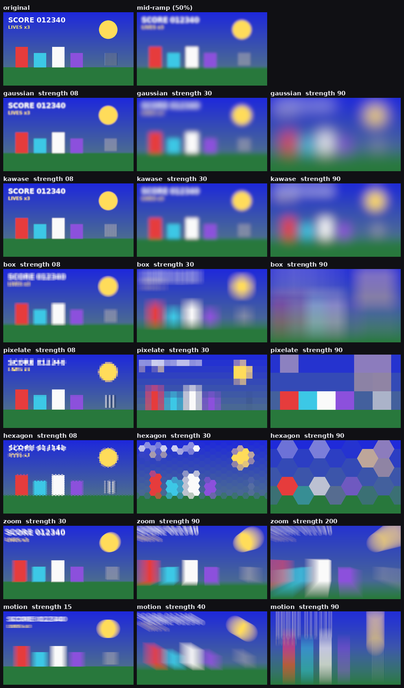
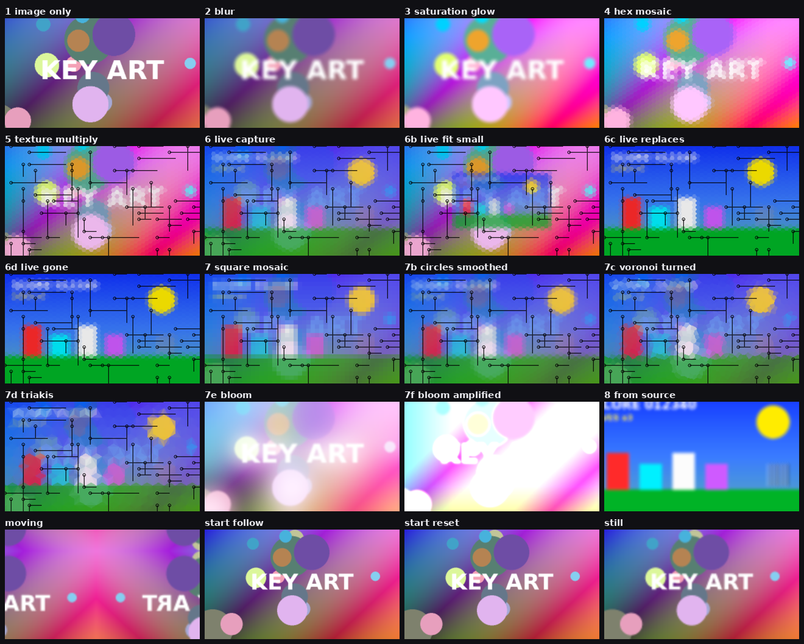
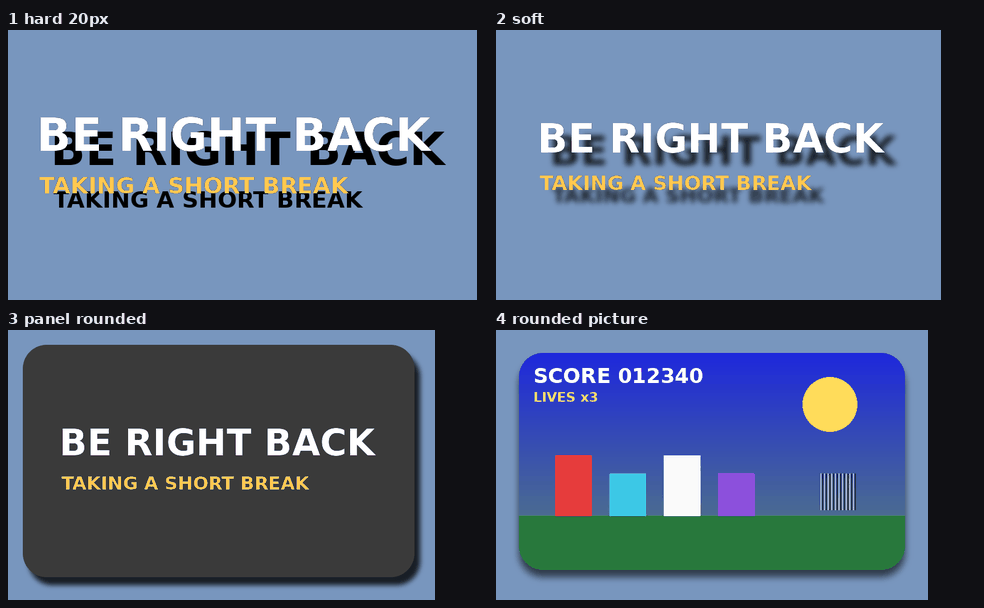
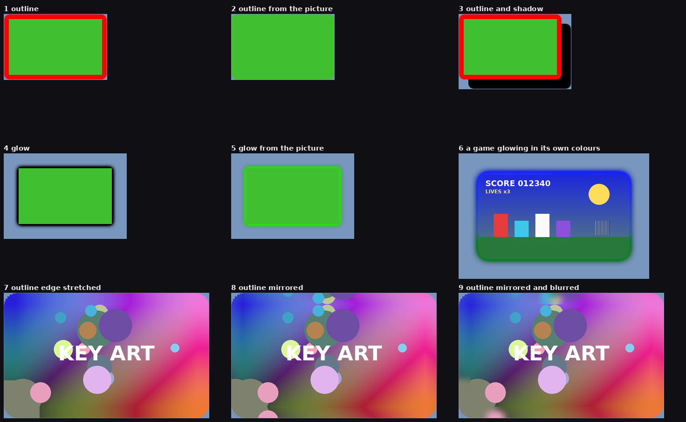
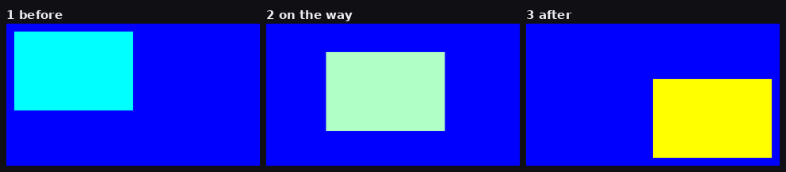

<h1 align="center">StageKit</h1>

<p align="center">Quality-of-life tools for OBS Studio: ramping blur, backgrounds, shadows and easy positioning, without chains of filters and nested scenes.</p>

<p align="center">
  <a href="#download">Download</a> |
  <a href="#getting-started">Get started</a> |
  <a href="#features">Features</a> |
  <a href="#screenshots">Screenshots</a> |
  <a href="#updates-and-settings">Updates</a> |
  <a href="#development">Development</a>
</p>

## Features

StageKit is for streamers who build their scenes by hand. Each tool replaces a setup that normally
takes several filters, source clones or wrapper scenes. Everything can be triggered from OBS itself,
from hotkeys, or from the Stream Deck OBS Studio plugin's *Filter* and *Source* keys.

- **Blur** (filter): blurs a source in and out smoothly. Seven types: Gaussian, Dual Kawase, Box,
  Pixelate (in seven cell shapes), Zoom, Motion and Temporal.
- **Ambient Background** (source): a soft, drifting backdrop built from an image or another source,
  optionally tinted by whatever capture is live.
- **Standby image**: one image, chosen once, shown on the start scene and used by the background.
- **Shadow, Glow & Outline** (filter): drop shadow or glow, in a colour or in the image's own moving
  colours, an outline, a panel behind the source, and rounded corners, with no
  wrapper scene.
- **Corners & Edges** (filter): rounds, cuts, notches or scoops a source's corners, trims and softens
  its edges and outlines it. A shadow added after it takes the same shape.
- **Auto Frame** (filter): gives a game or emulator capture a fixed frame and fits any resolution inside
  it, so one scene serves every image shape.
- **Morph** (transition): on a change of scene, whatever is in both scenes glides from its place
  and size in the one to its place and size in the other, and the rest cross-fades. Inside a scene,
  an item hidden and another shown at the same moment change into each other the same way.
- **Fade and Zoom** (transition): what appears grows to its size as it fades in, what disappears
  shrinks as it fades out. For a change of scene and for single items.
- **Fit to Space** (scene filter): one capture for every shape. An image with the screen's shape fills it;
  an emulator's squarer image floats centred inside a margin.
- **Automatic Window Switcher** (filter): one Window Capture follows several apps, taking whichever of
  them you are using.
- **Auto Capture** (filter): one Game Capture finds whatever game is running, windowed or full-screen,
  with no list of games to keep. Windows only.
- **Automatic Source Switcher** (scene filter): a scene has a capture for each of several apps, and the one you are
  using is shown, with a fade. The last one stays while something else is in front, and an earlier
  one comes back when an app closes. Windows only.
- **Program Trigger** (filter): while a program is open, shows chosen items and switches chosen filters
  on; puts them back when it closes. Windows only.
- **Cropped View** (source): part of another source, such as your camera cropped square, as a source of
  its own. Filters on the view follow the crop, so no wrapper scene is needed.
- **Zoom** (filter): zooms smoothly into a point of a source and back out.
- **Move Source** (filter): put it on your camera, once per spot. Each one is a Stream Deck key that moves
  the camera to a corner or to a spot you saved, in every scene the camera is in.
- **Move Scene Item** (scene filter): the same move, set up on a scene instead of on the source.
- **Show/Hide Animation** (scene filter): slides or pops an item in and out when it is shown or hidden.
- **Link Visibility** (scene filter): ties eye icons together. Show only one of a set of items, show
  and hide a set together, or have a set follow its first item.
- **Match Item** (scene filter): keeps an item lined up with an item in another scene, so titles sit in
  the same place in every scene.
- **Apply Layout** (scene filter): saves an arrangement of a scene's items and glides back to it.
- **StageKit dock**: click an item into place, and make Stream Deck keys for its positions in one click.
- **Line up, resize and snap**: from a right-click in the preview, hotkeys or the dock, measured by
  what is actually drawn in each item.

## Screenshots

These are real frames rendered by the plugin in its automated tests, using made-up sample images.

**Blur: every blur type at three strengths**

<p align="center"></p>

**Ambient Background: from image to finished backdrop**

<p align="center"></p>

**Shadow, Glow & Outline**

<p align="center"></p>

## Download

StageKit is in pre-release. Builds for Windows, macOS and Linux are on the releases page:

- [All releases, including pre-releases](https://github.com/TechSavage1989/StageKit/releases)

On Windows, pick the file ending in `windows-x64-Installer.exe` (from the second pre-release onward), or
the `windows-x64` zip to copy the files yourself. The installer shows the folder it will install to
(`C:\ProgramData\obs-studio\plugins\stagekit`) and lets you change it; OBS only loads plugins from its
own plugins folder, so change it only if your OBS uses a different one, such as a portable copy. There is no stable release yet, so the "latest release" shortcut
does not point anywhere. Release notes are kept in [docs/releases](docs/releases).

## Requirements

- OBS Studio 31 or newer. Builds are compiled against OBS 31.1.1.
- Windows x64, macOS (Apple silicon and Intel) or Ubuntu 24.04 x86_64.
- Automated tests run on Linux with OpenGL only. Nothing has been verified in OBS on Windows or macOS
  yet, including whether the shaders compile under Direct3D.
- Optional: obs-websocket (bundled with OBS) for remote control.

## Getting started

On Windows, with the installer:

1. Download the file ending in `windows-x64-Installer.exe` from the releases page.
2. Close OBS, then run the installer. Windows may warn that the publisher is unknown, because the
   installer is not signed: choose *More info*, then *Run anyway*, if you trust this download.
3. Start OBS. *Blur (StageKit)* and the other tools appear in the filter list of any source,
   *Ambient Background (StageKit)* in the list of sources, and the dock under *Docks → StageKit*.

The installer puts the plugin in `C:\ProgramData\obs-studio\plugins\stagekit` and adds an entry under
*Apps & features* for removing it. It needs administrator rights for that folder.

Without the installer: unzip the `windows-x64` zip and copy its `stagekit` folder into
`C:\ProgramData\obs-studio\plugins\` yourself.

Neither route has been checked on a real Windows machine yet; please report anything that looks wrong.

## How to use

**Lists.** Wherever a StageKit filter keeps a list (sources to blur, scenes to leave a shadow off in,
programs to capture, items to link), it works the same way: choose from the box to add, and press the
✕ on a row to remove that entry.

### Blur

Add **Blur (StageKit)** as a filter on a source or scene. The filter's own on/off switch is the
blur: turning it on ramps the blur in, turning it off ramps it out and then really switches the filter
off, so it costs nothing while off.

| Setting | What it does |
| --- | --- |
| Blur type | Gaussian (smoothest), Dual Kawase (fastest, best for strong blur), Box, Pixelate (a mosaic of cells), Zoom, Motion, Temporal (the image stays sharp and whatever moves leaves a trail; strength 100 is a trail of one second) |
| Cell shape | For Pixelate: squares, hexagons, circles, triangles, Voronoi (uneven cells), rhomboids or triakis (triangles split in three). A filter set to the old *Hexagons* type is now Pixelate with hexagon cells and looks the same |
| Smoothing | For Pixelate: how far each cell's colour runs into its neighbours. 0 gives hard edges |
| Glass / Glass style | For Pixelate: lights each cell like a small piece of glass. *Dome*: curved like a bead, with a glint and a darker rim. *Flat plate*: a flat face with sharp bevelled edges (straight facets on squares and hexagons). 0 gives plain cells. Ambient Background's mosaic has the same two controls |
| Origin X / Y, Rotation | For Pixelate: the point of the image the pattern is laid out from and turned around, and by how much it is turned |
| Strength | 0–1000. Gaussian, Kawase and Box look alike at the same number; above 250, Gaussian and Box are drawn the Kawase way, which stays smooth |
| Blur transition | Grow the blur strength, or cross-fade a fully blurred image in |
| Ramp in / out time | 0–5000 ms each. 0 is instant |
| Easing | Eleven curves, eased in, out or both |
| Include in 'Blur All' | Whether the global Blur All hotkeys affect this filter |
| Blur these too | Other sources that are blurred and cleared together with this one |
| And live captures on screen | Also blurs every game, window, screen and camera capture showing in the scene on screen when this filter is switched on, including one shown through a Cropped View |
| Never blur these | Sources that *And live captures on screen* leaves alone: your camera, say, so it stays clear while everything else on screen is blurred. Any source can be chosen; a Cropped View (a camera's crop) also keeps the source it shows clear. Choose to add; each row has its own remove button |

Ways to trigger it:

- The eye icon next to the filter.
- A Stream Deck OBS Studio plugin *Filter* key pointing at the filter.
- Hotkeys under the source in *Settings → Hotkeys*: `StageKit: Blur Toggle / On / Off`.
- `StageKit: Blur All Toggle / On / Off` in the top section of *Settings → Hotkeys*, which drives every
  Blur at once.

**One key for several sources.** Under *Blur these too*, choose a source in the *Add a source* box,
once for each source; each becomes a row. From then on, switching this one filter on or off, from a single Stream
Deck *Filter* key, blurs and clears every source in the list. A listed source with no Blur of its
own is given one with the same settings (*Blur (follows another)*); one that already has a Ramp
Blur keeps its own settings. Remove a source with the ✕ on its row.

To replace a Composite Blur + Move chain: add one Blur, pick the type and strength (Composite
Blur's Pixelate at radius 5 is *Pixelate* at strength 4), point your existing keys at it, then delete
the old filters.

### Ambient Background

Add **Ambient Background (StageKit)** as a source. It fills the canvas.

| Group | Settings |
| --- | --- |
| Image | The standby image, an image file, or any existing source or scene. Optionally blend in a live capture: a chosen source, or *Automatic*, which uses the largest visible capture in the current scene. The capture can fill the screen, fit inside it, match its width or height, or stretch, with its own zoom. *Live capture replaces the image* makes the capture the whole background while there is one; the moment there is none, the usual image is back. A capture with an Auto Frame is used as the trimmed game image, without the empty frame around it. A capture showing nothing, or black all over for two seconds, counts as no capture. *Keep the capture ready* keeps it running in scenes that do not show it, so it is there at once in the next scene that does |
| Motion | Drift speed in each direction, zoom, and mirroring at the edges so the drift never shows a seam |
| Look | Blur type (Dual Kawase, Gaussian, Box, or Temporal, which blurs over time and leaves trails) and blur; a mosaic in the Blur filter's seven cell shapes, with the same smoothing, origin and rotation; saturation; glow; **Bloom**, where the bright parts of the image shine over what is around them (how strongly, from what brightness, and how far the light spreads); brightness; vignette |
| Texture overlay | An image multiplied or screened over the result, optionally in black and white |

Two more things about the capture blended in and the bloom:

- **Capture transition**, **Capture delay**, **Duration** and easing: how the background follows when
  the capture changes (another capture, none any more, or an Automatic Window Switcher taking
  another window). The background as it was stays for the delay, then gives way with a fade (as it
  comes), a cut, or a slide to any side. Set the delay to the length of the capture's own transition
  to have the background change after the image has.
- **Bloom style**: *Bright parts shine* (only what is brighter than the threshold spreads its light)
  or *Whole image, amplified* (the image's own light added back onto all of it, which brightens
  everything and lets colours run into white: the look of obs-shaderfilter's bloom shader, with
  100 % its strength of 1). Bloom now goes to 1000 %. The light always spreads at least as far as
  *Blur*, so bloom never makes the background sharper.

Put it in one shared scene and nest that scene wherever you need the background.

### Standby image

Choose the standby image once, in the StageKit dock under *Standby image*. The dock shows a small image
of it. It is saved with the scene collection.

- Add **Standby Image (StageKit)** as a source wherever the image itself should be shown.
- Every Ambient Background uses it as its image automatically. A background you had pointed at an
  image of its own switches over when you choose a standby image; to keep one on its own image, set its
  *Background from* back to *An image* afterwards.

Changing the standby image updates both at once.

### Shadow, Glow & Outline

Add **Shadow, Glow & Outline (StageKit)** as a filter on a source, group or scene. (It was called
Shadow & Backdrop; filters you already have keep working.) It has three parts, each with a tick box in
its heading:

<p align="center"></p>

- **Shadow or glow**
  - *Type*: *Drop shadow (to one side)* or *Glow (all round)*.
  - *Colour source*: *A colour*, or ***The image itself***. With the image itself, a game, camera or
    video casts a soft, moving copy of its own colours instead of a flat colour. *Colour boost* makes
    that richer.
  - *Opacity*, *Softness* (0 gives a hard edge), *Strength*, and for a drop shadow how far right/left
    and down/up it falls.
  - *Hide the image* leaves only the shadow or glow.
- **Outline**: a line round the image, any width. *Colour source* a colour or the image itself. Made
  from the image, *Past the edge* chooses between stretching the image's edge outwards and
  mirroring the image, and *Outline blur* softens it. The
  line follows the image's real shape, including text and rounded or cut corners. A shadow is cast
  by the image and its outline together.
- **Panel behind the source**: a coloured panel with a margin.

*Rounded corners* rounds the image and the panel.

**Leave it off in these scenes**: choose scenes from your collection; each becomes a row with its own
✕ to remove it. While a listed scene is on screen the filter draws nothing; the source shows plain
there and keeps its place. It goes by the scene on screen (Program in Studio Mode).

Sizes are as they look on screen: with *Sizes in screen pixels* ticked (the default), 20 px of
shadow is 20 px in the finished image however much the item is scaled, so a small camera and a large
panel get the same shadow. Untick it to give sizes in the source's own pixels.

The shadow needs room around the source, so the source itself gets bigger. With *Keep the image
where it is* ticked (the default), the source's items in every scene are adjusted by exactly that room:
the image keeps its size and place whatever the softness, offset, outline or panel margin, including
inside a bounding box. Switching the filter off or removing it puts the items back.

### Corners & Edges

Add **Corners & Edges (StageKit)** as a filter on a source: a camera, a capture, an image, a browser
widget.

<p align="center"></p>

- **Corner style**: *Rounded*, *Cut off (chamfer)*, *Notched (square cut)* or *Scooped (curved in)*.
- **Corner size**, and **Which corners** it applies to, each one on or off.
- **Trim edges** cuts the same amount off all four sides. **Soften edge** fades the image out
  towards its edge.
- **Outline**: a line of any width, colour and opacity that follows the shape.
- **Sizes as seen on screen** (on by default): a 40 px corner looks the same on a big item and a small
  one, the same rule Shadow, Glow & Outline uses.

It works with the other tools:

- The source **keeps its size**, so nothing moves or resizes in any scene, and Move Source keys, layouts
  and the line-up tools carry on as before. The line-up tools measure the new shape when *Use visible
  pixels* is on.
- **Shadow, Glow & Outline** after it in the filter list casts a shadow of the new shape. If you add
  Corners & Edges to a source that already has a shadow, it places itself above the shadow for you.
- After an **Auto Frame**, it shapes the game image inside the frame, and follows it when the image
  changes shape.
- Blur and Zoom can go before it (the blur or zoom stays inside the shape) or after it.

### Auto Frame

Add **Auto Frame (StageKit)** as the first filter on a game, window or capture-card source. Set the
frame's width and height once. From then on the source always has that size, and whatever the game or
emulator outputs is fitted inside it, gliding to its new fit when the resolution changes.

The top line of the controls says which program is being captured and which image shape applies.
The settings are in five numbered groups:

| Group | What is in it |
| --- | --- |
| 1. Frame size | Width and height, or pick a scene and an item and press *Use that item's size* |
| 2. Image | Fit (whole image, whole-number scale, fill, stretch), image shape, where it sits, sharp pixels |
| 3. Black bars | Trim automatically, trim a set amount, or leave them. Automatic trims only when the image is seen to end in a straight line, the same distance in from both sides, leaving a standard game shape. Artwork, a logo or a dark scene on black is not mistaken for bars. *Keep aspect ratio for* sets how long a different shape must be clearly on screen before the image changes to it |
| 4. Aspect ratio for each program | *Start from each program's usual shape*, *Forget shapes seen before*, and shapes you save yourself, used at once when that program is captured (see below) |
| 5. Movement | How long the image takes to settle after a resolution change |

**The first clear sight of an image is used at once.** When a game appears, or its window changes
size, the capture is looked at ten times a second until its shape is settled, and the bars are trimmed
within a fraction of a second of the image being seen clearly: a windowed game whose image sits
inside its window with bars above and below does not wait for the hold time. It does not need a bright
scene. Bars are flat black and even a night scene is not, and an image fitted in its window gives
itself away with a few lit pixels at each side: it reaches both ends one way and stops the same
distance in from both ends the other way, leaving a real image shape. A black loading screen teaches
nothing, and nothing is trimmed on a guess.

**A program's shape is remembered.** Once a program's image has held one shape for a quarter of a
minute, that shape is kept for the program, and the next time it is captured the image starts out in
it from the first frame, at any window size, even while the screen is still black. What is seen still
corrects it. A program that turns out to show more than one shape (an emulator for several consoles,
or a game that simply fills whatever window it is given) starts from nothing instead. The tooltip of
*Forget shapes seen before* lists what is remembered; the button clears it.

**A shape, once found, is held.** When a window goes full-screen, or the resolution changes, the
image keeps the shape it had: there is no moment of showing the bars and trimming them again. The
last good image stays up for a fifth of a second while the capture settles, and for up to a second if
the capture drops out, so the switch does not blink. A menu, a pop-up or a mouse pointer over the bars
does not resize it. It changes when another real image shape has been clearly on screen for the hold
time, when the image itself keeps showing inside the trimmed part, or when a different program is
captured. A shape carried over to a new size is only a starting point until the image is seen to fit
it: if the image plainly shows inside it, it is let go within about a second.

**If a game's shape is slow to come right**, OBS's log says what Auto Frame saw and when
(*Help → Log Files → Show Log Files*, the lines with `Auto Frame:` in them).

**Unusual shapes.** Automatic trimming knows the shapes consoles and handhelds use, including two
screens stacked or side by side (DS, 3DS), upright and ultra-wide. For an image in some other shape,
press *Measure the bars now* on a bright scene (or set the amounts by hand), then *Keep this trim for
this program*. That saves the shape for the program being captured and goes back to automatic, so the
program is right from then on, at any window size, and everything else is still worked out by itself.

**Image shape for each program.** A program seen before starts from the shape it showed then.
Otherwise common emulators start from their usual shape (Snes9x 8:7, mGBA
3:2, Project64 4:3 and so on), so the image is right from the first frame. Either is only a starting
point: if the image clearly shows another shape, that shape is used and held. To fix a program's
shape yourself, choose the program from the list of
open programs (or find its file with *…or find it on this computer*), choose its shape and press
*Remember this shape for this program*. A shape you save is always obeyed as it is. Emulators that play
several consoles, such as RetroArch and Dolphin, are not built in because their shape depends on the game.

**Two programs with the same file name.** A special build of an emulator often keeps the original's
file name (PrimeHack is `Dolphin.exe`). The *Program or window* list also offers the titles of the
open windows: pick one, shorten it if you like (`primehack` is enough: part of a title will do),
choose its shape and press the button. When several saved shapes fit a window, the one with the
longest name is used, so `primehack = 16:9` and `dolphin = 4:3` can sit side by side. In the same way
Automatic Source Switcher tells two captures of such programs apart by their window titles, and Auto
Capture's *Never capture* and *Always capture* take part of a title as well as part of a file name.

To set the shape from a Stream Deck, add **Aspect Ratio Preset (StageKit)** next to Auto Frame, once per
shape, and point a *Filter* key at it. Switching it on sets the shape and it switches itself off; a key
set to *Automatic* hands control back.

Because the source's size no longer changes, one scene can replace a scene per image shape and the
automation that switched between them. Put Shadow, Glow & Outline after it and the shadow follows the image.

### Fit to Space

Add **Fit to Space (StageKit)** as a filter on a *scene*. It places one item of that scene for you.

- **Item**: the item to place, usually your game capture.
- **Fit area**: *The whole screen*, *A box I set* (left, top, width, height in canvas pixels), or
  *Free space around source*.
- **Margin for other shapes**: an image with the box's shape fills the box. Any other shape is kept
  this far from the box's edges and centred. With a Shadow, Glow & Outline set to *Keep it on
  screen*, an image that fills the box makes room for its shadow.

**Free space around source** makes the item as large as it can be where it is, always keeping the
gap you set (*Gap*) from the screen's edges and from every other item, at its
nearest.

- Move, show or hide another item and the fitted item glides to its new space (*Glide to a new space
  over*, with a curve to choose; 0 changes at once). An item that starts drawing something after
  showing nothing, such as a music widget, is noticed within a few seconds.
- Drag the fitted item to another part of the scene, or send it there with a key, and it takes the
  free space around that place instead.
- A background or a frame is not in the way: anything the item's place lies inside is ignored.
- It only works while its scene is being shown, so scenes you are not on cost nothing.
- When the fitted source is a Window Capture with an **Automatic Window Switcher**, the fit goes with
  the switch: as the switcher changes to a window of another shape, the space for that shape is
  taken over the switcher's own *Duration* and easing, so the image and its place arrive together.
- **Ignored sources**: sources the free space ignores, such as a camera meant to overlap the
  game.
- **Overlap only when it fills** (unticked as it comes) with **Fill needed to overlap**: the ignored
  sources are only overlapped while the fitted item fills at least that much of its
  space. At 98 %, a window that fills the screen stays under the camera, and a window of another
  shape, which would leave bars beside it, is fitted beside the camera instead. The Stream Deck
  *Fit to Space Overlap* key switches it.
  Two tick boxes under it choose what counts as filling. **Use fill percentage** (ticked as it
  comes) is the share above. **Use edge gaps (pixels)** has four sliders, **Top**, **Bottom**,
  **Left** and **Right gap up to**: the widest empty gap allowed between the fitted source and
  that edge of its space. The source overlaps the ignored sources only when all four gaps are
  within their sliders; 0 means it must reach that edge. A window that fills the width and leaves
  20 px above and below overlaps the camera with top and bottom at 30; a narrower one that leaves
  300 px at the sides goes beside it. With both boxes ticked, meeting either is enough; with
  neither, the source is always fitted beside the ignored sources.
- Add the filter to the **scene**, not to a group. To fit a group, choose the group as the *Item*.
  On a group the filter does nothing and says so.
- With *Use visible pixels* ticked, the fitted item itself goes by what it shows, like the items
  around it: a group, a widget or a nested scene that is larger than its image is fitted, kept
  and centred by the image, and the empty part of its box may reach into the gap.
- Two Fit to Space filters in one scene work together: each goes by where the other is taking its
  item, so they settle in one move. An item that keeps its size, with a resized item on one side
  and the screen's edge or a fixed item on the other, sits against the fixed side; the resized item
  takes the rest.
- An item is never put past the screen's edges: it stays the gap inside them whatever is beside it.
- **Resize to fit** (ticked as it comes). Unticked, the item keeps the size it has and is only
  moved, to the middle of its space, so the room left over is the same on both sides and above and
  below; when the space changes (a camera above it is hidden, say) it moves to the new middle.
  If the filter had already resized the item (a new filter starts ticked), unticking gives it back
  the size it had before. Resize it yourself in the preview and that is the size it keeps. This works for the whole screen
  and a box as well as the free space.
- **Align in the space** (*The middle* as it comes): where the item lies in its space when it does not
  fill it, which is an image of another shape than the space, or an item that keeps its size. A
  side or a corner puts it against that side, the gap away, with all the room left over on the
  other side, so it only ever moves that way: a camera kept towards the top stays at the top, and a
  chat box kept towards the bottom stays put when the camera above it is hidden. A side where
  another fitted item makes room for this one is not used.
- An item that is hidden is left exactly where it is and holds no space, so the others take its
  room. Shown again, it is where it was, and the others make way for it in one move.
- An item that is showing but has no image yet (a display capture before its first frame, a
  capture card that is off) keeps the room it was last given, or its bounding box if it was never
  fitted, so the items beside it stay where they are until the image comes.
- **Sync position to scenes** (a list, empty as it comes): each time the filter has put its
  item in place while its scene is on screen, the same source in the scenes you list is given
  exactly that place and size, so it is already there when you switch to one of them and nothing
  shifts in view. Scenes you do not list are never touched: the source keeps its own place there.
  A listed scene that is on screen at that moment is left alone. Locked copies are moved too. The
  link holds both ways: a listed scene with a Fit to Space of its own for the item gives its place
  back when it is the one on screen, and fits the item to itself when it comes into view (at once,
  without a glide); where the scenes are laid out alike that is the same place.
- With *Resize to fit* unticked, the size the item keeps is saved with the scene collection and
  is the size it has the next time OBS starts.
- **Size tolerance** (8 px as it comes): when something sticks a little way into the space, the image
  may be made up to this many pixels smaller to keep the whole space, instead of keeping its size and
  losing the part of the space beside that thing. At 0 the biggest image always wins, even by one
  pixel. The gap is kept either way.
- **Use visible pixels** and **Ignore shadows & outlines** (both on as they come) are this filter's
  own settings; the dock's Arrange options do not change them. With the first, the items around it
  are measured by what they draw, and an item that is drawing nothing is not in the way. With the
  second unticked, shadows, glows and outlines keep the gap too, the fitted item's own included.

Use it with Auto Frame's *Frame → Just the image*, so the source is only the trimmed image. One
game capture can then sit in a full-screen scene (a widescreen game fills it, an emulator floats in the
middle) and in a scene with a camera and chat beside it (fitted to that scene's game box), with nothing
to change when you switch games. A shadow on the source is allowed for.

It works on any source. For a **Window Capture**, add Fit to Space to the scene and choose the window
capture: the window fills the space when it has the space's shape and floats centred otherwise, and it
stays fitted while you drag the window to a new size, because the fitting itself is done by OBS on
every frame. Use one Fit to Space filter for each item to be fitted.

Fit to Space takes over the item's position and bounding box and removes its rotation. Switch the
filter off to move the item by hand.

### Auto Capture

Add **Auto Capture (StageKit)** as a filter on one *Game Capture* source. Windows only.

Four times a second it looks at the window in front. If that window is a game, the capture is aimed at
it, windowed or full-screen. It stays on that game when you switch to another program, and moves on
when the game closes or another game comes to the front. There is nothing to set up per game.

The filter's controls show what it is capturing now.

- **It leaves alone what it cannot hook, for a while.** A program taken for a game that gives
  the capture no image for ten seconds is left alone (OBS's log says so): left aimed at it, OBS
  goes on trying several times a second, and each try stalls the image for a moment. It is tried
  again when its window's title changes, as when a game is started in an emulator, when you click
  back into it, and otherwise after a wait that grows from 20 seconds to a minute. Meanwhile the
  filter says it is aimed at the program and that it shows no image yet. Nothing is added to *Never capture* by
  itself. Programs listed in an Automatic Window Switcher are never taken at all.
- **Not a game? Never capture this program**: one press when it picks up the wrong thing.
- **Pick from the programs that are open**: choose a program and press *Always capture it* (for a game
  it misses) or *Never capture it*. There are no file names to type.
- **Your lists**: the two lists those buttons fill in, as plain text you can edit (`blender, vlc`). OBS,
  browsers, Discord, Steam's own windows and similar are already left alone.
- **Find games**: *Automatically*, or *Only from 'Always capture'*.
- **Keep capturing in other scenes** (on as it comes): the capture carries on while you are on a scene
  that does not show it, so it is there at once when you come back. Unticked, OBS stops it a moment
  after you leave and starts it again when you return.
- **No game: Standby Image** (off as it comes): with a Standby Image filter on the capture, the
  Standby Image is shown while no game is captured, and gives way when a game is found.
- **Standby Image** group: *Hide shows Standby Image* (on as it comes) hides the capture behind
  its Standby Image instead of hiding the item; *Hide/show capture now* does it, as does the
  hotkey under the capture and the Stream Deck *Manual Window / Source* key. *Transition*,
  *Duration* and the easing are how the Standby Image comes and goes for these two.
- With no game open, the Game Capture goes back to *Capture any fullscreen application*.

A game is recognised by what the program has loaded: a graphics engine together with something only
games have (controller support, a game store's library, a game engine's player, game audio or video),
a game engine's own kind of window, or a window that fills its screen. A program seen to be a game
once is remembered and picked up at once from then on. The filter changes the Game Capture's own
*Mode* and *Window* settings for you.

### Standby Image

An image in a capture's place while the capture has nothing to show, so its spot in the scene is not
an empty hole while you wait for a game or window. Add **Standby Image (StageKit)** as a filter on a
Game Capture, Window Capture or other live source.

- **Nothing to show** means no game or window is attached to the capture. A capture that is attached
  and showing a black image, such as a loading screen, is left alone.
- While it waits, the image is shown whole, in its own shape, as tall as the capture last was.
- When the capture starts, the size glides from the image's shape to the capture's while the
  image fades into it. When the capture ends, its last frame fades back into the image, which
  glides back to its own shape. Neither is ever squashed on the way.
- It belongs after an Auto Frame in the filter list and puts itself there.
- After an Automatic Window Switcher it takes the capture's size as the switcher gives it: the
  switcher already glides from one window's size to the next, and the two do not glide twice.
- Corners, shadows and other filters after it are put on the image as they are on the capture.
- To go without it, switch the filter off with its eye or a Stream Deck filter key.
- *Transition* has a fade, a cut, slides, wipes, *Fade and zoom* and *Morph* (the capture and the
  image both stretched over the frame as it glides from one shape to the other).
- **Cover the capture now** (a button, and a hotkey on the source) brings the image in over
  a capture that is running and takes it away again: a way to hide the capture without leaving a
  hole. An Automatic Window Switcher on the same capture does this when asked to hide the capture
  (*Hide shows Standby Image*, ticked as it comes), so the Stream Deck *Hide or show the capture*
  key shows the Standby Image.

| Setting | What it does |
| --- | --- |
| Image | *The standby image* (the default: the one set on the StageKit dock's Standby & Ambient tab), *An image or video file*, or *Another source* |
| Show when source is hidden | While the source is hidden in a scene, the standby image is shown in its place there, at the same position and size and with the source's later filters (shadow, corners). StageKit adds a locked item named *<source> (standby)* under each item of the source and shows and hides it by itself. *Show/Hide transition* below it is the one change between the source and the standby image: any OBS transition or *Morph (StageKit)*, with that transition's own settings, showing and hiding apart if you like. StageKit sets it on the source's items and on the stand-ins, so the source leaves and the standby image arrives the same way whatever hides the source (a Stream Deck key, Show in Scenes, the eye); other StageKit filters leave those items' transitions alone while this is ticked. With Morph the source changes into the standby image and back. Any StageKit filter may come after Standby Image; put OBS's own filters (colour correction, crop) and other plugins' filters before it in the list, or the change cuts instead of using the transition. The stand-in items appear two seconds after OBS has finished loading. Not for sources inside a group yet |
| File / Source | The file or source to show, for those two choices. A video loops, without sound |
| Keep image's aspect ratio | On (the default): the image is shown whole in its own shape. Off: it fills the size the capture last had, with what does not fit cut off |
| No-signal transition | Used while the source is shown but has nothing to show (hiding and showing it in a scene uses *Show/Hide transition*, below). How the image gives way to the capture: a fade (the default), a cut, sliding away or wiping in any of four directions, or a zoom and fade. It comes back the same way in reverse |
| Duration: image to capture / capture to image | How long each change takes |
| Easing curve / Easing direction | The motion the change follows |
| Animate the size change | On (the default): the size glides between the two shapes over the same time. Off: the size changes at once |

When first added it puts itself straight after an Auto Frame if there is one, and otherwise first in
the list; after that the order is yours.

### Automatic Window Switcher

One Window Capture for several apps. Add **Automatic Window Switcher (StageKit)** as a filter on a
*Window Capture* and list the apps it is for. The filter aims that one capture at whichever of them
you are using, so a scene needs one capture, one set of filters and one Fit to Space instead of a
capture for each app.

| Setting | What it does |
| --- | --- |
| Windows to switch between | Open the app, then choose it under *Add a window*: by its program, or by a window's title for two programs with the same file name. The first part of a title is offered too (*GBA1* of *GBA1 | Volume 100%*); a window chosen by part of its title is found again when the rest of the title has changed. **Ignored windows** below it lists windows never to take, by program or part of a title. For two windows of one program in a scene, use two Window Captures, each with this filter and one of the windows. Each row has its own remove button |
| Switch to the active window | Ticked (as it comes): clicking into one of the apps captures it; clicking into anything else changes nothing, so the last one stays. Unticked: an app is captured when it opens and stays until it closes |
| Manual windows | Other apps the capture shows when you say so, such as your browser. *Switch to next manual window* (a button here, a hotkey, a Stream Deck key) takes the next one that is open and holds it whatever app you use; after the last, or with *Return to automatic*, the apps above are followed again |
| Keep other windows captured | Ticked (as it comes): while the capture is showing, the other open apps on the two lists are captured in the background, so the one you switch to is there at once. Unticked, a switch waits for the capture to find the other window, which saves graphics memory |
| Transition | How one app's image gives way to the next: a fade (as it comes), **Morph** (the frame changes shape and size as the one image turns into the other), a cut, a fade and zoom, or sliding in from any of the four sides |
| Duration / Easing | How long that takes, and its curve |
| Show/Hide transition | *Hide/show capture now* hides the capture in every scene it is in, or shows it again, with the transition chosen under it. Also a hotkey and a Stream Deck key |

- An app on the list that opens is captured. When the app being captured closes, the one you used
  before it comes back.
- The change is smooth although there is only one capture: the filter keeps the last image the
  capture had, shows it while the capture is finding the other window, and brings the new image in
  over it. A Standby Image on the same capture does not stand in for that moment; it does once
  none of the apps is open.
- Three hotkeys under the capture in *Settings → Hotkeys*, named after the filter: *next app
  switched to by hand*, *back to following the apps*, *hide or show the capture*. The Stream Deck
  *Manual Window / Source* key presses any of the three.
- To hold a window that is on neither list, press the Stream Deck *Capture Active Window* key on
  it. The filter adds its program to *Manual windows* and captures it; with *Captured window*
  set to *Switch at selection* it also changes over to it with your *Transition* and holds it.
  *Manual Window / Source* (*Toggle*) then switches between that window and your apps.
- **A window you pick is that window, not its program.** *Capture Active Window* adds it to
  *Manual windows* as *program — its title*, for example two browser profiles as two entries.
  Another window of the same program never stands in for it. When it closes it leaves the list,
  and the capture does not move to the program's other window. It goes to your next manual
  window (with *Auto-switch manual windows*) or back to automatic, and with nowhere to go it
  shows the Standby Image, or nothing. A program named in a list still means any of its
  windows.
- **Picked windows are cleared.** *Clear picked windows on exit* (ticked as it comes): windows
  picked with *Capture Active Window* last only for this OBS session. *Clear picked windows* (a
  button, a hotkey under the capture, and the Stream Deck *Manual Window / Source* key's *Clear
  picked windows*) takes them off the list at any time; a picked window being shown goes back to
  the automatic windows. Programs you added to the list yourself stay.
- **The window shown is watched.** When it closes, OBS's Window Capture looks for another window
  of the same program by itself. StageKit does not show that image: it keeps the last frame of
  the window that closed until it has chosen and aimed at the next one.
- **Captured window**: what happens to a window picked with *Capture Active Window*.
  *Wait until switched to* (as it comes): it becomes the manual window and is captured in the
  background while your automatic windows go on showing; it is shown when you switch to it with
  *Manual Window / Source* (*Toggle* or *Next*). *Switch at selection*: the capture changes to
  it straight away, as before.
- **Auto-switch manual windows** (ticked as it comes): in manual mode the capture follows among
  your *Manual windows* the way automatic mode follows among the others: the manual window you
  click into or that opens is shown, and when the one shown closes the one before comes back.
  Nothing off the *Manual windows* list is taken. Unticked, the manual window stays until you
  switch.
- The capture's size glides from the one window's to the other's with every *Transition* but a
  cut. *Morph* stretches both images over the gliding frame; the others keep each image's own
  shape inside it.
- It keeps itself before a Standby Image and an Auto Frame in the capture's filter list.
- Windows only, like the other capture tools.

For a capture per app in one scene, each with its own filters, Automatic Source Switcher below is still
there.

### Automatic Source Switcher

For a scene that shows whichever app you are working in. Give the scene a Window Capture for each app
(Blender, ZBrush, a browser, and so on), then add **Automatic Source Switcher (StageKit)** as a filter on the *scene*
and add those captures to its list. Windows only.

Which app a capture belongs to is read from the capture itself, so there is nothing to type. From then
on one of the listed captures is shown at a time:

- **An app that opens is shown.** So is a capture you aim at another window in its own settings.
- **Clicking into one of the apps shows it** (*Switch to the active window*, on to begin with). With two of
  them open, the capture follows you from one to the other.
- **Clicking into anything else changes nothing.** The last app stays captured while OBS, a chat
  window or anything not on the list is in front.
- **When the app that is showing closes, the one you used before it comes back.** When none of them is
  open, the first capture in the list is shown, so put the one you want as the standby first.

| Setting | What it does |
| --- | --- |
| Sources to switch between | The scene's captures, one per app. Choose to add; each row has its own remove button. The first is the standby |
| Manual sources | Other captures in the scene that you show yourself, such as a Window Capture of your browser. Show one and it takes over and stays, whatever app you use; hide it and the captures above follow your apps again. Showing one hides any other on this list |
| Switch to the active window | On: the app you click into is shown. Off: an app is shown when it opens and stays until it closes |
| Transition | How one capture gives way to the next: a fade (the default), any other transition OBS has, a cut, or whatever is already set on each item. With *Morph (StageKit)* the capture you leave moves, resizes and changes into the one you go to (see [Morph between items](#morph-between-items)). It sets OBS's own show and hide transition on each listed item |
| Duration | How long the change takes |
| Keep other windows captured | While the scene is showing, the captures of the other open apps keep running, so the one you switch to has its image at once |

**Switching to a window by hand.** Add a Window Capture for the window you want (a browser, say), add
it to *Manual sources*, and hide it. Then:

- **A Stream Deck key** set to show and hide that source in the scene (Elgato's OBS *Source* key)
  switches to it and back. OBS's own *Show* and *Hide* hotkeys for the item do the same.
- While it is showing, nothing takes over from it: you can work in Blender or ZBrush and the browser
  stays on screen. Hide it and the capture of the app you are in comes back.
- With several on the list, showing one hides the others, so each can have its own key.
- The filter adds two hotkeys to the scene in *Settings → Hotkeys*, named after the filter: one steps
  through these captures in turn and then back to the apps, one goes straight back to the apps.

It acts only when one of those things happens, so a capture you show by hand stays until then. A
minimised window counts as closed. The top line says what is showing. Switch the filter off to pause it.
Each capture can have its own [Fit to Space](#fit-item), shadow and blur; they follow the capture.

### Program Trigger

Add **Program Trigger (StageKit)** as a filter on a *scene* to show and hide that scene's items, or on
any *source* to switch that source's other filters. Windows only.

1. **While this program**: choose the program from the open ones, or find its file. Optionally give
   text its window title must contain (for example `GBA1`); with the program left empty, the title alone
   decides. Choose whether it counts when it has a window open or only when that window is in front.
2. **Show and switch on**: pick items and filters and add them to the lists. *Do the opposite* hides and
   switches off while the program is here instead.
3. **Transition** and **Duration**: how the items appear and disappear. A fade to begin with; any other
   transition OBS has, a cut, or whatever is set on each item.

While the program is here the items are shown and the filters are on; when it goes they are hidden and
off. It acts when the program appears or goes, so a change you make by hand in between is kept until
then. A minimised window does not count as open. The top line says whether it sees the program now.

### Cropped View

Add **Cropped View (StageKit)** as a source. Choose the source to show, then crop it to a square, to
4:3, 16:9, 3:4 or 9:16 from the middle, by set amounts off each side, or to *Whatever is drawn*.

*Whatever is drawn* needs no numbers: it trims off the empty, see-through room around the content and
follows the content when it changes size. It suits web widgets, whose page is much bigger than the card
they draw. It looks about once a second, grows at once and shrinks only when the smaller image has
settled.

Use it when one camera is wanted in more than one shape. OBS applies an item's crop after the source's
filters, so a shadow on the camera is cut off by the crop; a Cropped View is the cropped image as a
source, and a Shadow, Glow & Outline or Zoom added to the view follows it. Make one view per shape. The
camera is still captured only once.

### Zoom

Add **Zoom (StageKit)** as a filter on a source. Turning it on zooms into the point you choose;
turning it off zooms back out. It has a `StageKit: Zoom Toggle` hotkey under the source.

### Move Source

Add **Move Source (StageKit)** as a filter on the source you want to move, such as your camera. Add one per
spot and name each after its spot ("Camera top right").

1. Choose where to send it: one of nine screen positions with a margin from the edge, or a saved spot.
   The margin is kept to the image you can see. *Use visible pixels* and *Ignore shadows &
   outlines* are the filter's own settings (the dock's Arrange options do not change them); untick
   the first to keep the margin to the item's box.
   For a saved spot, drag the camera where you want it in the preview and press *Save the item's
   current spot*. Its size is saved too if you tick *Also restore the item's size*. *A spot on the
   screen* puts the item's left and top edges at the numbers you give, in every scene alike; the
   dock's slides use it.
2. Choose where it moves (*Move it in*). **Every scene it is in** is the default: the source ends up
   in the same place in each of its scenes, on screen or not. **Only the scene on screen** leaves the
   other scenes as they are. **Only one scene I choose** always moves it in that scene. It is found
   inside nested scenes and groups.
3. Optionally choose an item to bring along.

On a Stream Deck, add the OBS Studio plugin's *Filter* key, pick the camera as the source and one of
these filters. Pressing the key moves the camera; the filter switches itself off again, ready for the
next press. Each filter also has a `StageKit: Move` hotkey under the source.

### Move Scene Item

Move Scene Item does the same job from the scene's side. Add **Move Scene Item (StageKit)** as a filter on a
*scene*, once per destination.

1. Choose the item to move.
2. Choose where to send it: one of nine screen positions with a margin from the edge, or a saved spot.
   The margin is kept to the image you can see. *Use visible pixels* and *Ignore shadows &
   outlines* are the filter's own settings (the dock's Arrange options do not change them); untick
   the first to keep the margin to the item's box.
   For a saved spot, drag the item where you want it and press *Save the item's current spot*.
3. Optionally choose an item to bring along. It keeps its place relative to the moved item and flips to
   the other side if it would leave the screen.

Switching the filter on moves the item; the filter then switches itself off, ready for the next time.
Trigger it from the eye icon, a Stream Deck *Filter* key, *Move it now*, or its `StageKit: Move`
hotkey under the scene.

### The StageKit docks

**StageKit**, under *Docks*, works on the item you are working on in the current scene (the preview
scene in Studio Mode). Its *Standby & Ambient* tab holds the standby image and the Ambient Background's image and settings.

<p align="center"></p>

**StageKit**

The *Scene* and *Item* it works on stay at the top; below them are five tabs. **Place** sends the
item to a spot and makes Stream Deck keys for it. **Arrange** lines up, spaces, snaps, resizes and
reorders what is selected, and holds the measuring options. **Copy** copies a transform to other
scenes or sources. **Effects** adds a StageKit filter to the item. **Standby & Ambient** holds the standby image and the moving
background. What the last press did is said
at the bottom, whichever tab is open.

- **Select an item in OBS's own preview** and the dock works on it. The *Item* list follows your
  selection; you can also choose from the list. A group you select is worked on as one item.
- Click one of the nine positions and the item glides there. With *In every scene* ticked (the
  default) its source is moved in every scene it is in, keys you make do the same, and one Undo takes
  the whole move back. Untick it to change only the scene you are working on.
  The *Edge distance* is kept to what the Arrange options below count as the item: with *Use visible
  pixels* the image you can see, and with *Ignore shadows & outlines* a shadow reaches past it.
- Tick **Slide to the next edge** and the arrows slide the item instead: it moves that way until it
  comes within the *Edge distance* of the next edge it meets, which is the near side of another item in
  its path, or the screen's edge. Press again and it goes through that edge: first to the item's far
  side (inside it, the same distance short of that side), then on to the next item or the screen's
  edge. Nothing takes it past the screen's edge, and something thinner than the edge distance is
  passed in one press. Pressing again while it is still gliding carries on from where it is going. The
  diagonals slide across, then up or down. The centre button centres the item in the free space around
  it. *Use visible pixels* and *Ignore shadows* in the Arrange box decide what counts as an edge, and
  an item brought along is never in the way. With *In every scene*, the item lands on the same spot of
  the screen in each of its scenes. It glides for the *Duration*, following the *Motion* you choose
  (the curve, and whether it eases at the start, the end or both); a run of presses made while it is
  still moving is one step for Undo.
- *Make 9 position keys* adds a Move Source filter for each one **to the item's own source**,
  named after the position ("Top right"). Point a Stream Deck *Filter* key at the camera and one of
  those filters, or give it a hotkey.
- *Save this spot as a key* does the same for wherever the item is now: drag it where you want
  it in the preview first.
- *Bring to front*, *Forward one*, *Back one* and *Send to back* change which items cover which.
- *Add effect* puts a Blur, Shadow, Glow & Outline, Zoom or Show/Hide Animation on the item
  and opens its filter window. Blur and Zoom are added switched off.
- The *Scene* list reaches a scene that is not on screen.

**Standby & Ambient tab**

- An image of the standby image, as wide as the dock. Turn the mouse wheel on it for a closer look, drag to move around,
  double-click to reset; this changes only the thumbnail, never your scene.
- The standby image is also the moving background's image. *Background image…* gives the
  background an image of its own; *Background settings…* opens the Ambient Background's settings.

### Lining up, resizing and snapping items

These tools move and resize the items **selected in OBS's preview**. Click one item, or hold Ctrl and
click several. You can use them from three places, and all three share the same options:

- **Right-click in the preview** and open the *StageKit* menu.
- **Hotkeys**: *Settings → Hotkeys*, the entries that start with *StageKit:* (for example
  *StageKit: Align left*).
- The **Arrange** box in the StageKit dock, which also lists every selected item in the order you
  selected it. It always works on the scene you are editing in OBS, whatever scene the dock's own
  *Scene* list shows.

Each use is one step in OBS's *Edit → Undo* and *Redo*.

What they do:

| Tool | What happens |
| --- | --- |
| *Left*, *Centre*, *Right*, *Top*, *Middle*, *Bottom* | Lines the items up with that side of the screen. With *Align to: Each other*, lines two or more up with one another instead. With *First selected* or *Last selected*, that item stays put and the others line up with it. |
| *Space out ↔*, *Space out ↕* | With three or more: the outer two stay put and the rest spread so the gaps are equal. |
| *Same width*, *Same height*, *Same size* | With two or more: resizes the others to match the first or last selected when *Align to* is set to that, otherwise the top-most one in the Sources list. |
| *Snap now* | Moves each item the last few pixels so an edge or its centre meets the screen's or a neighbour's. |
| *Copy transform to all scenes* | Takes the selected item's position, size, rotation and crop in this scene and gives them to every copy of the same source in all your other scenes: OBS's *Copy Transform* and *Paste Transform* done for every scene at once. Copies inside groups land on the same spot of the screen; locked copies are left alone; one step in *Edit → Undo* |
| *Copy transform to chosen scenes* | The same, but only to the scenes listed under *Scenes to copy to* in the dock. Choose a scene from *Add a scene...* to put it on the list; press the **x** beside one to take it off. The list is saved with your scene collection |
| *Sources to copy to* | Which sources take the transform, for both copy buttons. Empty (it then reads *The same source*): the copies of the selected item's own source in the other scenes. With sources listed, the transform goes to those sources instead, in this scene and the others, or in the listed scenes with *Copy transform to chosen scenes*. Add the item's own source to the list to include it too. With several items selected, the last one selected is the one copied. Saved with your scene collection |

*Also change locked copies* (off as it comes): ticked, both copy buttons change copies that are locked
in their scenes too, and leave them locked. A copy that a Fit to Space filter looks after takes the
copied transform as its new place (and, with *Resize to fit* unticked, its new size); a filter that
resizes it fits it again around that place.

**Lock and unlock** (on the Copy tab) locks or unlocks items across scenes in one press. *Items*: the
sources of the items selected in the preview, the sources listed under *Sources to copy to*, or every
source. *In*: all scenes, the scenes listed under *Scenes to copy to*, or only the scene being worked
on. Items inside groups are reached too. The copy tools leave locked copies alone, so *Unlock* is
also how to free one for them.

**Copy a filter's settings** (on the Copy tab) is for changing a filter everywhere at once. Set one
filter up the way you want, choose it under *Filter* (the filters of the item chosen at the top of the
dock, and of its scene, are listed), choose *To* and press *Copy filter settings*:

- *Every source that has one*: every filter of the same kind, on any source.
- *The listed sources*: only on the sources under *Sources to copy to*.
- *Sources in the listed scenes*: only on sources shown in the scenes under *Scenes to copy to*.
- *Sources in this scene*: only on sources shown in the scene being worked on.

On a source with several filters of that kind, the one with the same name is changed, or all of them
when none has that name. *Add it where it is missing* also gives a copy to chosen sources that have no
such filter (never with *Every source that has one*). It works for any filter, OBS's own included.
What a filter keeps for its own source is left alone on each: which item it works on, where a shadow
moved its items, what an Auto Frame has learned. Whether each filter is switched on is not changed.
There is no Undo for it.

Options:

- **In every scene** (off as it comes): whatever an arrange tool moves or resizes here is put the
  same way in every other scene showing that source. One Undo takes it back everywhere.
- *Use visible pixels* and *Ignore shadows & outlines* are also on the dock's **Place** tab. They are
  the same two options in both places: ticking one ticks the other.
- **Use visible pixels** (on by default) measures the image actually drawn in each item and ignores
  the empty, see-through room around it. Switch it off to go by the item's box, as OBS does. An item
  that is drawing nothing at all, such as a widget with nothing to show, is treated as not there: it
  does not stop a slide or a resize, and nothing snaps to it.
- **Ignore shadows & outlines** (on by default) measures only each source's own pixels: shadows,
  glows, outlines, borders and anything else its filters draw are left out, so images are lined up,
  sized and slid by themselves and their shadows reach past them. Unticked, each item counts together
  with everything its filters draw, so with *Same width* the image and its shadow together come out
  as wide as the other item and its shadow. (When a source's filters change its size in another way,
  as an Auto Frame does, the image is measured as it is before its first shadow.) What a filter
  takes away, such as trimmed edges or a mask, does not count as image either.
  The faint last row of pixels of a smoothed edge is not counted, so an image sent to the screen's
  edge leaves no line of background there.
- **Keep shape when resizing** (on by default) grows or shrinks an item evenly. Switch it off and
  *Same width* or *Same height* changes only that direction, which stretches the image.
- **Snap on release** snaps an item by itself after you drag it in the preview and let go. *Snap
  within* sets how close counts.
- **Stop resizing at edges** (off by default) is for resizing by hand. Resize an item in the preview
  as you always do, by an edge or a corner. When you let go, any side you dragged to within the
  *Resize limit* of the screen's edge or of another item is pulled back, so it stops that far short.
  An item scaled evenly is pulled back evenly and keeps its shape. *Use visible pixels* and *Ignore
  shadows & outlines* decide what counts as the item and as the others. It acts when you let go of
  the mouse, not while you drag; rotated and locked items are left alone; it is one step in Undo.
- **Guides in the preview** (off by default) draws a line across the preview where an item you are
  dragging lines up with the screen or another item, and where a line-up tool has just put things.
  The lines are on your screen only, never in the stream or a recording. They are placed for a preview
  set to *Scale to Window*. When you tick the box, a frame flashes round the image in the preview
  for a moment to show it is working, and the dock says so; if the dock says it cannot find OBS's
  preview, the lines cannot be shown. Each line is a thin strip placed inside the preview;
  OBS's log says when guides are switched on, when a drag is first seen, and where the first line
  was put.

### Show/Hide Animation

Add **Show/Hide Animation (StageKit)** as a filter on a scene and leave it on. Choose the item and
where it comes in from: the nearest screen edge, a chosen edge, or a pop from its centre. From then on,
showing or hiding the item animates it, including from a Stream Deck *Source* key.

### Show in Scenes

One switch that shows or hides sources across scenes, in place of a Stream Deck multi-action with a
*Source Visibility* step for every scene. Add **Show in Scenes (StageKit)** as a filter on a source,
then make a Stream Deck *Filter* key for that source and filter. Each press switches the filter on or
off, and the sources are shown or hidden to match.

| Setting | What it does |
| --- | --- |
| Sources to show and hide | Choose to add; each row has its own remove button. Left empty, it acts on the source the filter is on |
| In | *Every scene they are in*, or *The scenes listed below* |
| Scenes | The scenes to act in, when you chose to list them |
| When this is on | *They are shown* (off hides them) or *They are hidden* (off shows them) |
| Bring-along items too | Ticked: the items those sources bring along are shown and hidden with them. They are the items chosen under *Linked source* in the sources' Move Source keys, and in Move Scene Item filters that move them |
| Show transition / Duration | How each item appears: a fade (the default), any other transition OBS has, a cut, or whatever is already set on the item; and for how long. Under it come that transition's own settings, such as the way a slide goes. *Morph (StageKit)* and *Fade and Zoom (StageKit)* are on the list too (see [Morph between items](#morph-between-items) and [Fade and Zoom](#fade-and-zoom-transition)). A Slide and a Swipe have one more direction, *Off the nearest edge*: each item goes towards whichever edge of the screen it is nearest to when it hides, and comes in from that side when it shows |
| Hide transition / Duration | How each item disappears: *The same as showing* (the default), or a transition of its own with its own settings, so an item can slide down into view and slide up out of it |
| Settings for | With sources on the list: *All sources (the usual)*, or one of the listed sources. Choose a source and the controls below are that source's own: it can show and hide with another transition, another duration and other settings than the rest, or be left *As for all sources* |
| Follow what is shown | Unticked as it comes. Ticked, the switch also goes by what is shown: when something else shows or hides its sources (a Link Visibility filter, the eye icon, another key), the switch turns on or off to match, so a Stream Deck key's light stays true. It reads *shown* only while every one of its sources is shown in the scenes it covers. Matching the switch never shows or hides anything, and pressing a switch that is already on still shows its sources. Best left unticked on a switch whose source is hidden on purpose in some scene: it would read off for good there |
| Switch to scene | *(none)* as it comes. Choose a scene, and a press that shows the sources (turning the switch on, or off when *On means* is hidden) also changes OBS to that scene, with OBS's current transition, once the sources are shown (in Studio Mode, the preview changes). Nothing changes when the scene on screen already has one of the sources (shown or hidden, in a group too), or when that scene is already on screen. A press that hides them never changes scene, nor does *Do it now*, nor the switch turning itself on under *Follow what is shown*. Any scene can be chosen, so it suits any layout: a capture's key that also brings up the game layout, a title's key that also brings up the holding scene |
| Link this source / With this source / Add this link / Linked sources | Shown while *Morph (StageKit)* is chosen above: two sources that change into each other when one is hidden as the other is shown. See [Morph between items](#morph-between-items) |
| Do it now | Shows or hides them to match how the filter is switched now |

OBS's own transitions move an item's image inside the item's own frame, so a slide leaves through
the side of that frame, not across the screen. To have an item travel in from the screen's edge, use
Show/Hide Animation below.

It acts when it is switched, not all the time, so something you show or hide by hand stays until the
next press. It acts on the next frame after the press; of several presses in one frame, the last
counts. Items inside groups are included. OBS's own show and hide transitions on each item apply,
except in a scene that is not on screen: there the change is made at once, without a transition (a
transition only runs while its scene is drawn, and one left waiting would bring a hidden capture to
life for a moment when that scene comes on). The transitions stay set for the next change you see.

### Link Visibility

Add **Link Visibility (StageKit)** as a filter on a *scene*, once per set of items.

1. Choose *Show only one at a time*, *Show and hide together* or *Follow the first source*.
2. Pick each item from the list and press *Add it to the list*.

With *Show only one at a time*, showing one item hides the others in the set. With *Show and hide
together*, showing or hiding one does the same to the rest. With *Follow the first source*, the first
item in the list leads: when it is shown the others are shown with it, and when it is hidden they are
hidden. Showing or hiding any of the others moves nothing else, so a camera switched off in that set
stays off. Two rules make it suit several modes in one scene:

- While the first item is hidden, the others stay hidden: one shown by anything else (the eye icon,
  a key) is hidden again at once, and a [Show in Scenes](#show-in-scenes) switch that shows sources
  in every scene passes over them.
- When the first item is shown, an item that a Show in Scenes switch has off (its switch is off, or
  on, set so that on means hidden) is left hidden. So a camera switch acting in every scene shows the
  camera only in the mode showing, and switching modes with the camera off leaves it off.

It follows whatever shows or hides an item:
the eye icon, a Stream Deck *Source* key, a hotkey. Switch the filter off to pause it. *Transition*
and *Duration* choose how the items it shows and hides appear and disappear: a fade to begin with, any
other transition OBS has, a cut, or whatever is set on each item.

**Lock hidden sources** (unticked as it comes): each linked source is locked while it is hidden and
unlocked when it is shown, whatever shows or hides it. OBS's preview lets a click select a hidden
source, so with several captures stacked in one scene a click could pick one you cannot see; a locked
one cannot be clicked or moved there. Sources already hidden are locked when you tick it. A lock you
set yourself on a linked source is taken off the next time it is shown, and unticking leaves every
lock as it is. The copy tools pass over locked copies unless *Also change locked copies* is ticked.

As with Show in Scenes, a source shown or hidden in a scene that is not on screen changes at once,
without its transition. And a change still under way when its scene is left with a cut is finished
for the linked sources, so a hidden capture does not stay running.

**Also in other scenes** reaches past the filter's own scene. Add sources to that list (the same
camera, or another camera that lives in another scene) and they are shown and hidden with the linked
items wherever they are, in groups too. It works both ways: hiding one of the listed sources in any
scene hides the linked items here and the listed sources everywhere. So one Stream Deck *Source* key
on one camera hides every camera. For a plain on and off switch on a key, with no item to press,
there is also [Show in Scenes](#show-in-scenes).

### One scene per layout

Instead of one scene for each capture in each layout (game full screen, game with camera and chat,
window full screen, window with camera and chat ...), a scene can hold every capture for its layout
with one shown:

1. Put all the captures in the scene, stacked in the capture's place, each with its own Fit to Space.
2. Add a **Link Visibility** to the scene: *Show only one at a time*, the captures listed,
   *Lock hidden sources* ticked, and *Morph (StageKit)* as the transition, so one capture changes
   into the next where it stands.
3. On each capture add a **Show in Scenes** named alike on every capture (say *Show in Scenes-Capture*):
   *The scenes listed below* with the layout scenes, *Morph (StageKit)*, and *Follow what is shown*
   ticked. A Stream Deck *Show in Scenes* key per capture, set to *Switch on*, then chooses the capture
   in every layout scene at once, and only the key of the capture showing is lit. Set its
   *Switch to scene* to the layout you want a capture's key to bring up: from any other scene the
   key then goes there, and from a layout scene it only changes the capture.
4. Changing layout stays a change of scene, with the Morph transition: the capture showing is the
   same source in both scenes, so it glides to its place in the other layout.

The camera, chat box and widgets beside the captures stay where they are when the capture changes.
A capture that is showing but has no image yet keeps its room meanwhile.

### One holding scene

The scenes shown before, between and after the game (stream starting, be right back, stream
ending) often share one design: the same background, image, chat box and alerts, with another
title and a few extras. They can be one scene with one mode showing:

1. Put every mode's title and extras in the scene with the shared items, each where it was. Make
   each title a group, so a mode is one title plus the items that come with it.
2. Add a **Link Visibility** to the scene with *Show only one at a time* and the titles listed.
3. Add one more **Link Visibility** per mode, set to *Follow the first source*, listing that mode's
   title first and then its extras. Showing a title then shows its extras, and hiding it hides them
   and keeps them hidden.
4. On each title add a **Show in Scenes** named alike on every title (say *Show in Scenes-Mode*):
   *The scenes listed below* with the holding scene only, a fade, and *Follow what is shown*
   ticked. With *Switch to scene* set to the holding scene, a mode's key also brings that scene up
   from a game scene.

A Stream Deck *Show in Scenes* key per mode, set to *Switch on* (not *Toggle*, which would leave no
title), then chooses the mode: the other title and its extras fade out, and only the key of the
mode showing is lit.

A mode can hold a camera view too (the full-size camera of an intermission, or the camera beside a
handheld game). A camera switch that acts in every scene then shows that view only while its mode
is showing: the other modes' views stay hidden, the switch still reads on, and switching modes with
the camera off leaves it off.

### Match Item

Add **Match Item (StageKit)** as a filter on a scene and leave it on. Choose an item in this scene, and
the scene and item it should line up with. *Fit inside the same box* scales the item to the other
item's box, which suits titles of different lengths; *Copy its position and size settings* matches it
exactly. Moving the original moves every matched item.

### Apply Layout

Add **Apply Layout (StageKit)** as a filter on a scene. Arrange the scene and press *Save where everything is
now*. Switching the filter on glides every saved item back to that arrangement. To cover only some
items, add their names under *Only these items* before saving; several Apply Layout filters can then each
move a different set.

### Morph transition

A scene transition, chosen like any other: in OBS's *Scene Transitions* box press the plus, pick
**Morph (StageKit)**, and set its duration there.

- Every item that shows the **same source in both scenes** (the camera, the chat box, a widget, the
  background) is drawn once and glides from its place, size and crop in the scene you leave to its
  place, size and crop in the scene you go to. Groups move as one.
- **Morph the main image** (ticked as it comes): besides those, the largest item left over in
  each scene is taken for the main image, and the one changes into the other while it moves and
  resizes: a game capture in one scene and a window capture in the next. Unticked, those two are
  cross-faded where they are.
- **Use visible pixels** (ticked as it comes): when two different sources change into each other
  (linked sources, or the main images), they are matched by the part of each that shows, not by
  their boxes. A shadow's side, a transparent border or a group wider than its contents is left
  out, so the one image lands exactly on the other. Each is looked at once as the change begins.
  Unticked, box changes into box.
- **Ignore shadows & outlines** (ticked as it comes): the two images themselves are matched. The
  room a Shadow, Glow & Outline filter takes round an image is left out of the matching, and the
  shadows, glows and outlines are still drawn, each fading with its own image. Unticked, the
  effects count as part of the image.
- **Linked sources**: two different sources that are to count as the same thing, your camera in
  one scene and another camera in the next, say. Choose the two under *Link this source* and *With
  this source* and press *Add this link*; the one then moves, resizes and changes into the other.
  Add as many links as you like, each with its own remove button. A source linked to several
  others goes with whichever of them the other scene shows.
- **A rule for two scenes**: the change from one named scene to another made its own way. Choose
  the *From scene* and the *To scene* (either can be *(any scene)*), set *Change with* (*Morph*,
  *Cross-fade* or *Cut*), *Other items*, *Morph the main image* and the easing, tick *Both ways*
  for the change back as well, and press *Save this rule*. Rules are listed under *Rules for
  scenes*, each with its remove button; choosing two scenes that have a rule shows it again. The
  duration stays the one set for the transition in OBS.
- **Other items**, which are in only one of the scenes, fade (as it comes), fade and zoom, or slide
  off the nearest edge of the screen. Something that fills the screen is a background and always
  fades; two backgrounds changing over stay a whole image all the way.
- **Easing**: the same eleven curves as everywhere else, eased in, out or both.

Things to know:

- Items are matched by source, not by how they look. Two different sources that look alike are
  cross-faded, unless you link them or they are the two main images.
- A scene that carries a filter which draws (a blur or a colour correction on the scene itself)
  cannot be taken apart; a change to or from it is a plain cross-fade, and OBS's log says which
  filter it was. Filters that only move, show and hide items do not count, StageKit's own and the
  Move plugin's among them.
- A capture that OBS only starts when its scene is switched to (a display capture, say) joins the
  change the moment it has an image, a little after the start.
- An item's blending mode, its own show and hide transition and a crop made by *Crop to bounding
  box* are not followed during the change.
- A shadow sized in screen pixels goes by one scene at a time, so on an item that changes size it
  may change thickness at the start of the change instead of gliding with it.

<p align="center"></p>

### Morph between items

The same change inside one scene: when one item is hidden and another is shown at the same moment,
the one moves, resizes and turns into the other, instead of each fading where it is.

It happens whenever both items have **Morph (StageKit)** as their way of going and coming:

- in a StageKit filter that shows and hides items (Automatic Source Switcher, Show in Scenes, Program
  Trigger, Link Visibility), choose *Morph (StageKit)* under *Transition* or *Show transition*;
- or set it on the items yourself: right-click an item, *Show Transition* and *Hide Transition*.

Who hides and shows them does not matter: one filter, two filters, two Stream Deck keys in one
multi-action, or the eye in OBS's list, as long as it happens within a tenth of a second.

Which two go together follows the Morph transition's rules:

- **Linked sources** first: every link made in any Morph's settings counts, the ones under *Scene
  Transitions* and the ones made in a Show in Scenes filter. Links carry through one another.
- Then **the main image**: the largest item hidden and the largest item shown, when each covers
  at least 15 % of the screen. That is what pairs two captures in Automatic Source Switcher with no link
  at all. Untick *Morph the main image* to have only linked sources change into each other.

An item with nothing to change into fades by itself, or fades and zooms if *With nothing to change
into* (in Show in Scenes; *Other items* in the transition's own settings) says so.

Things to know:

- While a change lasts, a locked item named *Morph (StageKit, in progress)* is in the scene, straight
  above the two items; it draws the change and takes itself out again. You may see it flash by in
  the Sources list.
- It works in the scene that is on screen and for items straight in the scene. An item inside a
  group, or in a scene that is not showing, fades instead.
- The two items are hidden and shown from the first moment, as far as OBS and everything else is
  concerned; only the drawing is taken over. A Fit to Space on the item that is shown places it as
  usual, and the change ends wherever that puts it.

<p align="center"></p>

### Fade and Zoom transition

A transition for single items and for scenes: **Fade and Zoom (StageKit)**.

- For an item, choose it under *Transition* or *Show transition* in a StageKit filter, or as the item's
  own *Show Transition* or *Hide Transition*. The item grows to its size as it fades in, and shrinks
  as it fades out.
- For a change of scene, add it with the plus in *Scene Transitions*. The scene you leave stays as it
  is underneath and the new one fades in over it as it grows.
- **Smallest size**: how small the image is when it is all but gone (80 % as it comes; 100 % is a
  plain fade). **Easing**: the same curves as everywhere else.

### Scene filters

A scene filter sits on a scene, not on a source, and looks after the scene's sources together: one filter in
place of one per source. Add one from the scene's own Filters window (right-click the scene, *Filters*).

#### Scene Modes

<!-- ==== scene-filters:modes (Scene Modes) ==== -->
<!-- ==== end scene-filters:modes (Scene Modes) ==== -->

#### Scene Transitions

<!-- ==== scene-filters:transitions (Scene Transitions) ==== -->
**Scene Transitions (StageKit)** is one place to set how every source in a scene shows and hides, instead of
a transition setting inside each filter. It sets OBS's own show and hide transition on each source (the ones
in a source's right-click menu), so they also hold when a source is shown or hidden with the eye, its
hotkeys, a Stream Deck *Source Visibility* key or obs-websocket.

- **Applies to**: *All sources in the scene*, or *Only listed sources*.
- **Sources**: with *All sources*, a source listed here can have settings of its own: choose it under
  *Settings for* in *Show/Hide transition*. With *Only listed sources*, only these are set.
- **Leave these alone**: sources this filter never sets, such as one another tool animates. A source a
  Show/Hide Animation animates, and one a Standby Image stands in for, are always left to those filters.
- **Sources in groups**: also set the sources inside groups (off as it comes: a group is then one source
  like any other). OBS plays an inner source's transitions whenever its group is shown or hidden too, so a
  fade on both fades twice.
- **Show/Hide transition**: the same control as Show in Scenes': a show and a hide transition, each with its
  own duration and settings (the way a slide goes, *Off the nearest edge*), settings of their own for listed
  sources, and Morph links. Fade, 300 ms, as it comes.

**As the scene sets** is a new choice in every StageKit filter that shows and hides sources (Show in
Scenes, Link Visibility, Program Trigger, the two switchers, Auto Capture's hide, Standby Image), and the
one they start with. With a Scene Transitions on the source's scene, the change is the one set there; where
the scene has none, it is a fade of the filter's own duration, which is what those filters did before. A
filter set to a transition of its own uses it for the changes it makes, and afterwards the source carries
the scene's transitions again. A Standby Image that stands in for a source sets that source's transitions
itself.

Switching the filter off or removing it leaves each source the transitions it has. It writes only when a
source differs from what it should carry, so nothing is written at each start. For a source set to *Off the
nearest edge* that is shown or hidden by hand (the eye, a Stream Deck key), the direction is the one worked
out where the source last came to rest: OBS starts the transition before StageKit hears of the change.
<!-- ==== end scene-filters:transitions (Scene Transitions) ==== -->

#### Scene Fit

<!-- ==== scene-filters:fit (Scene Fit) ==== -->
<!-- ==== end scene-filters:fit (Scene Fit) ==== -->

#### Scene Standby

<!-- ==== scene-filters:standby-corners (Scene Standby) ==== -->
<!-- ==== end scene-filters:standby-corners (Scene Standby) ==== -->

#### Scene Corners

<!-- ==== scene-filters:standby-corners (Scene Corners) ==== -->
<!-- ==== end scene-filters:standby-corners (Scene Corners) ==== -->

#### Scene Shadow

<!-- ==== scene-filters:shadow (Scene Shadow) ==== -->
<!-- ==== end scene-filters:shadow (Scene Shadow) ==== -->

### Remote control

With obs-websocket, send `CallVendorRequest` with `vendorName: "StageKit"`:

| requestType | requestData | Response |
| --- | --- | --- |
| `GetVersion` | none | `version`, `features` |
| `ListBlurFilters` | none | `filters: [{sourceName, filterName, active, level, blurType}]` |
| `BlurOn` / `BlurOff` / `BlurToggle` | `sourceName`, `filterName?`, `durationMs?` | the filter's new state |
| `SetBlur` | `sourceName`, `filterName?`, `active`, `durationMs?` | the filter's new state |
| `BlurAll` | `mode?`: `on`, `off` or `toggle` | `active` |
| `HookFront` | `sourceName`: a Game Capture or a Window Capture; `transition?`: an OBS transition's kind or `none`; `transitionMs?` | `executable`: the program in front, which the capture now takes. An Auto Capture on the source is switched off |
| `SetPictureShape` | `sourceName`: a source with an Auto Frame; `shape`: `4:3`, `8:7`, a number, or `auto`; `untilGone?` (true unless given): drop it when that game's capture ends | none |
| `GetOptions` | none | The dock's switches: `snap`, `guides`, `limit`, `slide`, `everyScene`, `keepShape` |
| `SetOption` | `option`: one of those names; `mode?`: `toggle` (unless given), `on` or `off` | `on`: which way it is now. An `OptionsChanged` event with all six follows every change |
| `Slide` | `direction`: `left`, `right`, `up`, `down`, `up-left`, `up-right`, `down-left`, `down-right` or `centre` | none. Slides the item the dock is on, as its arrows do |

Every response has `success` and, on failure, `error`. A `BlurChanged` event is sent when a blur turns
on or off. The other tools are filters, so the standard `SetSourceFilterEnabled` request triggers them.

## Stream Deck plugin

StageKit has its own plugin for the Elgato Stream Deck. It is new and **has not been run on a real
Stream Deck yet**; Elgato's OBS Studio plugin and its *Filter* and *Source* keys keep working as
before, side by side with it.

**Install:** download `stagekit-<version>-streamdeck.streamDeckPlugin` from the release page and
double-click it. Stream Deck (7.1 or later) asks whether to install it; the keys then appear under
**StageKit** in the list on the right.

**Connect it to OBS once:** in OBS, *Tools → WebSocket Server Settings*, tick *Enable WebSocket
server*, and press *Show Connect Info* for the port and password. In Stream Deck, drop a StageKit key
on a button, open **OBS connection** at the bottom of its settings and fill in the port and password
(the address stays `127.0.0.1` when OBS runs on the same computer). Every StageKit key uses that one
connection, and it reconnects by itself when OBS is started later.

There is one key for each feature, under **StageKit** in Stream Deck's list. Each has one list to
choose from, holding only what that key is for.

Key images carry no words: each key sets its own title from what it does and the options you
choose (*Manual / Auto*, *Blur Off*, *Slide Up Left*), and a title you type in Stream Deck takes its
place. Left on *Automatic*, a key's image is the one for its filter and its options; every
option has one.

**Images for devices:** besides each key's own, the *Image* list has a *devices* group for any
key: internal capture card, external capture box, HDMI, console, webcam, camcorder, DSLR,
microphone, phone, display, laptop, browser and speaker, in every palette.

**Editable SVGs:** `streamdeck/svg/` holds every image drawn in this repository as SVG, with the
drawing as shapes in a layer of its own (see its README). The original icon pack's own images
exist here as PNGs only.

**Every key that switches something shows which way it is**, whatever switched it (the key, OBS,
a hotkey, another key): a **green dot** in the corner while it is on, the image **dimmed with a
red slash** while it is off. That is every feature key, *Blur All*, *Dock Option*, *Fit to Space
Overlap*, and *Manual Window / Source* set to *Toggle* (on: a manual window is shown) or *Hide*
(on: the capture is shown). Stream Deck no longer flips such a key's image by itself when it is
pressed, so it never flashes the wrong one.

| Key | What it does |
| --- | --- |
| **Blur**, **Shadow, Glow & Outline**, **Corners & Edges**, **Zoom**, **Auto Capture**, **Auto Frame**, **Standby Image**, **Show in Scenes**, **Fit to Space**, **Automatic Source Switcher**, **Automatic Window Switcher**, **Program Trigger**, **Link Visibility**, **Show/Hide Animation** | Switches that feature on a source (or scene) on and off, and the key shows which way it is, also when it is switched some other way. *On press* can be *Toggle*, *Switch on* or *Switch off* |
| **Move Source**, **Move Scene Item**, **Apply Layout** | Runs that move. A tick shows on the key when OBS has taken it |
| **Set Aspect Ratio** | Sets a game's aspect ratio by hand, for when Auto Frame's own reading is not what you want: 4:3, 8:7, 3:2, 10:9, 16:9 and more, or *Automatic* to hand it back. *Keep ratio*: *This game only* (the shape lasts while that game is captured and goes back to automatic when it ends; set before the game starts, it waits for it) or *Until changed*. The key shows its ratio |
| **Capture Active Window** | Makes a Game Capture or a Window Capture take whatever window or game is in front when you press it. *Transition* and *Duration* choose how the capture changes over: a fade (as it comes), a cut, or any other transition OBS has. An Auto Capture on that capture is switched off so it stays where you put it; the **Auto Capture** key, set to *Switches it on*, hands it back |
| **Fit to Space Overlap** | Switches a Fit to Space filter's *Overlap only when it fills* on and off, and shows which way it is. On: the fitted window goes under the camera only while it fills its space, and beside it otherwise |
| **Switch Scene** | Switches OBS to the scene chosen: on the program (live), or on the preview in Studio Mode. *Transition* and *Duration* can be chosen (*As set in OBS* as it comes); a transition chosen here becomes OBS's current one. Lit (green dot) while that scene is the one on the program or preview, however it got there; titled with the scene's name. Left on *Automatic*, its image is the icon pack's own image of that scene's layout when the pack has one by the scene's name, and a generic scene otherwise. A scene called *Live*, *Chat Live* or *Standby* has an image of its own: a screen with a record button, a record button beside chat bubbles, and a screen with the standby sign |
| **Manual Window / Source** | Also for a Window Capture with a Automatic Window Switcher filter: the next of its *Manual windows*, back to following the apps, or the capture hidden and shown. For a scene with a Automatic Source Switcher filter: shows the next of its *Manual sources*, or goes back to following the apps. Set to *Toggle* it shows whether a manual window is on; set to *Hide*, whether the capture is shown. Also lists Auto Capture filters, for *Hide* |
| **Arrange tool** | One of the dock's arrange tools on a key: line up an edge or centre, space out evenly, snap, make the same width, height or size, or copy a transform to all or to the chosen scenes. It works on the items selected in OBS's preview |
| **Dock Option** | One of the dock's switches on a key: *Snap on release*, *Guides*, *Stop resizing at edges*, *Slide to the next edge*, *In every scene* or *Keep shape*. It shows which way the switch is, also when you change it in the dock |
| **Slide to Edge** | Slides the item selected in OBS left, right, up, down or cornerwise to the next edge, or centres it in the free space, with the dock's edge distance and timing. The next press passes that edge |
| **Blur All** | Switches every Blur on, and the next press switches them all off. It shows on while any is on |

A key that cannot reach OBS, or whose target is gone, shows Stream Deck's yellow warning triangle when
pressed. *Set Aspect Ratio* and *Capture Active Window* need StageKit 0.1.0-beta84 or later in OBS; *Dock Option* and *Slide to Edge* need 0.1.0-beta85. Keys made with
the first versions' *Filter switch* and *Move* keep working; those two are no longer in the list.

**Images.** The keys use the StageKit icon pack. Left on *Automatic*, a key takes the image that
fits its filter and how it is set: a Blur key shows its blur type, a Move Source key the corner it
sends the camera to, Shadow, Glow & Outline its look, Corners & Edges its corner style, and switch
keys have an "on" and an "off" look. Where the pack has an image drawn for one source (its *show
hide*, shadow, standby and blur images) and that image's name is in the source's name, a Show
in Scenes, Shadow, Standby Image or Blur key on that source takes it. Failing that, a Show in
Scenes key shows what its source is: a camera, a game, a window, a display or a browser (a Cropped
View counts as what it shows). The holding scene's titles and the column markers have show-key
images of their own, by the source's name: *starting* (a play sign), *BRB* (a cup), *intermission*
(an hourglass), *ending* (a stop sign), *column chat* and *column GBA*. When several images fit a
name, the one whose label has the most words wins, so *Chat Live* gets its own image, not *Live*'s.
A filter the pack has no image for gets a plain key in the same
style. **Image** lets you give a key any other image of the pack (the ones drawn for a particular
source, for instance). **Palette** is each key's own colour: mono (as it comes), violet, ocean,
forest, ember or neon. You can still set your own image on a key in Stream Deck.

The plugin's code is in [`streamdeck/`](streamdeck); `npm install`, then `npm run build`, `npm test`,
`npm run validate` and `npm run pack` there.

## Updates and settings

StageKit updates itself from inside OBS, on Windows.

- **It looks for a newer release** about ten seconds after OBS starts, by reading the list of
  releases of this project on GitHub. Nothing about you or your setup is sent; it is an ordinary
  web request to `api.github.com`.
- **When there is one**, a line appears at the top of the StageKit dock: *StageKit … is
  available*, with **What's new** (the release page) and **Update**. With no update, the dock shows
  nothing of the updater.
- **Update** asks first. Then the installer (and the Stream Deck plugin's file, if that plugin is
  installed) is downloaded and checked against the checksums in the release notes. If that fails it
  says so and nothing is changed. Otherwise OBS closes, Windows asks for permission to install, the
  installer runs without its pages, and OBS opens again. It will not start while you are streaming
  or recording.
- OBS's **Tools** menu has a **StageKit** entry: the version you have, *Check for updates now*,
  *Check when OBS starts* and *Include test versions* (pre-releases; on, because that is all there
  is so far), and *Update to … now* while a newer version is waiting.
- The same entry keeps **OBS's window layout**: *Save window layout* stores where every dock is,
  docked or floating; *Restore window layout* brings it back; *Restore it when a collection loads* (ticked
  as it comes) does so shortly after OBS has loaded, and again after every change of scene
  collection (OBS puts the docks that belong to a collection up again then), once every plugin's
  docks are there; *Save it
  when OBS closes* (unticked as it comes) keeps it up to date by itself. Nothing happens until a
  layout has been saved once.
- On macOS and Linux it tells you about a newer release and opens its page; installing is by hand.

To update by hand instead, close OBS and run a newer installer, or replace the plugin folder with a
newer build.

All settings are stored by OBS in your scene collection, alongside the filters and sources they belong
to (the two update choices are kept with the plugin instead). Replacing the plugin does not change them. Hotkey bindings are stored there too.

## Troubleshooting

- **A StageKit filter or source shows a blank or unchanged image on Windows.** The shaders have only
  been tested with OpenGL. Open *Help → Log Files → View Current Log*, search for `stagekit`, and
  report any line that mentions an effect failing to load.
- **A filter you switched on turned itself off.** Move Source, Move Scene Item and Layout do that on purpose
  after each move.
- **Auto Capture picked up a program that is not a game.** Add part of its file name to *Never
  capture*.
- **Auto Capture does not pick up a game.** Add part of its file name to *Always capture*. The OBS log
  has a line starting `Auto Capture:` each time it changes what it follows.
- **Auto Capture is aimed at a game but the capture stays empty, or comes only after clicking out
  of the game and back in.** With an NVIDIA card, open *NVIDIA Control Panel → Manage 3D settings*
  and set **Vulkan/OpenGL present method** to **Prefer native**, then restart the game. Set to
  *Prefer layered on DXGI Swapchain*, the driver shows a Vulkan or OpenGL game through a Direct3D
  swapchain; OBS's Game Capture then starts two captures of the one game and they keep ending each
  other. OBS's log shows it as `attempting to hook process` followed by `capture stopped` over and
  over, or `vulkan capture freed` many times a second. Emulators such as Ryujinx and Dolphin are
  typical. It can be set for single programs under *Program Settings* instead.
- **Items inside a group are missing from a scene filter's item list.** Add the filter to the group
  itself instead.

## Development

Start with [AGENTS.md](AGENTS.md), then [DEVELOPMENT_HANDOFF.md](DEVELOPMENT_HANDOFF.md).

Build and run every test on Linux:

```bash
tests/run-tests.sh
```

`scripts/merge-capture-scenes.py` turns a collection with a scene per capture into one with two
layout scenes, *Live* and *Chat Live*, added beside the old ones,
`scripts/merge-holding-scenes.py` adds one holding scene, *Standby*, beside Stream Start, Be Right Back, Intermission and Stream Ending (and brings a holding
scene it made before up to date), and `scripts/merge-columns.py` gives the Chat Live scene
a second column (the GBA windows of Dolphin-GBA-Scene) beside the chat column, each for a
side-by-side trial (see the scripts' headers). Each switch they make has *Switch to scene* set:
the captures' to Live, the titles' to Standby, the column markers' to Chat Live. Each reads one
file and writes another, with a report. A collection merged before 0.1.0-beta154 (scenes called
Full-Capture-Scene, Component-Capture-Scene, Holding-Scene) is refused: merge again from the file
before it.

Windows and macOS builds come from GitHub Actions, based on the official
[obs-plugintemplate](https://github.com/obsproject/obs-plugintemplate).

## License

[GPL-2.0](LICENSE), the same license as OBS Studio.
