<h1 align="center">StageKit</h1>

<p align="center">Quality-of-life tools for OBS Studio: ramping blur, backgrounds, shadows and easy positioning, without chains of filters and nested scenes.</p>

<p align="center">
  <a href="#download">Download</a> |
  <a href="#getting-started">Get started</a> |
  <a href="#features">Features</a> |
  <a href="#screenshots">Screenshots</a> |
  <a href="#updates-and-settings">Updates</a> |
  <a href="#development">Development</a>
</p>

## Features

StageKit is for streamers who build their scenes by hand. Each tool replaces a setup that normally
takes several filters, source clones or wrapper scenes. Everything can be triggered from OBS itself,
from hotkeys, or from the Stream Deck OBS Studio plugin's *Filter* and *Source* keys.

- **Blur** (filter): blurs a source in and out smoothly. Seven types: Gaussian, Dual Kawase, Box,
  Pixelate (in seven cell shapes), Radial, Motion and Temporal.
- **Ambient Background** (source): a soft, drifting backdrop built from an image or another source,
  optionally tinted by whatever capture is live.
- **Standby image**: one image, chosen once, shown on the start scene and used by the background.
- **Shadow, Glow & Outline** (filter): drop shadow or glow, in a colour or in the image's own moving
  colours, an outline, a panel behind the source, and rounded corners, with no
  wrapper scene.
- **Corners & Edges** (filter): rounds, cuts, notches or scoops a source's corners, trims and softens
  its edges and gives it a border. A shadow added after it takes the same shape.
- **Auto Frame** (filter): gives a game or emulator capture a fixed frame and fits any resolution inside
  it, so one scene serves every image shape.
- **Morph** (transition): on a change of scene, whatever is in both scenes glides from its place
  and size in the one to its place and size in the other, and the rest cross-fades. Inside a scene,
  an item hidden and another shown at the same moment change into each other the same way.
- **Fade and Zoom** (transition): what appears grows to its size as it fades in, what disappears
  shrinks as it fades out. For a change of scene and for single items.
- **Make Room** (transition): Morph, with everything that has no partner sliding off the screen by
  the nearest edge that lies away from what morphs in. As a single item's transition, the item slides
  off (or in) away from whatever else is shown or hidden beside it.
- **Fit to Space** (scene filter): one capture for every shape. An image with the screen's shape fills it;
  an emulator's squarer image floats centred inside a margin.
- **Automatic Window Switcher** (filter): one Window Capture follows several apps, taking whichever of
  them you are using.
- **Auto Capture** (filter): one Game Capture finds whatever game is running, windowed or full-screen,
  with no list of games to keep. Windows only.
- **Automatic Source Switcher** (scene filter): a scene has a capture for each of several apps, and the one you are
  using is shown, with a fade. The last one stays while something else is in front, and an earlier
  one comes back when an app closes. Windows only.
- **Program Trigger** (filter): while a program is open, shows chosen items and switches chosen filters
  on; puts them back when it closes. Windows only.
- **Cropped View** (source): part of another source, such as your camera cropped square, as a source of
  its own. Filters on the view follow the crop, so no wrapper scene is needed.
- **Zoom** (filter): zooms smoothly into a point of a source and back out.
- **Move Source** (filter): put it on your camera, once per spot. Each one is a Stream Deck key that moves
  the camera to a corner or to a spot you saved, in every scene the camera is in.
- **Move Scene Item** (scene filter): the same move, set up on a scene instead of on the source.
- **Show/Hide Animation** (scene filter): slides or pops an item in and out when it is shown or hidden.
- **Link Visibility** (scene filter): ties eye icons together. Show only one of a set of items, show
  and hide a set together, or have a set follow one or more lead items.
- **Match Item** (scene filter): keeps an item lined up with an item in another scene, so titles sit in
  the same place in every scene.
- **Apply Layout** (scene filter): saves an arrangement of a scene's items and glides back to it.
- **Scene Modes** (scene filter): named modes (Game, Window, Be right back...), one on at a time, a key
  each. Turning one on shows its sources and hides the other modes'.
- **Scene Transitions** (scene filter): one place for how every source in a scene shows and hides.
- **Scene Fit** (scene filter): several sources fitted into the free space together, all moving at once.
- **Scene Standby** (scene filter): every empty capture in a scene shows the standby image, set once.
- **Scene Corners** (scene filter): the same corners and edges on every source of a scene, set once.
- **Scene Shadow** (scene filter): one shadow, glow or outline for a whole scene; no source changes size.
- **StageKit dock**: click an item into place, and make Stream Deck keys for its positions in one click.
- **Line up, resize and snap**: from a right-click in the preview, hotkeys or the dock, measured by
  what is actually drawn in each item.

## Screenshots

These are real frames rendered by the plugin in its automated tests, using made-up sample images.

**Blur: every blur type at three strengths**

<p align="center"></p>

**Ambient Background: from image to finished backdrop**

<p align="center"></p>

**Shadow, Glow & Outline**

<p align="center"></p>

## Download

StageKit is in pre-release. Builds for Windows, macOS and Linux are on the releases page:

- [All releases, including pre-releases](https://github.com/TechSavage1989/StageKit/releases)

On Windows, pick the file ending in `windows-x64-Installer.exe` (from the second pre-release onward), or
the `windows-x64` zip to copy the files yourself. The installer shows the folder it will install to
(`C:\ProgramData\obs-studio\plugins\stagekit`) and lets you change it; OBS only loads plugins from its
own plugins folder, so change it only if your OBS uses a different one, such as a portable copy. There is no stable release yet, so the "latest release" shortcut
does not point anywhere. Release notes are kept in [docs/releases](docs/releases).

## Requirements

- OBS Studio 31 or newer. Builds are compiled against OBS 31.1.1.
- Windows x64, macOS (Apple silicon and Intel) or Ubuntu 24.04 x86_64.
- Automated tests run on Linux with OpenGL only. Nothing has been verified in OBS on Windows or macOS
  yet, including whether the shaders compile under Direct3D.
- Optional: obs-websocket (bundled with OBS) for remote control.

## Getting started

On Windows, with the installer:

1. Download the file ending in `windows-x64-Installer.exe` from the releases page.
2. Close OBS, then run the installer. Windows may warn that the publisher is unknown, because the
   installer is not signed: choose *More info*, then *Run anyway*, if you trust this download.
3. Start OBS. *Source Filter: Blur (StageKit)* and the other tools appear in the filter list of any source,
   *Ambient Background (StageKit)* in the list of sources, and the dock under *Docks → StageKit*.
   Every StageKit filter's name says where it goes: *Scene Filter: …* for a filter you add to a
   scene, *Source Filter: …* for one you add to a source. A filter you already have keeps the name
   it was given.

The installer puts the plugin in `C:\ProgramData\obs-studio\plugins\stagekit` and adds an entry under
*Apps & features* for removing it. It needs administrator rights for that folder.

Without the installer: unzip the `windows-x64` zip and copy its `stagekit` folder into
`C:\ProgramData\obs-studio\plugins\` yourself.

Neither route has been checked on a real Windows machine yet; please report anything that looks wrong.

## How to use

**Lists.** Wherever a StageKit filter keeps a list (sources to blur, scenes to leave a shadow off in,
programs to capture, items to link), it works the same way: choose from the box to add, and press the
✕ on a row to remove that entry.

**Windows.** Every filter's window ends with one line that says where the filter goes and what
switching it on does (Scene Fit's is its first line). The rest is in each control's tooltip and in
this guide. A scene filter's window runs in one order: what it applies to, *Sources covered*, its
lists, the look, the timing, the transition, then any button; a button that acts at once is the last
thing in its window or group. Controls that do nothing in the current choice are hidden.

### Blur

Add **Source Filter: Blur (StageKit)** as a filter on a source or scene. The filter's own on/off switch is the
blur: turning it on ramps the blur in, turning it off ramps it out and then really switches the filter
off, so it costs nothing while off.

| Setting | What it does |
| --- | --- |
| Blur type | Gaussian (smoothest), Dual Kawase (fastest, best for strong blur), Box, Pixelate (a mosaic of cells), Radial (zoom blur), Motion, Temporal (the image stays sharp and whatever moves leaves a trail; strength 100 is a trail of one second) |
| Cell shape | For Pixelate: squares, hexagons, circles, triangles, Voronoi (uneven cells), rhomboids or triakis (triangles split in three). A filter set to the old *Hexagons* type is now Pixelate with hexagon cells and looks the same |
| Smoothing | For Pixelate: how far each cell's colour runs into its neighbours. 0 gives hard edges |
| Glass / Glass style | For Pixelate: lights each cell like a small piece of glass. *Dome*: curved like a bead, with a glint and a darker rim. *Flat plate*: a flat face with sharp bevelled edges (straight facets on squares and hexagons). 0 gives plain cells. Ambient Background's mosaic has the same two controls |
| Origin X / Y, Rotation | For Pixelate: the point of the image the pattern is laid out from and turned around, and by how much it is turned |
| Mosaic edge | For Pixelate: *Cut at the edge* (as it comes) cuts the cells along the source's edge straight. *Whole cells* leaves out every cell the edge would cut, so the blurred source's outline is made of whole cells (hexagons, circles ...) and its see-through parts follow them. A Shadow, Glow & Outline or Corners & Edges after the Blur filter then follows that outline. The image never grows past its own edge: cells are only left out, never added. The Blur filter cannot know where its source sits on screen, so on a full-screen source it leaves out the cells along the screen's edge too: there, use Scene Blur with *Each source by itself*, which keeps them |
| Strength | 0–1000. Gaussian, Kawase and Box look alike at the same number; above 250, Gaussian and Box are drawn the Kawase way, which stays smooth |
| Blur transition | Grow the blur strength, or cross-fade a fully blurred image in |
| Ramp in / out time | 0–5000 ms each. 0 is instant |
| Easing | Eleven curves, eased in, out or both |
| Include in Blur All | Whether the Blur All hotkeys and the Stream Deck *Blur All* key switch this filter too. It is in the *Switching* group, with *Blur on / off now* |
| Blur these too | Other sources that are blurred and cleared together with this one. With the two rows below it is in one group, *Blur other sources too* (to blur sources in one scene only, use [Scene Blur](#scene-filters)) |
| And live captures on screen | Also blurs every game, window, screen and camera capture showing in the scene on screen when this filter is switched on, including one shown through a Cropped View |
| Never blur these | Shown while *And live captures on screen* is ticked. Sources that it leaves alone: your camera, say, so it stays clear while everything else on screen is blurred. Any source can be chosen; a Cropped View (a camera's crop) also keeps the source it shows clear. Choose to add; each row has its own remove button |

Ways to trigger it:

- The eye icon next to the filter.
- StageKit's own **Blur** key on a Stream Deck, or the OBS Studio plugin's *Filter* key pointing at the filter.
- Hotkeys under the source in *Settings → Hotkeys*: `StageKit: <the filter's name>: toggle`, `switch on` and `switch off`.
- `StageKit: Blur All: toggle`, `switch on` and `switch off` in the top section of *Settings → Hotkeys*, which drives every
  Blur at once.

**One key for several sources.** Under *Blur these too*, choose a source in the *Add a source* box,
once for each source; each becomes a row. From then on, switching this one filter on or off, from a single Stream
Deck *Filter* key, blurs and clears every source in the list. A listed source with no Blur of its
own is given one with the same settings (*Blur (follows another)*); one that already has a Ramp
Blur keeps its own settings. Remove a source with the ✕ on its row.

To replace a Composite Blur + Move chain: add one Blur, pick the type and strength (Composite
Blur's Pixelate at radius 5 is *Pixelate* at strength 4), point your existing keys at it, then delete
the old filters.

### Ambient Background

Add **Ambient Background (StageKit)** as a source. It fills the canvas.

| Group | Settings |
| --- | --- |
| Image | The standby image, an image file, any existing source or scene, or an animated pattern (below). Optionally blend in a live capture: a chosen source, or *Automatic*, which uses the largest visible capture in the current scene. The capture can fill the screen, fit inside it, match its width or height, or stretch, with its own zoom. *Capture replaces image* makes the capture the whole background while there is one; the moment there is none, the usual image is back. A capture with an Auto Frame is used as the trimmed game image, without the empty frame around it. A capture showing nothing, or black all over for two seconds, counts as no capture. *Keep the capture ready* (shown with *Automatic*) keeps it running in scenes that do not show it, so it is there at once in the next scene that does. The window has three groups for this: *Background*, *Live capture* and *Capture change* |
| Motion | Drift speed in each direction, zoom, and mirroring at the edges so the drift never shows a seam. An image file's empty edges (rows and columns at its sides that are see-through, or black all the way along, up to a quarter of it from each side) are left out, so they never show as bars between the repeats; a source or scene is used as it is |
| Look | Blur type (Dual Kawase, Gaussian, Box, or Temporal, which blurs over time and leaves trails) and blur; a mosaic in the Blur filter's seven cell shapes, with the same smoothing, origin and rotation (the *Blur and mosaic* group); then, under *Light and colour*: saturation; *Midtone boost*, which lifts the middle brightnesses; **Bloom**, where the bright parts of the image shine over what is around them (how strongly, from what brightness, and how far the light spreads); brightness; vignette; and **Darkest level** (below) in a group of its own |
| Texture overlay | An image multiplied or screened over the result, optionally in black and white |

Two more things about the capture blended in and the bloom:

- **Capture transition**, **Capture delay**, **Duration** and easing: how the background follows when
  the capture changes (another capture, none any more, or an Automatic Window Switcher taking
  another window). The background as it was stays for the delay, then gives way with a fade (as it
  comes), a cut, or a slide to any side. Set the delay to the length of the capture's own transition
  to have the background change after the image has.
- **Bloom style**: *Bright parts shine* (only what is brighter than the threshold spreads its light)
  or *Whole image, amplified* (the image's own light added back onto all of it, which brightens
  everything and lets colours run into white: the look of obs-shaderfilter's bloom shader, with
  100 % its strength of 1). Bloom now goes to 1000 %. The light always spreads at least as far as
  *Blur*, so bloom never makes the background sharper.
- **Darkest level** (0 %, off, as it comes): how bright the darkest parts of the background
  become, even while the capture blended in is dark. **Lift toward**: *The background image*
  (the image or source the background is made from, where the background has it, at the level's
  share of its brightness: 1 % barely shows it, 10 % is a dim image, 100 % is the image itself;
  with nothing under *Background from*, the colour is used) or *A colour* (**Lift colour**, a mid
  grey as it comes: black takes on that colour, as bright as the level). Parts twice as bright as
  that are left as they are, with a smooth change between, and the image itself is never made
  brighter. The lift is made before the blur, so the blur, the mosaic, the trail and bloom act on
  it as on the rest of the background (it is as soft as the blur, and a mosaic cell is one
  colour); brightness, vignette and the texture overlay come after it (a strong vignette can
  darken the corners below the level). A capture that is black all over for two seconds already
  counts as no capture; this is for one that is dark but not empty.

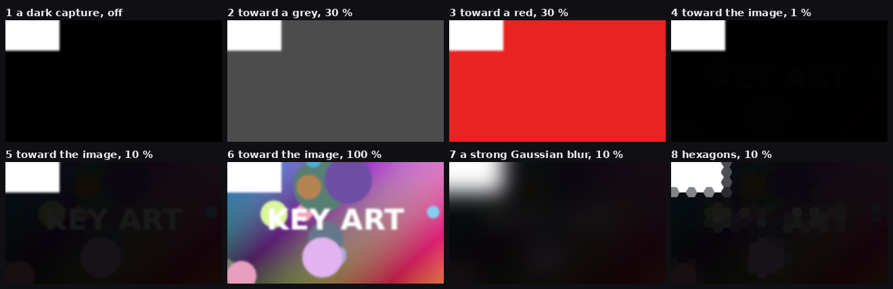

**Patterns.** *Background from: A pattern* needs no image: StageKit draws an animated background
itself. **Pattern**: *Aurora* (slow curtains of colour), *Plasma*, *Lava lamp* (soft blobs that
merge and part), *Waves* (layered dunes), *Bokeh* (soft circles drifting and fading), *Starfield*
(drifting points that twinkle), *Gradient flow* (a turning, sliding three-colour gradient),
*Nebula* (cloud), *Grid pulse* (a faint grid with pulses running along its lines), *Rays*
(light rays turning slowly round a point), *Circuit board* (ribbons of thin parallel traces that bend together at 45°, each trace ending
in a ring pad, a few thick traces, a dimmer board under it, and lights running along the ribbons
that light the pads as they arrive; chips, soldered pads and pours join in at a higher *Detail*),
*Circuit traces* (bundles of traces coming down from the top, each ending in a round pad at its
own height, lights running down them and small lights drifting up), *Data lines* (a few very
thin lines running across with gentle steps, dashes of light sliding along them, and small
drifting lights). For these three Colour 1 is the board, Colour 2 the lines and Colour 3 what
lights up (in Data lines: the drifting lights), and they are made for a light board as well as a
dark one: on a light Colour 1 the lights turn deeper instead of whiter. *Hex grid* (a
honeycomb whose cells light up), *Matrix rain* (falling streaks of changing signs), *Tunnel*
(rings flying out of the middle), *Ripples* (raindrop rings on water), *Embers* (sparks rising),
*Sun grid* (a sun over a grid running to the horizon). Six more are built on hexagons and dots:
*Hex columns* (six-sided columns seen from above and in front, with lit tops, darker sides and
dark edges, rising and falling in slow waves), *Mesh* (perforated metal: a tight comb of round
discs with dark rims, under a wide soft light that sweeps across), *Halftone hexagons* (fine dots
whose size draws large hexagons with rings in them, a wave passing from one to the next while the
whole turns very slowly), *Dot grid* (rows of small dots under diagonal beams of light; a dot
under a beam is larger and brighter, and one where two beams cross flares in a four-point star),
*Hex wire glow* (a dark honeycomb whose thin lines light up where a soft light passes) and *Hex
mosaic* (flat hexagon tiles in close shades that shimmer slowly). In these Colour 1 is the ground,
dark or light, and Colours 2 and 3 are what is lit or inked; Dot grid and Hex wire glow run from
Colour 2 at one side of the screen to Colour 3 at the other. **Colour 1**, **Colour 2**, **Colour 3** are its palette
(Colour 1 is the ground where a pattern has one); **Speed** (100 % as it comes; 0 holds it still,
under 0 runs it backwards; at 100 % a pattern comes back to where it began every four minutes,
with no jump), **Size** and **Detail**. A pattern takes the image's place and nothing else changes:
the blur, the mosaic, bloom, Darkest level, the texture overlay and a live capture blended in all
act on it, so a hexagon mosaic over Plasma works as it does over an image. The blur softens a
pattern a great deal: turn *Blur* down to see its shapes. The Motion group (drift, zoom, mirror) is
an image's and is hidden for a pattern. **Position X**, **Position Y** and **Rotation** pose the
background whatever it is made from: X and Y move it by a share of the screen's width and height,
Rotation turns it about the middle of the screen (clockwise, -180° to 180°). An image or source
still covers the whole screen (the space left is filled by repeating or mirroring it, as the drift
does) and its drift stays in the direction set. A pattern's own layout is moved and turned, so
Circuit traces can come in from a side instead of the top, the centre of Rays can sit elsewhere
and Sun grid can tilt. All three are 0 as they come, and then nothing changes. The patterns cost one small extra drawing step, and
nothing while an image is chosen. If the patterns cannot be loaded, the background shows the
standby image (or its image file) and OBS's log says so.

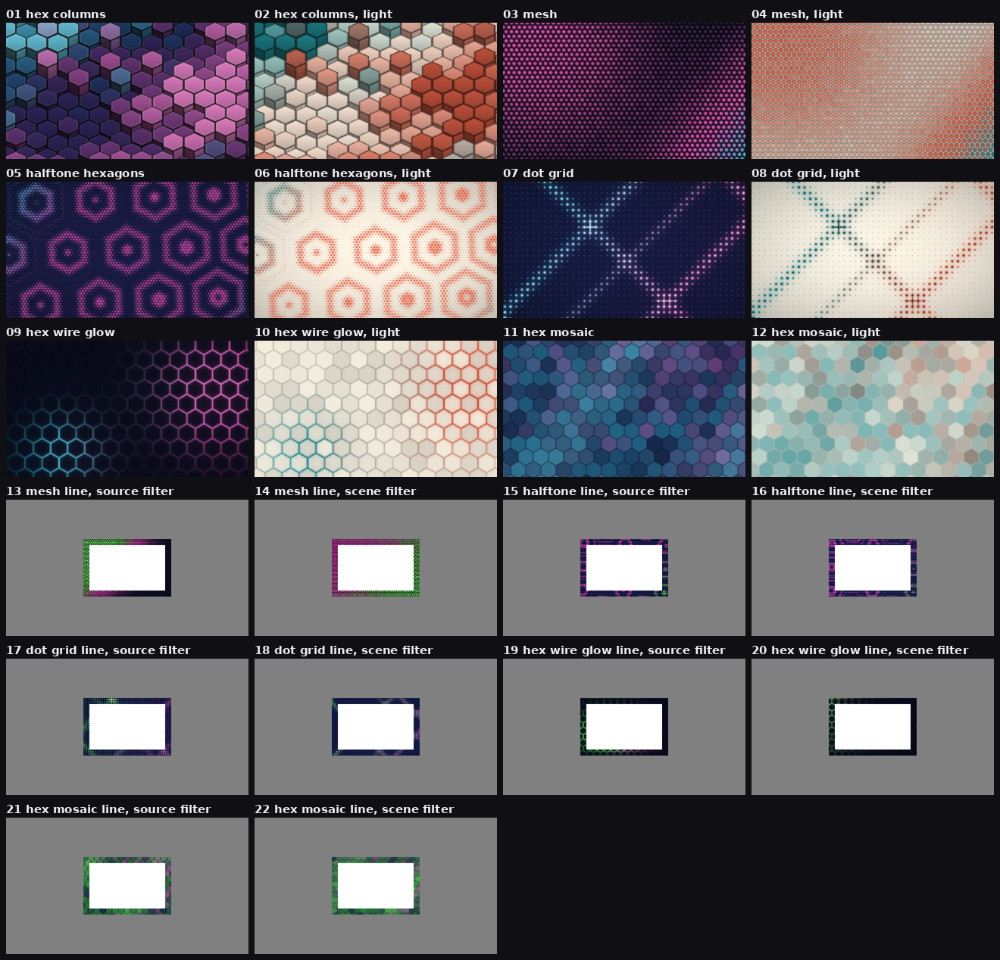


Put it in one shared scene and nest that scene wherever you need the background.

### Standby image

Choose the standby image once, in the StageKit dock under *Standby image*. The dock shows a small image
of it. It is saved with the scene collection.

- Add **Standby Image (StageKit)** as a source wherever the image itself should be shown.
- Every Ambient Background uses it as its image automatically. A background you had pointed at an
  image of its own switches over when you choose a standby image; to keep one on its own image, set its
  *Background from* back to *An image* afterwards.

Changing the standby image updates both at once.

An animated image, such as a GIF, plays: in the Standby Image source, in every Standby Image filter
(and the image shown in a hidden source's place), in Ambient Background and in the dock's small image,
where it keeps the zoom and place you chose with the wheel. A still image is shown as before.

### Shadow, Glow & Outline

Add **Source Filter: Shadow, Glow & Outline (StageKit)** as a filter on a source, group or scene. (It was called
Shadow & Backdrop; filters you already have keep working.) It has three parts, each with a tick box in
its heading:

<p align="center"></p>

- **Shadow or glow**
  - *Type*: *Drop shadow (to one side)* or *Glow (all round)*.
  - *Colour source*: *A colour*, or ***The image itself***. With the image itself, a game, camera or
    video casts a soft, moving copy of its own colours instead of a flat colour. *Colour boost* makes
    that richer.
  - *Opacity*, *Softness* (0 gives a hard edge), *Spread* (how far the shadow stays solid before it
    fades), and for a drop shadow how far right/left
    and down/up it falls.
  - *Hide the image* leaves only the shadow or glow.
- **Outline**: a line round the image, any width. *Colour source* a colour or the image itself. Made
  from the image, *Past the edge* chooses between stretching the image's edge outwards and
  mirroring the image, and *Outline blur* softens it. The
  line follows the image's real shape, including text and rounded or cut corners. A shadow is cast
  by the image and its outline together.
  - *Outline corners*: *Follow the source* (as it comes: the line goes round the shape of what shows,
    text and odd shapes too, as it always did; its outer corners are rounded by the line's width), or
    *Square*, *Rounded*, *Bevel*, *Notch* or *Scoop*: the line is drawn as a shape round the rectangle
    the source's image covers on screen, see-through margins left out (its panel, when it has one),
    the same width on every side whatever its bounding box, crop or scale (text and shaped sources,
    anything that fills under nine tenths of that rectangle, and turned sources keep a line that
    follows them); *Square* has sharp
    corners, and the others at a *Corner size* of 0 are square too. An item's crop cuts Shadow, Glow &
    Outline's line with the rest of what the filter draws (OBS crops the finished image), so crop
    with a Cropped View or a crop filter before it, or use Scene Shadow; its outer corners *Corner size* pixels across (no
    larger than keeps the source's own corners under the line), and
    the drop shadow takes the same shape.
  - *Intensity* (in the shadow part, 100 % as it comes): more fills a glow's or shadow's soft tail in
    towards full colour without giving it a hard edge, for a bright glow; less makes it fainter.
    Shadows and glows fall off smoothly with no steps in their soft tail.
  - *Outline design* (in the outline part of both filters, *Solid* as it comes): *Double line*
    (two thin lines with a gap, inside the outline's width), *Dashed* and *Dotted* (*Dash length*,
    *Gap length*), *Gradient* (the outline colour changing into a *Second colour* round the
    border), *Neon* (a bright tube in the outline colour with a soft halo of light spreading out past the
    line; *Glow size* is how far the halo reaches, in per cent of the outline's width; pick a
    bright colour, as a black line has no light to give and then takes the *Second colour* for
    its halo if that is brighter) and *Inner line* (drawn just inside the image's edge instead of
    outside it; it needs *Outline corners* other than *Follow the source*, and text and shaped
    sources keep a solid line outside). Five designs move, at a *Speed* you set (0 stands still, a
    negative number goes the other way): *Marching dashes*, *Travelling gradient*, *Pulse* (the
    line fades in and out), *Shimmer* (a highlight in the second colour goes round) and *Rainbow*.
    The patterns run round the border when *Outline corners* is Square, Rounded, Bevel, Notch or
    Scoop. With *Follow the source* they are laid round the source's middle in Shadow, Glow &
    Outline, and slanted across the whole scene in Scene Shadow, so pick corners there for dashes
    that travel round. The drop shadow is still thrown by the whole line, and a filter saved
    before keeps its solid line.
  - *Outline design* also has twenty-two designs called *Pattern*, which fill the line with one of
    Ambient Background's moving patterns: *Aurora*, *Plasma*, *Lava lamp*, *Waves*, *Nebula*,
    *Gradient flow*, *Starfield*, *Bokeh*, *Rays*, *Circuit board*, *Hex grid*, *Matrix rain*,
    *Tunnel*, *Ripples*, *Embers*, *Circuit traces*, *Data lines*, *Mesh*, *Halftone*, *Dot grid*,
    *Hex wire glow* and *Hex mosaic*. The line keeps its width, corners and shape
    (round the box or following the source); it is a window onto the pattern. The colours are the
    outline colour, the *Second colour* and a *Third colour*; *Pattern size* makes the pattern
    smaller or larger (smaller shows more of it along a thin line), and *Speed* moves it (60 is
    the speed it has as an Ambient Background, 0 holds it still). In Scene Shadow the pattern lies
    over the whole scene, so the lines of sources side by side flow together. In Shadow, Glow &
    Outline it lies over the source itself and travels with it. Plasma, Nebula and Gradient flow
    colour a thin line all the way round; Aurora, Starfield and Rays are mostly the outline colour
    with light passing through, as are Ripples and Embers, and look best on a wide line. For
    Circuit board, Circuit traces, Hex grid and Matrix rain turn *Pattern size* down (to 30 % or
    so) so that traces, cells and streaks fit in the line's width. Data lines is sparse on
    purpose: in a line it is the outline colour with a thin line or a light now and then. Mesh, Halftone, Dot grid, Hex wire glow and Hex mosaic also want *Pattern size* at 30 to 50 %;
    Hex wire glow is dark except where its light passes. Grid pulse is not offered (in a line it is
    only a tick every so often), nor Sun grid or Hex columns (each is a view, not a texture).
    *Position X*, *Position Y* and *Rotation* move and turn the pattern inside the line (the
    line itself stays where it is); they show for the pattern fills. *Rotation* alone also shows
    for the designs with something that goes round the border: for Gradient, Travelling, Shimmer
    and Rainbow it is where round the border the colours begin (180° puts the first colour at
    the opposite corner), for Dashed and Marching it slides the dashes along, a whole turn being
    one dash and gap. Solid, Double, Dotted, Neon, Inner and Pulse have nothing to pose and show
    none of the three.
  - *Outline design* *Ambient Background* fills the line with what an Ambient Background shows:
    its pattern, image or live capture, with its blur, mosaic, bloom and transitions, moving as
    it moves. So a border can match the background behind it. *Background* chooses which:
    *Automatic* (as it comes) takes the one in the scene (for Scene Shadow its own scene; for
    Shadow, Glow & Outline the scene on screen), or any there is; or pick one by name, which may
    be in no scene at all. *Fill brightness* (130 % as it comes) and *Fill saturation* (120 %)
    lift the line so it can be told from the background where the two meet; at 100 % each it is
    exactly the background. *Pattern size*, *Position X*, *Position Y* and *Rotation* lay the
    background out in the line as they do a pattern. In Scene Shadow the line shows the
    background where it lies on the screen; in Shadow, Glow & Outline the background's middle is
    on the source's middle, at the screen's size, and travels with the source. With no Ambient
    Background the line is its outline colour. The drop shadow and glow keep their own colours.

<p align="center">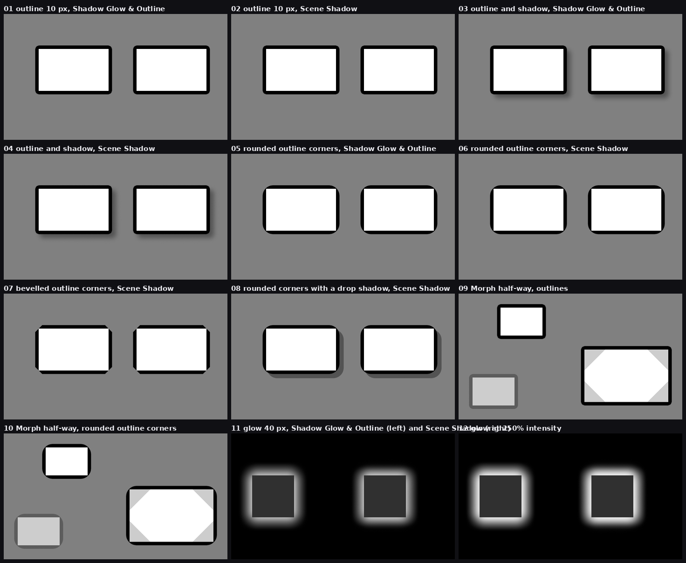</p>

<p align="center">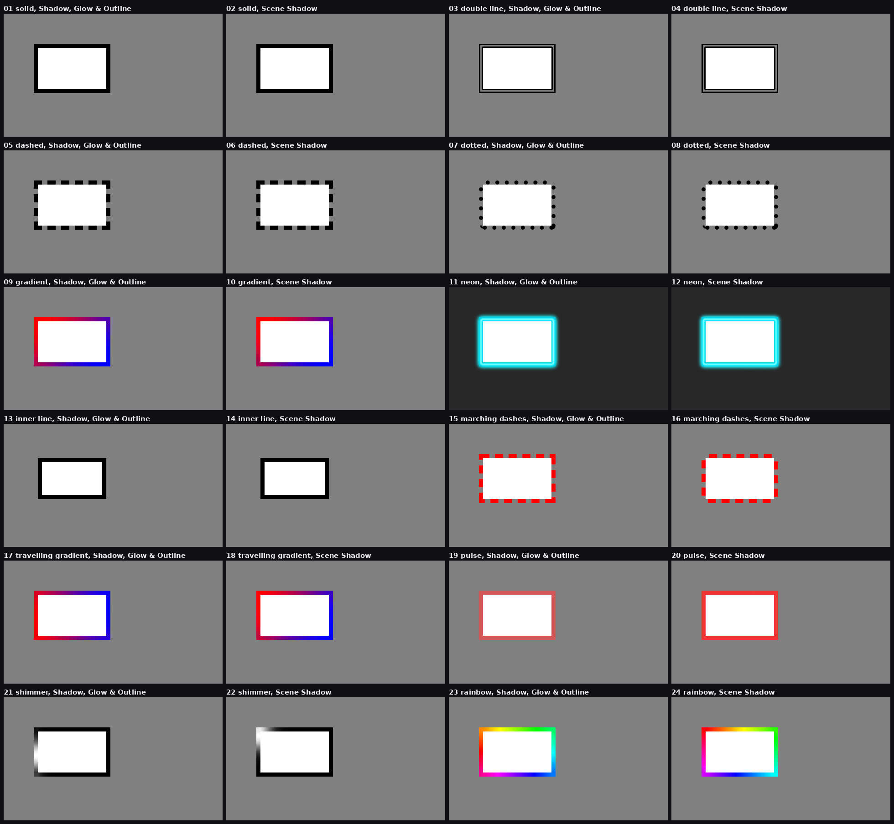</p>

<p align="center">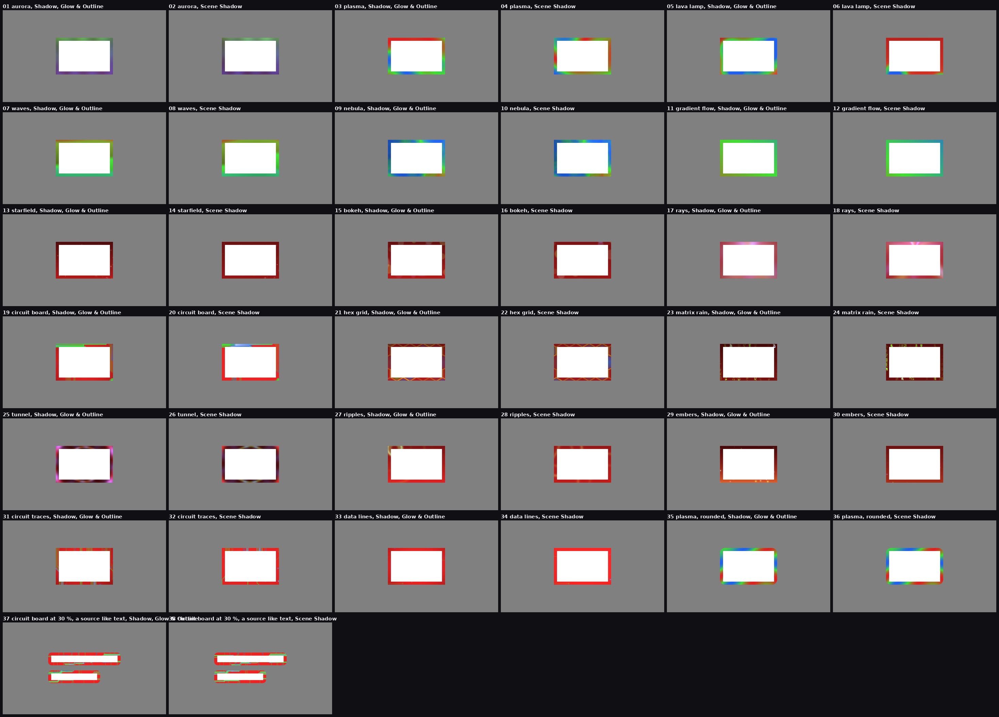</p>

<p align="center">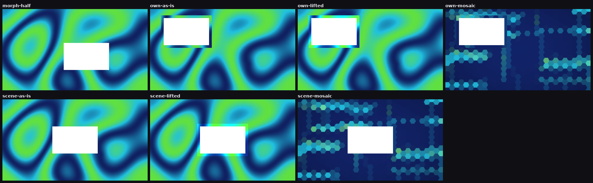</p>

- **Panel behind the source**: a coloured panel with a margin.

*Rounded corners* rounds the image and the panel. For other corner styles, use Corners & Edges.

The last group, *Placement and scenes*, holds *Keep the image where it is*, *Sizes in screen pixels*,
*Keep it on screen* and the list below.

**Leave it off in these scenes**: choose scenes from your collection; each becomes a row with its own
✕ to remove it. While a listed scene is on screen the filter draws nothing; the source shows plain
there and keeps its place. It goes by the scene on screen (Program in Studio Mode).

Sizes are as they look on screen: with *Sizes in screen pixels* ticked (the default), 20 px of
shadow is 20 px in the finished image however much the item is scaled, so a small camera and a large
panel get the same shadow. Untick it to give sizes in the source's own pixels.

The shadow needs room around the source, so the source itself gets bigger. With *Keep the image
where it is* ticked (the default), the source's items in every scene are adjusted by exactly that room:
the image keeps its size and place whatever the softness, offset, outline or panel margin, including
inside a bounding box. Switching the filter off or removing it puts the items back.

### Corners & Edges

Add **Source Filter: Corners & Edges (StageKit)** as a filter on a source: a camera, a capture, an image, a browser
widget.

<p align="center">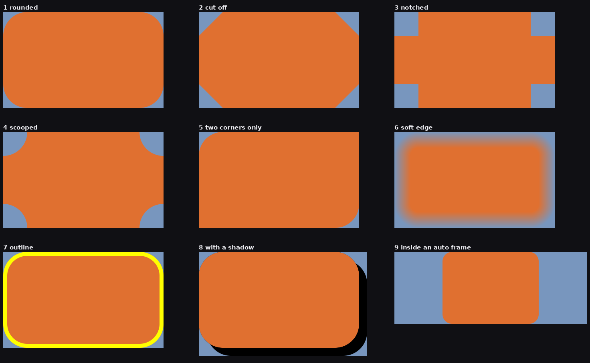</p>

- **Corner style**: *Rounded*, *Cut off (chamfer)*, *Notched (square cut)* or *Scooped (curved in)*.
- **Corner size**, and **Which corners** it applies to, each one on or off.
- **Trim edges** cuts the same amount off all four sides. **Soften edge** fades the image out
  towards its edge.
- **Border**: a line of any width, colour and opacity that follows the shape, drawn inside the edge (Shadow, Glow & Outline's outline is drawn outside it).
- **Sizes in screen pixels** (on by default): a 40 px corner looks the same on a large source and a small
  one, the same rule Shadow, Glow & Outline uses.

It works with the other tools:

- The source **keeps its size**, so nothing moves or resizes in any scene, and Move Source keys, layouts
  and the line-up tools carry on as before. The line-up tools measure the new shape when *Use visible
  pixels* is on.
- **Shadow, Glow & Outline** after it in the filter list casts a shadow of the new shape. If you add
  Corners & Edges to a source that already has a shadow, it places itself above the shadow for you.
- After an **Auto Frame**, it shapes the game image inside the frame, and follows it when the image
  changes shape.
- Blur and Zoom can go before it (the blur or zoom stays inside the shape) or after it.

### Auto Frame

Add **Source Filter: Auto Frame (StageKit)** as the first filter on a game, window or capture-card source. Set the
frame's width and height once. From then on the source always has that size, and whatever the game or
emulator outputs is fitted inside it, gliding to its new fit when the resolution changes.

The top line of the controls says which program is being captured and which image shape applies.
On a Window Capture with an Automatic Window Switcher, that is the window the switcher shows, not
the one the capture was last aimed at. The settings are in five numbered groups:

| Group | What is in it |
| --- | --- |
| 1. Frame size | Width and height, or pick a scene and a source and press *Use that source's size*. With *Frame: Just the image* only *Image height* is shown: the width follows the image |
| 2. Image | Fit (whole image, whole-number scale, fill, stretch), image shape, where it sits (*Align left ↔ right*, *Align top ↔ bottom*), sharp pixels. *Fit* and the two alignments are for a fixed frame and are hidden with *Just the image* |
| 3. Black bars | Trim automatically, trim a set amount, or leave them. Automatic trims only when the image is seen to end in a straight line, the same distance in from both sides, leaving a standard game shape. Artwork, a logo or a dark scene on black is not mistaken for bars. *Keep aspect ratio for* sets how long a different shape must be clearly on screen before the image changes to it |
| 4. Aspect ratio for each program | *Start from usual ratios*, *Forget ratios seen before*, and aspect ratios you save yourself, used at once when that program is captured (see below). The group and the *Saved aspect ratios* list under it show while the trim is automatic, which is when they are read |
| 5. Movement | How long the image takes to settle after a resolution change |

**The first clear sight of an image is used at once.** When a game appears, or its window changes
size, the capture is looked at ten times a second until its shape is settled, and the bars are trimmed
within a fraction of a second of the image being seen clearly: a windowed game whose image sits
inside its window with bars above and below does not wait for the hold time. It does not need a bright
scene. Bars are flat black and even a night scene is not, and an image fitted in its window gives
itself away with a few lit pixels at each side: it reaches both ends one way and stops the same
distance in from both ends the other way, leaving a real image shape. A black loading screen teaches
nothing, and nothing is trimmed on a guess.

**A program's shape is remembered.** Once a program's image has held one shape for a quarter of a
minute, that shape is kept for the program, and the next time it is captured the image starts out in
it from the first frame, at any window size, even while the screen is still black. What is seen still
corrects it. A program that turns out to show more than one shape (an emulator for several consoles,
or a game that simply fills whatever window it is given) starts from nothing instead. The tooltip of
*Forget ratios seen before* lists what is remembered; the button clears it.

**A shape, once found, is held.** When a window goes full-screen, or the resolution changes, the
image keeps the shape it had: there is no moment of showing the bars and trimming them again. The
last good image stays up for a fifth of a second while the capture settles, and for up to a second if
the capture drops out, so the switch does not blink. A menu, a pop-up or a mouse pointer over the bars
does not resize it. It changes when another real image shape has been clearly on screen for the hold
time, when the image itself keeps showing inside the trimmed part, or when a different program is
captured. A shape carried over to a new size is only a starting point until the image is seen to fit
it: if the image plainly shows inside it, it is let go within about a second.

**If a game's shape is slow to come right**, OBS's log says what Auto Frame saw and when
(*Help → Log Files → Show Log Files*, the lines with `Auto Frame:` in them).

**Unusual shapes.** Automatic trimming knows the shapes consoles and handhelds use, including two
screens stacked or side by side (DS, 3DS), upright and ultra-wide. For an image in some other shape,
press *Measure the bars now* on a bright scene (or set the amounts by hand), then *Keep this trim for
this program*. That saves the shape for the program being captured and goes back to automatic, so the
program is right from then on, at any window size, and everything else is still worked out by itself.

**Image shape for each program.** A program seen before starts from the shape it showed then.
Otherwise common emulators start from their usual shape (Snes9x 8:7, mGBA
3:2, Project64 4:3 and so on), so the image is right from the first frame. Either is only a starting
point: if the image clearly shows another shape, that shape is used and held. To fix a program's
shape yourself, choose the program from the list of
open programs (or find its file with *…or find it on this computer*), choose its shape and press
*Remember this ratio*. A shape you save is always obeyed as it is. Emulators that play
several consoles, such as RetroArch and Dolphin, are not built in because their shape depends on the game.

**Two programs with the same file name.** A special build of an emulator often keeps the original's
file name (PrimeHack is `Dolphin.exe`). The *Program or window* list also offers the titles of the
open windows: pick one, shorten it if you like (`primehack` is enough: part of a title will do),
choose its shape and press the button. When several saved shapes fit a window, the one with the
longest name is used, so `primehack = 16:9` and `dolphin = 4:3` can sit side by side. In the same way
Automatic Source Switcher tells two captures of such programs apart by their window titles, and Auto
Capture's *Never capture* and *Always capture* take part of a title as well as part of a file name.

To set the aspect ratio from a Stream Deck, use StageKit's **Set Aspect Ratio** key, which needs no filter. For a hotkey,
or the OBS plugin's *Filter* key, add **Source Filter: Aspect Ratio Preset (StageKit)** next to Auto Frame, once per
aspect ratio. Switching it on sets the ratio and it switches itself off; one
set to *Automatic* hands control back.

Because the source's size no longer changes, one scene can replace a scene per image shape and the
automation that switched between them. Put Shadow, Glow & Outline after it and the shadow follows the image.

### Fit to Space

Add **Scene Filter: Fit to Space (StageKit)** as a filter on a *scene*. It places one item of that scene for you.

- **Item**: the item to place, usually your game capture.
- The settings are in five numbered groups, *1. Where*, *2. Size*, *3. Sharing the space*,
  *4. Measuring* and *5. Movement*, then *Sync position to scenes*. A Scene Fit shows the same groups
  for each source. *Use visible pixels* (under *4. Measuring*) shows for every *Fit area*, since the
  fitted source is measured that way in all of them; *5. Movement* shows where the fit goes by other
  sources.
- **Fit area**: *The whole screen*, *A box I set* (left, top, width, height in canvas pixels), or
  *Free space around source*.
- **Margin for other shapes**: an image with the box's shape fills the box. Any other shape is kept
  this far from the box's edges and centred. With a Shadow, Glow & Outline set to *Keep it on
  screen*, an image that fills the box makes room for its shadow.

**Free space around source** makes the item as large as it can be where it is, always keeping the
gap you set (*Gap*) from the screen's edges and from every other item, at its
nearest.

- Move, show or hide another item and the fitted item glides to its new space (*Glide to a new space
  over*, with a curve to choose; 0 changes at once). An item that starts drawing something after
  showing nothing, such as a music widget, is noticed within a few seconds.
- Drag the fitted item to another part of the scene, or send it there with a key, and it takes the
  free space around that place instead.
- A background or a frame is not in the way: anything the item's place lies inside is ignored.
- It only works while its scene is being shown, so scenes you are not on cost nothing.
- When the fitted source is a Window Capture with an **Automatic Window Switcher**, the fit goes with
  the switch: as the switcher changes to a window of another shape, the space for that shape is
  taken over the switcher's own *Duration* and easing, so the image and its place arrive together.
- **Ignored sources**: sources the free space ignores, such as a camera meant to overlap the
  game.
- **Overlap only when it fills** (unticked as it comes) with **Fill needed to overlap**: the ignored
  sources are only overlapped while the fitted item fills at least that much of its
  space. At 98 %, a window that fills the screen stays under the camera, and a window of another
  shape, which would leave bars beside it, is fitted beside the camera instead. The Stream Deck
  *Fit to Space Overlap* key switches it.
  Two tick boxes under it choose what counts as filling. **Use fill percentage** (ticked as it
  comes) is the share above. **Use edge gaps (pixels)** has four sliders, **Top**, **Bottom**,
  **Left** and **Right gap up to**: the widest empty gap allowed between the fitted source and
  that edge of its space. The source overlaps the ignored sources only when all four gaps are
  within their sliders; 0 means it must reach that edge. A window that fills the width and leaves
  20 px above and below overlaps the camera with top and bottom at 30; a narrower one that leaves
  300 px at the sides goes beside it. With both boxes ticked, meeting either is enough; with
  neither, the source is always fitted beside the ignored sources.
- **Make room if not filling** (for *The whole screen* and *A box I set*; unticked as it comes):
  with it and *Overlap only when it fills* both ticked, an image that fills the screen is fitted
  there as ever, over the other sources, and one that does not (a 4:3 standby image on a
  widescreen canvas) is fitted into the largest space clear of the other sources instead, the
  margin kept as a gap, so it sits beside a camera in the corner rather than over a sliver of it.
  When the image fills again (a widescreen game appears) it glides back to the whole screen.
  *Use fill percentage* and *Use edge gaps* say what counts as filling, measured against the
  screen (less the margin, for an image of another shape); which of the two places it takes comes
  from the image's shape alone, so it does not flip by itself. **Make room for** lists the
  sources room is made for; with none listed, room is made for every other source. Anything the
  middle of the screen lies inside (a background, a frame) is never in the way. Ticked, the fit
  also gets the free space's *Move duration*, easing, *Use visible pixels*, *Size tolerance* and
  *Space priority*. With *Overlap only when it fills* off, the image always takes the whole
  screen.
- **Only if it would overlap** (under *Make room if not filling*; unticked as it comes): room is
  made only when the image, fitted to the screen as it would be without making room, would
  actually overlap one of the *Make room for* sources. A camera that lies wholly in the empty bar
  beside a narrow image is then left alone, and the image keeps the whole screen; a camera the
  image would reach is made room for as above. It goes by what shows of each, as *Use visible
  pixels* and *Ignore shadows & outlines* say (boxes with *Use visible pixels* off); edges that
  only touch and the gap do not count, and a source that draws nothing is not there. Like the
  fill rules it is worked out from the image's shape and where the screen would put it, not from
  where the image is now, so it does not flip once room has been made.
- Add the filter to the **scene**, not to a group. To fit a group, choose the group as the *Item*.
  On a group the filter does nothing and says so.
- With *Use visible pixels* ticked, the fitted item itself goes by what it shows, like the items
  around it: a group, a widget or a nested scene that is larger than its image is fitted, kept
  and centred by the image, and the empty part of its box may reach into the gap.
- Two Fit to Space filters in one scene work together: each goes by where the other is taking its
  item, so they settle in one move. Wherever they are, each lies in its space where its *Align in
  the space* puts it: a resized item fills the room round where the items that keep their size
  belong, and an item that keeps its size lies by its alignment in the room that leaves it. The
  same rule holds for any layout; nothing is special to one arrangement.
  Where another resized source is above, below or beside a resized one, the resized one's box is
  just its image (a source that keeps its size there changes nothing: a capture keeps its whole
  space beside a camera and chat column), so several resized sources share a column (two handheld windows and a camera,
  say) without one box taking the room the others' images need. Side by
  side this does not happen. The same goes for a Scene Fit's sources.
- **Space priority** (in the free space) says which source gets the room when two want it:
  - *Takes space first*: the source takes the space it would have if the sources that share space
    or make room were not there, and never shrinks for them; they fit around it. It never covers
    a source that keeps its size (*Resize to fit* unticked): it stops the gap short of that size
    at the place the source is kept round. Use it for the main capture, so the camera and chat box
    fit beside it.
  - *Shares space* (as it comes, and what every filter made before this setting does): the sources
    make room for each other, as above.
  - *Makes room*: the source always fits around every source that shares space or takes space
    first.

  Two sources with the same setting share. Priority decides who gives way, never that one covers
  another; only *Overlap only when it fills* lets sources overlap. A resized source you put down inside the
  space of one that takes space first fits beside it, and goes back to its place when the first is
  hidden.
- **Priority by list order** (unticked as it comes): ticked, *Space priority* is greyed out and not
  used. Among the fitted sources of the scene that have it ticked, the one whose filter is higher in
  the scene's filter list takes its space first, and the ones below fit around it. Move a filter up
  or down and the sources glide to their new places. A Scene Fit with it ticked counts at its own
  place in the list, its sources in its own order. Towards a fitted source without it ticked, a
  source with it ticked counts as *Shares space*.
- An item is never put past the screen's edges: it stays the gap inside them whatever is beside it.
- **Resize to fit** (ticked as it comes). Unticked, the item keeps the size it has and is only
  moved, to where *Align in the space* puts it in its space (the middle as it comes, so the room
  left over is the same on both sides and above and below); when the space changes (a camera above
  it is hidden, say) it moves with it.
  Unticking gives the item back the size it last kept: the one you gave it in the preview, or, if it
  never kept one (a new filter starts ticked), the size it had before the filter. Resize it
  yourself in the preview and that is the size it keeps, once you let go and it has stayed that
  size for a moment (the dock's snap and resize glide are taken as one resize). This works for the whole screen
  and a box as well as the free space.
- **Moved or resized by hand while the filter is on**, a source is left alone for as long as you
  hold it, and about a third of a second after you let go the filter takes over again: a source
  with *Resize to fit* ticked glides back, from where you let go, to fill its space; one with it
  unticked keeps the size you gave it and glides to where its alignment puts it. (Holding is
  known from the mouse button on Windows; elsewhere the filter goes by the source having come to
  rest.) To have it fitted at once, press the dock's **Fit to space**.
- **Align in the space** (*The middle* as it comes): where the item lies in its space when it does not
  fill it, which is an image of another shape than the space, or an item that keeps its size. A
  side or a corner puts it against that side, the gap away, with all the room left over on the
  other side, so it only ever moves that way: a camera kept towards the top stays at the top, and a
  chat box kept towards the bottom stays put when the camera above it is hidden. It always
  decides, whatever lies beside the item, for a source kept at its size and a resized one alike,
  in Fit to Space, in Scene Fit and for the dock's Fit to space. It is also obeyed for a layout you
  made by hand with the filter off: **switching the filter on moves a source to where its
  alignment puts it** if you had put it somewhere else in its space (it glides there). The list
  shows the nine places row by row with an arrow each, as OBS's Edit Transform lays out a
  bounding box's alignment (OBS's filter window cannot show a grid of buttons); the dock has the
  grid itself (below).
- An item that is hidden is left exactly where it is and holds no space, so the others take its
  room. Shown again, it is where it was, and the others make way for it in one move.
- An item that is showing but has no image yet (a display capture before its first frame, a
  capture card that is off) keeps the room it was last given, or its bounding box if it was never
  fitted, so the items beside it stay where they are until the image comes.
- **Sync position to scenes** (a list, empty as it comes): each time the filter has put its
  item in place while its scene is on screen, the same source in the scenes you list is given
  exactly that place and size, so it is already there when you switch to one of them and nothing
  shifts in view. Scenes you do not list are never touched: the source keeps its own place there.
  A listed scene that is on screen at that moment is left alone. Locked copies are moved too. The
  link holds both ways: a listed scene with a Fit to Space of its own for the item gives its place
  back when it is the one on screen, and fits the item to itself when it comes into view (at once,
  without a glide); where the scenes are laid out alike that is the same place.
- With *Resize to fit* off, StageKit keeps the size the image has on the screen, not a share of
  its source. A capture that changes resolution keeps its on-screen size. A different aspect ratio
  fits inside the saved rectangle. While the capture has no image (0x0), nothing about it is
  changed. While a source keeps its resolution and shows more or less of itself (a chat box with
  more lines), it keeps its scale. A size is never read off a Standby Image standing in for a
  capture: a collection saved by an older version, which kept a scale, is given its sizes when
  the capture's own image is there.
- **Switching the filter on over a hand layout** takes each source as it is: the space it is in
  and the size you gave it. An image with *Resize to fit* on keeps that size when it already
  fills the available space within *Size tolerance*; an undersized image grows to fit. A
  kept-size image keeps its size. Each then lies in its space by its *Align in the space*, so a
  layout made with the gaps and the alignments is left exactly as it is, and one that is not is
  put right. A source that is hidden (or has no image) when the filter is switched on keeps the
  size and space it had before.
- **Size tolerance** (8 px as it comes): when something sticks a little way into the space, the image
  may be made up to this many pixels smaller to keep the whole space, instead of keeping its size and
  losing the part of the space beside that thing. At 0 the biggest image always wins, even by one
  pixel. The gap is kept either way.
- **Use visible pixels** and **Ignore shadows & outlines** (both on as they come) are this filter's
  own settings; the dock's Arrange options do not change them. With the first, the items around it
  are measured by what they draw, and an item that is drawing nothing is not in the way. With the
  second unticked, shadows, glows and outlines keep the gap too, the fitted item's own included.

Use it with Auto Frame's *Frame → Just the image*, so the source is only the trimmed image. One
game capture can then sit in a full-screen scene (a widescreen game fills it, an emulator floats in the
middle) and in a scene with a camera and chat beside it (fitted to that scene's game box), with nothing
to change when you switch games. A shadow on the source is allowed for.

It works on any source. For a **Window Capture**, add Fit to Space to the scene and choose the window
capture: the window fills the space when it has the space's shape and floats centred otherwise, and it
stays fitted while you drag the window to a new size, because the fitting itself is done by OBS on
every frame. Use one Fit to Space filter for each item to be fitted.

Fit to Space takes over the item's position and bounding box and removes its rotation. Switch the
filter off to move the item by hand.

### Auto Capture

Add **Source Filter: Auto Capture (StageKit)** as a filter on one *Game Capture* source. Windows only.

Four times a second it looks at the window in front. If that window is a game, the capture is aimed at
it, windowed or full-screen. It stays on that game when you switch to another program, and moves on
when the game closes or another game comes to the front. There is nothing to set up per game.

The filter's controls show what it is capturing now.

- **It leaves alone what it cannot hook, for a while.** A program taken for a game that gives
  the capture no image for ten seconds is left alone (OBS's log says so): left aimed at it, OBS
  goes on trying several times a second, and each try stalls the image for a moment. While it is
  left alone the capture is aimed at no window at all (or at another game), so OBS stops trying.
  Every five seconds it looks in on the program for one second, so a game started meanwhile is
  picked up within a few seconds (after a minute of looks that find nothing, they come up to 15
  seconds apart); that is about a sixth of the hooking OBS would do if it stayed aimed at it. It is
  tried again at once, for the full ten seconds, when one of its windows shows a title not seen
  before, as when a game is started in an emulator, or when you click back into it. A frame rate or
  a volume in the title changing does not count, and a title counts only once. Nothing is added to
  *Never capture* by itself. Programs listed in an Automatic Window Switcher are never taken at all.
- **Not a game? Never capture this program**: one press when it picks up the wrong thing.
- **Pick from the programs that are open**: choose a program and press *Always capture it* (for a game
  it misses) or *Never capture it*. There are no file names to type.
- **Games** (the first group): *Always capture* and *Never capture*, one row per entry with its own
  remove button, then *Find games* and *Keep the capture ready*. OBS, browsers, Discord, Steam's own
  windows and similar are already left alone.
- **Find games**: *Automatically*, or *Only from 'Always capture'*.
- **Keep the capture ready** (on as it comes): the capture carries on while you are on a scene
  that does not show it, so it is there at once when you come back. Unticked, OBS stops it a moment
  after you leave and starts it again when you return.
- **No game: Standby Image** (off as it comes): with a Standby Image filter on the capture, the
  Standby Image is shown while no game is captured, and gives way when a game is found.
- **Standby Image** group: *Hide shows Standby Image* (on as it comes) hides the capture behind
  its Standby Image instead of hiding the item; *Hide/show capture now* does it, as does the
  hotkey under the capture and the Stream Deck *Manual Window / Source* key. *Transition*,
  *Duration* and the easing are how the Standby Image comes and goes for these two.
- Without a Standby Image (or with *Hide shows Standby Image* unticked) the hide hides the
  capture's items wherever they are shown and remembers where; the next press shows them again
  there only, never in a scene where the capture was hidden already (a Link Visibility's other
  capture, a mode that is not on). With nothing remembered, the press shows nothing. What is
  remembered is kept over a restart.
- **A game's window closing lets go of it.** When the game's own window closes and its program
  stays open (Dolphin back in its game list, with the menu in a window of its own), the capture
  lets go within about half a second, so it no longer keeps the game's last frame: a Standby
  Image after it comes in with its own transition, or, with *No game: Standby Image*, Auto
  Capture's. The program's next game window is picked up as usual. A window that is only made
  again (going full-screen) or minimised, or one of several closing (a GBA window), is not let go
  of. The same happens when the menu is minimised as the game's window closes, and the menu is
  not taken for a game when it is brought back.
- **It stays on a game while its image comes back.** When OBS loses a game's image for a moment
  (the game goes full-screen or makes its window again, or an emulator starts or stops a game),
  the capture stays aimed at that game for as long as its program runs, also while none of its
  windows can be seen, and OBS picks the image up again by itself. Only another game you click
  into takes over meanwhile. A game whose window is made again as another kind of window is
  followed at once. OBS's log says `kept on <program> while its picture comes back`.
- With no game open, the Game Capture goes back to *Capture any fullscreen application* (while an
  emulator whose game window closed is still open, it stays aimed at nothing instead). A program
  that has just closed is waited for about three seconds first, in case it is only making its
  window again; only then does another game that is open take over (one you click into takes
  over at once).
- **Switching Auto Capture on again hands the capture back.** After *Capture Active Window* (or
  anything else) has aimed the capture by hand and Auto Capture was switched off, switching it
  on again aims the capture afresh at once. It also switches itself back on once the program you
  hooked has closed (after a restart too), so it follows games again; one you switched off
  yourself stays off.

A game is recognised by what the program has loaded: a graphics engine together with something only
games have (controller support, a game store's library, a game engine's player, game audio or video),
a game engine's own kind of window, or a window that fills its screen. A program seen to be a game
once is remembered and picked up at once from then on. The filter changes the Game Capture's own
*Mode* and *Window* settings for you.

### Standby Image

An image in a capture's place while the capture has nothing to show, so its spot in the scene is not
an empty hole while you wait for a game or window. Add **Source Filter: Standby Image (StageKit)** as a filter on a
Game Capture, Window Capture or other live source.

- **Nothing to show** means no game or window is attached to the capture. A capture that is attached
  and showing a black image, such as a loading screen, is left alone.
- While it waits, the image is shown whole, in its own shape, as tall as the capture last was.
- When the capture starts, the size glides from the image's shape to the capture's while the
  image fades into it. When the capture ends, its last frame fades back into the image, which
  glides back to its own shape. Neither is ever squashed on the way.
- It belongs after an Auto Frame in the filter list and puts itself there.
- After an Automatic Window Switcher it takes the capture's size as the switcher gives it: the
  switcher already glides from one window's size to the next, and the two do not glide twice.
- Corners, shadows and other filters after it are put on the image as they are on the capture.
- To go without it, switch the filter off with its eye or a Stream Deck filter key.
- *Transition* has a fade, a cut, slides, wipes, *Fade and zoom* and *Morph* (the capture and the
  image both stretched over the frame as it glides from one shape to the other).
- **Cover the source now** (the last button in the window, and a hotkey on the source) brings the image in over
  a capture that is running and takes it away again: a way to hide the capture without leaving a
  hole. An Automatic Window Switcher on the same capture does this when asked to hide the capture
  (*Hide shows Standby Image*, ticked as it comes), so the Stream Deck *Hide or show the capture*
  key shows the Standby Image.
- **On any source, not only a capture**: put Standby Image on a camera, a capture card or a display
  capture and cover it from a Stream Deck **Standby Image** key set to *Cover: toggle*, *Cover with
  image* or *Uncover* (lit while the image covers the source), or from a **Show in Scenes** switch
  with *Hide shows Standby Image* ticked. No Automatic Window Switcher is needed. See
  [Covering a camera with its Standby Image](#covering-a-camera-with-its-standby-image).
- The cover belongs to the source the filter is on, so it shows wherever that source is drawn: every
  scene, and every Cropped View of it (a *Square Camera* view of a DSLR shows the image too). To
  cover one view only, put the Standby Image filter on that view instead.

| Setting | What it does |
| --- | --- |
| Image | *The standby image* (the default: the one set on the StageKit dock's Standby & Ambient tab), *An image or video file*, or *Another source* |
| Show when source is hidden | While the source is hidden in a scene, the standby image is shown in its place there, at the same position and size and with the source's later filters (shadow, corners). StageKit adds a locked item named *<source> (standby)* under each item of the source and shows and hides it by itself. *Show/Hide transition* below it, shown while this is ticked, is the one change between the source and the standby image: any OBS transition or *Morph (StageKit)*, with that transition's own settings, showing and hiding apart if you like. StageKit sets it on the source's items and on the stand-ins, so the source leaves and the standby image arrives the same way whatever hides the source (a Stream Deck key, Show in Scenes, the eye); other StageKit filters leave those items' transitions alone while this is ticked. With Morph the source changes into the standby image and back. Any StageKit filter may come after Standby Image; put OBS's own filters (colour correction, crop) and other plugins' filters before it in the list, or the change cuts instead of using the transition. The stand-in items appear two seconds after OBS has finished loading. Not for sources inside a group yet |
| File / Source | The file or source to show, for those two choices. A video loops, without sound |
| Keep image's aspect ratio | On (the default): the image is shown whole in its own shape. Off: it fills the size the capture last had, with what does not fit cut off |
| No-signal transition | Used while the source is shown but has nothing to show (hiding and showing it in a scene uses *Show/Hide transition*, below). How the image gives way to the capture: *Fade* (the default), *Morph*, *Fade and zoom*, *Cut*, *Slide left / right / up / down* or *Wipe left / right / up / down*, named for the way the image leaves. It comes back the same way in reverse. The lists StageKit draws itself (this one, Auto Capture's, the Window Switcher's and Ambient Background's) use these names in this order |
| Duration: image to capture / capture to image | How long each change takes |
| Easing curve / Easing direction | The motion the change follows |
| Animate the size change | On (the default): the size glides between the two shapes over the same time. Off: the size changes at once |

When first added it puts itself straight after an Auto Frame if there is one, and otherwise first in
the list; after that the order is yours.

### Automatic Window Switcher

One Window Capture for several apps. Add **Source Filter: Automatic Window Switcher (StageKit)** as a filter on a
*Window Capture* and list the apps it is for. The filter aims that one capture at whichever of them
you are using, so a scene needs one capture, one set of filters and one Fit to Space instead of a
capture for each app.

The window has four groups, in the order of the table: *Windows* (the first four rows), *Switching*
(the switch transition, its duration and easing), *Manual windows*, then *Show/Hide transition*.

| Setting | What it does |
| --- | --- |
| Windows to switch between | Open the app, then choose it under *Add a window*: by its program, or by a window's title for two programs with the same file name. The first part of a title is offered too (*GBA1* of *GBA1 | Volume 100%*); a window chosen by part of its title is found again when the rest of the title has changed. **Ignored windows** below it lists windows never to take, by program or part of a title. For two windows of one program in a scene, use two Window Captures, each with this filter and one of the windows. Each row has its own remove button |
| Switch to the active window | Ticked (as it comes): clicking into one of the apps captures it; clicking into anything else changes nothing, so the last one stays. Unticked: an app is captured when it opens and stays until it closes |
| Keep other windows captured | Ticked (as it comes): while the capture is showing, the other open apps on the two lists are captured in the background, so the one you switch to is there at once. Unticked, a switch waits for the capture to find the other window, which saves graphics memory |
| Game area only | Unticked as it comes. Ticked, only the part of the window the app draws its game in is shown: an emulator's menu bar, tool bar and status bar are left out, with nothing to crop by hand. It is found by itself for each window (the app's largest drawing area inside its window) and followed when it changes, gliding to the new size; a menu that opens for a moment changes nothing. Needs Window Capture's *Client area* ticked. Where none is found the window is shown whole (a web browser is always shown whole, tabs and all), and OBS's log says what was found for each program |
| Switch transition | How one app's image gives way to the next: *Fade* (as it comes), **Morph** (the frame changes shape and size as the one image turns into the other), *Fade and zoom*, *Cut*, or *Slide left / right / up / down*, named for the way the image moves (with *Slide left* the new window comes in from the right) |
| Duration / Easing | How long that takes, and its curve |
| Manual windows | Other apps the capture shows when you say so, such as your browser. *Switch to next manual window* (a button here, a hotkey, a Stream Deck key) takes the next one that is open and holds it whatever app you use; after the last, or with *Return to automatic*, the apps above are followed again. In the *Manual windows* group with it: *Auto-switch manual windows*, *When a window is picked*, *Clear picked windows at start* and the buttons |
| Show/Hide transition | *Hide/show capture now* hides the capture in every scene it is shown in, or shows it again, with the transition chosen under it. Also a hotkey and a Stream Deck key. The show brings it back only where the hide hid it (not in a scene where it was hidden already, nor where a mode not on holds it hidden), and does nothing when nothing was hidden; this is kept over a restart |

- An app on the list that opens is captured. When the app being captured closes, the one you used
  before it comes back.
- The change is smooth although there is only one capture: the filter keeps the last image the
  capture had, shows it while the capture is finding the other window, and brings the new image in
  over it. A Standby Image on the same capture does not stand in for that moment; it does once
  none of the apps is open.
- Five hotkeys under the capture in *Settings → Hotkeys*, named after the filter: *next manual
  window*, *return to automatic*, *toggle manual / automatic*, *hide or show the capture* and *clear picked
  windows*. The Stream Deck *Manual Window / Source* key does any of the five.
- To hold a window that is on neither list, press the Stream Deck *Capture Active Window* key on
  it. The filter adds its program to *Manual windows* and captures it; with *When a window is picked*
  set to *Switch at selection* it also changes over to it with your *Transition* and holds it.
  *Manual Window / Source* (*Toggle*) then switches between that window and your apps.
- **A window you pick is that window, not its program.** *Capture Active Window* adds it to
  *Manual windows* as *program — its title*, for example two browser profiles as two entries.
  Another window of the same program never stands in for it. When it closes it leaves the list,
  and the capture does not move to the program's other window. It goes to your next manual
  window (with *Auto-switch manual windows*) or back to automatic, and with nowhere to go it
  shows the Standby Image, or nothing. A program named in a list still means any of its
  windows.
- **Picked windows are cleared.** *Clear picked windows at start* (ticked as it comes): windows
  picked with *Capture Active Window* last only for this OBS session. *Clear picked windows* (a
  button, a hotkey under the capture, and the Stream Deck *Manual Window / Source* key's *Clear
  picked windows*) takes them off both lists at any time, *Windows to switch between* and
  *Manual windows*. A picked window being shown is let go of: the capture goes on to the next
  automatic window, or shows the Standby Image if none is open. Programs and titles you added
  yourself stay, Firefox titles too (they have the same dash in them as a picked window).
- **The window shown is watched.** When it closes, OBS's Window Capture looks for another window
  of the same program by itself. StageKit does not show that image: it keeps the last frame of
  the window that closed until it has chosen and aimed at the next one.
- **Only listed windows are shown.** When none of the windows on the lists is open, nothing of
  the capture is shown, whatever it is aimed at: the Standby Image stands in if the capture has
  one, and the status line says *Capturing nothing*. The capture is never left aimed where OBS
  could find a window by itself: aimed at a program not on the lists by name, at a title no entry
  answers, or at an ignored window, it is aimed at no window instead.
- **When a window is picked**: what happens to a window picked with *Capture Active Window*.
  *Wait until switched to* (as it comes): it becomes the manual window and is captured in the
  background while your automatic windows go on showing; it is shown when you switch to it with
  *Manual Window / Source* (*Toggle* or *Next*). *Switch at selection*: the capture changes to
  it straight away, as before.
- **Auto-switch manual windows** (ticked as it comes): in manual mode the capture follows among
  your *Manual windows* the way automatic mode follows among the others: the manual window you
  click into or that opens is shown, and when the one shown closes the one before comes back.
  Nothing off the *Manual windows* list is taken. Unticked, the manual window stays until you
  switch.
- The capture's size glides from the one window's to the other's with every *Transition* but a
  cut. *Morph* stretches both images over the gliding frame; the others keep each image's own
  shape inside it.
- It keeps itself before a Standby Image and an Auto Frame in the capture's filter list.
- **An Auto Frame after it goes by the window shown.** Its top line names the program of the
  window on screen, and that program's saved shape (by file name or part of the title) is the one
  used: a browser shown after Dolphin is not cut to Dolphin's 4:3, and going back to Dolphin brings
  its 4:3 back. Each switch to another program is a new program for Auto Frame. When the window
  shown closes, its last image keeps its shape for the moment it is held; while nothing is shown,
  Auto Frame names no program.
- Windows only, like the other capture tools.

For a capture per app in one scene, each with its own filters, Automatic Source Switcher below is still
there.

### Automatic Source Switcher

For a scene that shows whichever app you are working in. Give the scene a Window Capture for each app
(Blender, ZBrush, a browser, and so on), then add **Scene Filter: Automatic Source Switcher (StageKit)** as a filter on the *scene*
and add those captures to its list. Windows only.

Which app a capture belongs to is read from the capture itself, so there is nothing to type. From then
on one of the listed captures is shown at a time:

- **An app that opens is shown.** So is a capture you aim at another window in its own settings.
- **Clicking into one of the apps shows it** (*Switch to the active window*, on to begin with). With two of
  them open, the capture follows you from one to the other.
- **Clicking into anything else changes nothing.** The last app stays captured while OBS, a chat
  window or anything not on the list is in front.
- **When the app that is showing closes, the one you used before it comes back.** When none of them is
  open, the first capture in the list is shown, so put the one you want as the standby first.

| Setting | What it does |
| --- | --- |
| Sources to switch between | The scene's captures, one per app. Choose to add; each row has its own remove button. The first is the standby |
| Manual sources | Other captures in the scene that you show yourself, such as a Window Capture of your browser. Show one and it takes over and stays, whatever app you use; hide it and the captures above follow your apps again. Showing one hides any other on this list |
| Switch to the active window | On: the app you click into is shown. Off: an app is shown when it opens and stays until it closes |
| Transition | How one capture gives way to the next: a fade (the default), any other transition OBS has, a cut, or whatever is already set on each item. With *Morph (StageKit)* the capture you leave moves, resizes and changes into the one you go to (see [Morph between items](#morph-between-items)). It sets OBS's own show and hide transition on each listed item |
| Duration | How long the change takes |
| Keep other windows captured | While the scene is showing, the captures of the other open apps keep running, so the one you switch to has its image at once |

**Switching to a window by hand.** Add a Window Capture for the window you want (a browser, say), add
it to *Manual sources*, and hide it. Then:

- **A Stream Deck key** set to show and hide that source in the scene (Elgato's OBS *Source* key)
  switches to it and back. OBS's own *Show* and *Hide* hotkeys for the item do the same.
- While it is showing, nothing takes over from it: you can work in Blender or ZBrush and the browser
  stays on screen. Hide it and the capture of the app you are in comes back.
- With several on the list, showing one hides the others, so each can have its own key.
- The filter adds three hotkeys to the scene in *Settings → Hotkeys*, named after the filter: *next manual
  source* steps through these captures in turn and then back to the apps, *return to automatic* goes straight
  back to the apps, and *toggle manual / automatic* changes between the two.

It acts only when one of those things happens, so a capture you show by hand stays until then. A
minimised window counts as closed. The top line says what is showing. Switch the filter off to pause it.
Each capture can have its own [Fit to Space](#fit-to-space), shadow and blur; they follow the capture.

### Program Trigger

Add **Source Filter: Program Trigger (StageKit)** as a filter on a *scene* to show and hide that scene's items, or on
any *source* to switch that source's other filters. Windows only.

1. **While this program**: choose the program from the open ones, or find its file. Optionally give
   text its window title must contain (for example `GBA1`); with the program left empty, the title alone
   decides. Choose whether it counts when it has a window open or only when *Its window is active*. The title box
   offers the titles of the windows that are open.
2. **Show and switch on** (the second group): pick items and filters and add them to the lists. *Off
   while it is here* hides and switches off while the program is here instead.
3. **Transition** and **Duration**, in the same group: how the items appear and disappear. A fade to
   begin with; any other transition OBS has, a cut, or whatever is set on each item. On a source, where
   only filters are switched, the two are not shown.

While the program is here the items are shown and the filters are on; when it goes they are hidden and
off. It acts when the program appears or goes, so a change you make by hand in between is kept until
then. A minimised window does not count as open. The top line says whether it sees the program now.

### Cropped View

Add **Cropped View (StageKit)** as a source. Choose the source to show, then crop it to *1:1 (square)*, to
4:3, 16:9, 3:4 or 9:16 from the middle, by set amounts off each side, or to *Visible pixels*.

*Visible pixels* needs no numbers: it trims off the empty, see-through room around the content and
follows the content when it changes size. It suits web widgets, whose page is much bigger than the card
they draw. It looks about once a second, grows at once and shrinks only when the smaller image has
settled.

Use it when one camera is wanted in more than one shape. OBS applies an item's crop after the source's
filters, so a shadow on the camera is cut off by the crop; a Cropped View is the cropped image as a
source, and a Shadow, Glow & Outline or Zoom added to the view follows it. Make one view per shape. The
camera is still captured only once.

### Zoom

Add **Source Filter: Zoom (StageKit)** as a filter on a source. Turning it on zooms into the point you choose;
turning it off zooms back out. It has a `StageKit: <the filter's name>: toggle` hotkey under the source.

| Setting | What it does |
| --- | --- |
| Zoom | How far the image is zoomed in while the filter is on. 100% is no zoom; 200% shows it twice as large |
| Centre X / Centre Y | The point of the image the zoom closes in on. 50 and 50 is the middle |
| Zoom-in duration / Zoom-out duration | How long zooming in and back out takes. 0 changes at once |
| Easing curve / Easing direction | The curve the zoom follows |

On a Stream Deck, use StageKit's own **Zoom** key, or the OBS Studio plugin's *Filter* key.

### Move Source

Add **Source Filter: Move Source (StageKit)** as a filter on the source you want to move, such as your camera. Add one per
spot and name each after its spot ("Camera top right").

1. Choose where to send it: one of nine screen positions with a *Gap* from the edge, or a saved position.
   The gap is kept to the image you can see. *Use visible pixels* and *Ignore shadows &
   outlines* are the filter's own settings (the dock's Arrange options do not change them); untick
   the first to keep the gap to the source's box.
   For a *Saved position*, drag the camera where you want it in the preview and press *Save current
   position*. Its size is given back too if you tick *Restore its size too*. *Screen
   position* puts the source's left and top edges at the numbers you give, in every scene alike; the
   dock's slides use it.
2. Choose where it moves (*Move it in*). **Every scene it is in** is the default: the source ends up
   in the same place in each of its scenes, on screen or not. **Only the scene on screen** leaves the
   other scenes as they are. **Only one scene I choose** always moves it in that scene. It is found
   inside nested scenes and groups.
3. Optionally choose a *Linked source* to take along.

On a Stream Deck, add StageKit's own **Move Source** key (or the OBS Studio plugin's *Filter* key), pick the camera as the source and one of
these filters. Pressing the key moves the camera; the filter switches itself off again, ready for the
next press. Each filter also has a `StageKit: <the filter's name>: move` hotkey under the source.

### Move Scene Item

Move Scene Item does the same job from the scene's side. Add **Scene Filter: Move Scene Item (StageKit)** as a filter on a
*scene*, once per destination.

1. Choose the item to move.
2. Choose where to send it: one of nine screen positions with a *Gap* from the edge, or a saved position.
   The gap is kept to the image you can see. *Use visible pixels* and *Ignore shadows &
   outlines* are the filter's own settings (the dock's Arrange options do not change them); untick
   the first to keep the gap to the source's box.
   For a *Saved position*, drag the source where you want it and press *Save current position*.
3. Optionally choose a *Linked source* to take along. It keeps its place relative to the moved source and flips to
   the other side if it would leave the screen.

Switching the filter on moves the item; the filter then switches itself off, ready for the next time.
Trigger it from the eye icon, StageKit's **Move Scene Item** key on a Stream Deck (or the OBS plugin's *Filter* key), *Move it now*, or its
`StageKit: <the filter's name>: move` hotkey under the scene.

### The StageKit docks

**StageKit**, under *Docks*, works on the item you are working on in the current scene (the preview
scene in Studio Mode). Its *Standby & Ambient* tab holds the standby image and the Ambient Background's image and settings.

<p align="center"></p>

**StageKit**

The *Scene* and *Item* it works on stay at the top; below them are five tabs. **Place** sends the
item to a spot and makes Stream Deck keys for it. **Arrange** lines up, spaces, snaps, resizes and
reorders what is selected, and holds the measuring options. **Copy** copies a transform to other
scenes or sources. **Effects** adds a StageKit filter to the item. **Standby & Ambient** holds the standby image and the moving
background. What the last press did is said
at the bottom, whichever tab is open.

- **Select an item in OBS's own preview** and the dock works on it. The *Item* list follows your
  selection; you can also choose from the list. A group you select is worked on as one item.
- Click one of the nine positions and the item glides there. With *Move in every scene* ticked (the
  default) its source is moved in every scene it is in, keys you make do the same, and one Undo takes
  the whole move back. Untick it to change only the scene you are working on.
  The *Gap* is kept to what the Arrange options below count as the item: with *Use visible
  pixels* the image you can see, and with *Ignore shadows & outlines* a shadow reaches past it.
- Tick **Slide to the next edge** and the arrows slide the item instead: it moves that way until it
  comes within the *Gap* of the next edge it meets, which is the near side of another item in
  its path, or the screen's edge. Press again and it goes through that edge: first to the item's far
  side (inside it, the same distance short of that side), then on to the next item or the screen's
  edge. Nothing takes it past the screen's edge, and something thinner than the gap is
  passed in one press. Pressing again while it is still gliding carries on from where it is going. The
  diagonals slide across, then up or down. The centre button centres the item in the free space around
  it. *Use visible pixels* and *Ignore shadows* in the Arrange box decide what counts as an edge, and
  an item brought along is never in the way. With *Move in every scene*, the item lands on the same spot of
  the screen in each of its scenes. It glides for the *Duration*, following the *Motion* you choose
  (the curve, and whether it eases at the start, the end or both); a run of presses made while it is
  still moving is one step for Undo.
- **Fit to space** uses the selected source's *Gap*, *Align in the space*, *Use visible pixels*
  and *Ignore shadows & outlines* whenever it has a fit entry, including when the filter is off.
  Without an entry, it uses the dock's *Gap* and measuring options, and the alignment
  grid beside it. That grid, nine small squares as in OBS's Edit Transform, shows the selected
  source's *Align in the space* and sets it on its Fit to Space or Scene Fit entry when pressed;
  for a source with no fit it is how the dock's Fit to space places it.
  Visible images set the limits. Standby twins, private sources, the Morph layer and sources
  held hidden by Scene Modes leave their space available. A briefly hidden fitted source can
  keep its last image clear for up to two seconds. The tool checks whether a neighbouring image
  would move or resize before applying a change. **A source that its own fit filter resizes**
  (the filter on, *Resize to fit* ticked) is fitted by that filter at once: it glides from where
  it is, a size you gave it by hand included, to fill its space, and the status line says
  *Fitted by* and the filter's name. (Undo does not cover that: the filter does the moving.) A
  source that keeps its size is never made smaller; the status line says so when its space is
  too small. If OBS is busy measuring, press the button again.
  A source in a group that has its own fit stays in place.
  With *Repeat in every scene*, a scene where the copy would make a filter there move or resize its
  source is left out and named, and so is a scene whose filters have not worked out their spaces
  since OBS started (show that scene once first). An item with
  a bounding box gets a new box instead of a new scale. It glides there for the *Duration*, is one
  step for Undo, and with *Repeat in every scene* on the Arrange tab its copies in other scenes take the
  result. With several items selected, the top-most goes first and the next sees where it went.
  Locked items are left alone. It is also in the preview's right-click *StageKit* menu, a hotkey
  (*StageKit: Fit to space*) and a choice of the Stream Deck *Arrange tool* key.
- **Edit transform** (the second drawing) opens OBS's own *Edit Transform* window for the item
  chosen in the dock, selecting it in OBS's preview first.
- **Bounds** sets the bounding box type of the selected items, in the words of OBS's own Edit
  Transform: *Automatic* (no bounds), *Stretch*, *Fit*, *Cover*, *Fill Width*, *Fill Height* and
  *Maximum size only*. It shows the selected item's type, or nothing when the selected items differ.
  Each item keeps its size and place on screen: from no bounds its bounds become its size, back to
  *Automatic* its scale is set to that size. The bounds alignment is kept, and it is one step for
  Undo. When a Fit to Space or Scene Fit fits the item, the status line says so: that filter may
  set the bounds again.
- **Auto-fit** switches every Fit to Space and Scene Fit filter of the scene being edited on or
  off; it is ticked while any is on, and greyed out in a scene without them. With **Selected only**
  ticked it acts on the selected sources alone: their own Fit to Space filters and their entries in
  a Scene Fit (each entry has *Fit this source* in the Scene Fit's window). There is a hotkey,
  *StageKit: Auto-fit on/off*, which goes by the same tick box.
- *Make 9 position keys* adds a Move Source filter for each one **to the item's own source**,
  named after the position ("Top right"). Point a Stream Deck *Filter* key at the camera and one of
  those filters, or give it a hotkey.
- *Save this spot as a key* does the same for wherever the item is now: drag it where you want
  it in the preview first.
- *Bring to front*, *Forward one*, *Back one* and *Send to back* change which items cover which.
- *Add effect* puts a Blur, Shadow, Glow & Outline, Zoom or Show/Hide Animation on the item
  and opens its filter window. Blur and Zoom are added switched off.
- The *Scene* list reaches a scene that is not on screen.

**Standby & Ambient tab**

- An image of the standby image, as wide as the dock. Turn the mouse wheel on it for a closer look, drag to move around,
  double-click to reset; this changes only the thumbnail, never your scene.
- The thumbnail is always the standby image. Under it, the *Ambient Background* part says what
  the moving background shows: *Same as standby image*, or the image of its own that *Background
  image…* gave it (*Use standby image as background* goes back). *Background settings…* opens the
  Ambient Background in the scene being edited; with several in the collection and none in that
  scene, a list asks which.

### Lining up, resizing and snapping items

These tools move and resize the items **selected in OBS's preview**. Click one item, or hold Ctrl and
click several. You can use them from three places, and all three share the same options:

- **Right-click in the preview** and open the *StageKit* menu.
- **Hotkeys**: *Settings → Hotkeys*, the entries that start with *StageKit:* (for example
  *StageKit: Align left*).
- The **Arrange** box in the StageKit dock, which also lists every selected item in the order you
  selected it. It always works on the scene you are editing in OBS, whatever scene the dock's own
  *Scene* list shows.

Each use is one step in OBS's *Edit → Undo* and *Redo*.

What they do:

| Tool | What happens |
| --- | --- |
| *Left*, *Centre*, *Right*, *Top*, *Middle*, *Bottom* | Lines the items up with that side of the screen. With *Align to: Each other*, lines two or more up with one another instead. With *First selected* or *Last selected*, that item stays put and the others line up with it. |
| *Space out across*, *Space out down* | With three or more: the outer two stay put and the rest spread so the gaps are equal. |
| *Same width*, *Same height*, *Same size* | With two or more: resizes the others to match the first or last selected when *Align to* is set to that, otherwise the top-most one in the Sources list. |
| *Snap now* | Moves each item the last few pixels so an edge or its centre meets the screen's or a neighbour's. |
| *Copy transform to all scenes* | Takes the selected item's position, size, rotation and crop in this scene and gives them to every copy of the same source in all your other scenes: OBS's *Copy Transform* and *Paste Transform* done for every scene at once. Copies inside groups land on the same spot of the screen; locked copies are left alone; one step in *Edit → Undo* |
| *Copy transform to chosen scenes* | The same, but only to the scenes listed under *Chosen scenes*, at the top of the Copy tab. Choose a scene from *Add a scene...* to put it on the list; press the **x** beside one to take it off. The list is saved with your scene collection |
| *Chosen sources* | The second list at the top of the Copy tab: which sources take the transform, for both copy buttons. Empty (it then reads *The same source*): the copies of the selected item's own source in the other scenes. With sources listed, the transform goes to those sources instead, in this scene and the others, or in the listed scenes with *Copy transform to chosen scenes*. Add the item's own source to the list to include it too. With several items selected, the last one selected is the one copied. Saved with your scene collection |

*Also change locked copies* (off as it comes): ticked, both copy buttons change copies that are locked
in their scenes too, and leave them locked. A copy that a Fit to Space filter looks after takes the
copied transform as its new place (and, with *Resize to fit* unticked, its new size); a filter that
resizes it fits it again around that place.

**Lock and unlock** (on the Copy tab) locks or unlocks items across scenes in one press. *Items*: the
sources of the items selected in the preview, the sources listed under *Chosen sources*, or every
source. *In*: all scenes, the scenes listed under *Chosen scenes*, or only the scene being worked
on. Items inside groups are reached too. The copy tools leave locked copies alone, so *Unlock* is
also how to free one for them.

**Copy a filter's settings** (on the Copy tab) is for changing a filter everywhere at once. Set one
filter up the way you want, choose it under *Filter* (the filters of the item chosen at the top of the
dock, and of its scene, are listed), choose *To* and press *Copy filter settings*:

- *Every source that has one*: every filter of the same kind, on any source.
- *The chosen sources*: only on the sources under *Chosen sources*.
- *Sources in the chosen scenes*: only on sources shown in the scenes under *Chosen scenes*.
- *Sources in this scene*: only on sources shown in the scene being worked on.

On a source with several filters of that kind, the one with the same name is changed, or all of them
when none has that name. *Add it where it is missing* (greyed out with *Every source that has one*, where it does nothing) also gives a copy to chosen sources that have no
such filter (never with *Every source that has one*). It works for any filter, OBS's own included.
What a filter keeps for its own source is left alone on each: which item it works on, where a shadow
moved its items, what an Auto Frame has learned. Whether each filter is switched on is not changed.
There is no Undo for it.

Options:

- **Repeat in every scene** (off as it comes): whatever an arrange tool moves or resizes here is put the
  same way in every other scene showing that source. One Undo takes it back everywhere.
- *Use visible pixels* and *Ignore shadows & outlines* are also on the dock's **Place** tab. They are
  the same two options in both places: ticking one ticks the other.
- **Use visible pixels** (on by default) measures the image actually drawn in each item and ignores
  the empty, see-through room around it. Switch it off to go by the item's box, as OBS does. An item
  that is drawing nothing at all, such as a widget with nothing to show, is treated as not there: it
  does not stop a slide or a resize, and nothing snaps to it.
- **Ignore shadows & outlines** (on by default) measures only each source's own pixels: shadows,
  glows, outlines, borders and anything else its filters draw are left out, so images are lined up,
  sized and slid by themselves and their shadows reach past them. Unticked, each item counts together
  with everything its filters draw, so with *Same width* the image and its shadow together come out
  as wide as the other item and its shadow. (When a source's filters change its size in another way,
  as an Auto Frame does, the image is measured as it is before its first shadow.) What a filter
  takes away, such as trimmed edges or a mask, does not count as image either.
  The faint last row of pixels of a smoothed edge is not counted, so an image sent to the screen's
  edge leaves no line of background there.
- **Keep shape when resizing** (on by default) grows or shrinks an item evenly. Switch it off and
  *Same width* or *Same height* changes only that direction, which stretches the image.
- **Snap on release** snaps an item by itself after you drag it in the preview and let go. *Snap
  within*, right under it, sets how close counts.
- **Stop resizing at edges** (off by default) is for resizing by hand. Resize an item in the preview
  as you always do, by an edge or a corner. When you let go, any side you dragged to within the
  *Resize gap* (right under it, greyed out while this is off) of the screen's edge or of another item is pulled back, so it stops that far short.
  An item scaled evenly is pulled back evenly and keeps its shape. *Use visible pixels* and *Ignore
  shadows & outlines* decide what counts as the item and as the others. It acts when you let go of
  the mouse, not while you drag; rotated and locked items are left alone; it is one step in Undo.
- **Guides in the preview** (off by default) draws a line across the preview where an item you are
  dragging lines up with the screen or another item, and where a line-up tool has just put things.
  The lines are on your screen only, never in the stream or a recording. They are placed for a preview
  set to *Scale to Window*. When you tick the box, a frame flashes round the image in the preview
  for a moment to show it is working, and the dock says so; if the dock says it cannot find OBS's
  preview, the lines cannot be shown. Each line is a thin strip placed inside the preview;
  OBS's log says when guides are switched on, when a drag is first seen, and where the first line
  was put.

### Show/Hide Animation

Add **Scene Filter: Show/Hide Animation (StageKit)** as a filter on a scene and leave it on. Choose the item and
where it comes in from: the nearest screen edge, a chosen edge, or a pop from its centre. From then on,
showing or hiding the item animates it, including from a Stream Deck *Source* key.

### Show in Scenes

One switch that shows or hides sources across scenes, in place of a Stream Deck multi-action with a
*Source Visibility* step for every scene. Add **Source Filter: Show in Scenes (StageKit)** as a filter on a source,
then add StageKit's **Show in Scenes** key on a Stream Deck (or the OBS plugin's *Filter* key) for that source and filter. Each press switches the filter on or
off, and the sources are shown or hidden to match.

The window is in the order of the table: the *Sources* group (the first four rows), the *Each press*
group (the next five), the *Show/Hide transition* group, then the button.

| Setting | What it does |
| --- | --- |
| Sources to show and hide | Choose to add; each row has its own remove button. Left empty, it acts on the source the filter is on |
| In | *Every scene they are in*, or *The scenes listed below* |
| Scenes | The scenes to act in, when you chose to list them |
| Move's linked sources too | Ticked: the sources those sources take along are shown and hidden with them. They are the ones chosen under *Linked source* in the sources' Move Source filters, and in Move Scene Item filters that move them |
| When this is on | *They are shown* (off hides them) or *They are hidden* (off shows them) |
| Hide shows Standby Image | Unticked as it comes. Ticked, a press that hides the sources covers each one that has an enabled **Source Filter: Standby Image (StageKit)** with its image instead (the way that filter is set to change); its items stay shown, so nothing round them moves, and the press that shows them takes the image away. A source without a Standby Image is hidden as usual. The image covers the source everywhere it is drawn (every scene, and Cropped Views of it). A covered source counts as hidden for *Follow what is shown*. A Stream Deck key can choose its own way for its presses (*When hiding*, see [Covering a camera](#covering-a-camera-with-its-standby-image)) |
| Show only what it hid | Unticked as it comes. Ticked, a press that hides notes exactly which items it hid (and which sources it covered with their Standby Image), and the next press that shows brings back only those, and only while they are still hidden. A listed source that was already hidden (a full-screen camera kept for another layout) stays hidden, nothing hidden by anything else is ever shown, and with nothing noted a press that shows does nothing. The notes are kept when OBS restarts. The switch then means *has hidden things*: on (with *When this is on* set to shown) while nothing it hid is still hidden, so a toggle key always hides and then restores; tick *Follow what is shown* too to keep the key's light that way |
| Follow what is shown | Unticked as it comes. Ticked, the switch also goes by what is shown: when something else shows or hides its sources (a Link Visibility filter, the eye icon, another key), the switch turns on or off to match, so a Stream Deck key's light stays true. It reads *shown* only while every one of its sources is shown in the scenes it covers. Matching the switch never shows or hides anything, and pressing a switch that is already on still shows its sources. Best left unticked on a switch whose source is hidden on purpose in some scene: it would read off for good there |
| Switch to scene | *Stay in this scene* as it comes. Choose a scene, and a press that shows the sources (turning the switch on, or off when *On means* is hidden) also changes OBS to that scene, with OBS's current transition, once the sources are shown (in Studio Mode, the preview changes). Nothing changes when the scene on screen already has one of the sources (shown or hidden, in a group too), or when that scene is already on screen. A press that hides them never changes scene, nor does *Apply the switch now*, nor the switch turning itself on under *Follow what is shown*. Any scene can be chosen, so it suits any layout: a capture's key that also brings up the game layout, a title's key that also brings up the holding scene |
| Settings for | With sources on the list: *All sources*, or one of the listed sources. Choose a source and the controls below are that source's own: it can show and hide with another transition, another duration and other settings than the rest, or be left *As for all sources* |
| Show transition / Duration | How each item appears: a fade (the default), any other transition OBS has, a cut, or whatever is already set on the item; and for how long. Under it come that transition's own settings, such as the way a slide goes. *Morph (StageKit)* and *Fade and Zoom (StageKit)* are on the list too (see [Morph between items](#morph-between-items) and [Fade and Zoom](#fade-and-zoom-transition)). A Slide and a Swipe have one more direction, *Off the nearest edge*: each item goes towards whichever edge of the screen it is nearest to when it hides, and comes in from that side when it shows |
| Hide transition / Duration | How each item disappears: *The same as showing* (the default), or a transition of its own with its own settings, so an item can slide down into view and slide up out of it |
| Link this source / With this source / Add this link / Linked sources | In the *Show/Hide transition* group, shown while *Morph (StageKit)* is chosen above: two sources that change into each other when one is hidden as the other is shown. See [Morph between items](#morph-between-items) |
| Apply the switch now | The last control: shows or hides them to match how the filter is switched now |

OBS's own transitions move an item's image inside the item's own frame, so a slide leaves through
the side of that frame, not across the screen. To have an item travel in from the screen's edge, use
Show/Hide Animation below.

It acts when it is switched, not all the time, so something you show or hide by hand stays until the
next press. A switch is a command, not a lock: once it has shown or hidden its sources, anything
else may change them again. A switch that is off does not stop a [Link Visibility](#link-visibility)
filter or a [Scene Modes](#scene-modes) mode from showing its source, so a camera you switched off
comes back when a mode or a link that includes it shows it. To keep it off there, take it out of
that mode or link. It acts on the next frame after the press; of several presses in one frame, the
last counts. Items inside groups are included. OBS's own show and hide transitions on each item
apply, except in a scene that is not on screen: there the change is made at once, without a
transition (a transition only runs while its scene is drawn, and one left waiting would bring a
hidden capture to life for a moment when that scene comes on). The transitions stay set for the next
change you see.

### Link Visibility

Add **Scene Filter: Link Visibility (StageKit)** as a filter on a *scene*, once per set of items.

1. Choose *Show only one at a time*, *Show and hide together* or *Follow sources*.
2. Pick each item from the list and press *Add it to the list*.

With *Show only one at a time*, showing one item hides the others in the set. With *Show and hide
together*, showing or hiding one does the same to the rest.

With *Follow sources*, two lists appear: **Lead sources** and **Following sources**. The following
sources go with the lead sources: while a lead source is shown they are shown, and once every lead
source is hidden they are hidden. Changing from one lead to another (one capture to the next) never
hides them in between. **Followers show when** (*Any lead is shown* as it comes) can be set to *All
leads are shown*: then they show only while every lead source is shown. Showing or hiding a
following source moves nothing else, so a camera hidden in that set stays hidden until the lead
sources change. Two rules make it suit several modes in one scene:

- While the lead sources say hidden, the following sources stay hidden: one shown by anything else
  (the eye icon, a key) is hidden again at once, and a [Show in Scenes](#show-in-scenes) switch that
  shows sources in every scene passes over them.
- When the lead sources say shown, every following source is shown, even one whose Show in Scenes
  switch is off: a switch is a command, not a lock. So a camera switch acting in every scene shows
  the camera only in the mode showing, and a mode that includes the camera brings it back even if
  you switched it off. Pressing the switch off afterwards hides it again.

When the filter is switched on or OBS starts, the sources are taken as they are; only a change of
the lead sources moves the following ones.

A filter made before *Lead sources* existed (*Follow the first source*) has that list empty, and its
first linked source leads the rest exactly as before. Its window offers **Make the first a lead**,
which moves that source into *Lead sources*; nothing changes until you press it.

For example, a chat column that goes with every capture of a layout scene: one Link Visibility set
to *Follow sources*, every capture under *Lead sources*, the chat column under *Following sources*.
To replace one filter per capture with that one:

1. Add a **Link Visibility** to the scene and set it to *Follow sources*.
2. Under *Lead sources*, add each capture the old filters led (the first source of each).
3. Under *Following sources*, add what they followed (the chat column).
4. Choose the same *Show/Hide transition* as the old filters (*Morph (StageKit)*, say).
5. Switch the old filters off and try every capture key; when all is well, remove them.

It follows whatever shows or hides an item:
the eye icon, a Stream Deck *Source* key, a hotkey. Switch the filter off to pause it.

Under *Show/Hide transition*, *Show transition* and *Hide transition* choose how the items it shows
and hides appear and disappear: *As the scene sets* to begin with, any other transition OBS has (with
its own settings, such as the way a slide goes, right under it), a cut, or whatever is set on each
item. *Hide transition* is *The same as showing* until you choose another, and each has its own
*Duration*. *Settings for* switches the controls to one listed source (from *Sources*, *Lead
sources* or *Also in other scenes*), so that source can come and go its own way; the rest keep the usual settings. With
*Morph (StageKit)* chosen, *Unpaired: show or hide* says how a source with nothing to change into comes and
goes ([below](#morph-between-items)). A filter set up before this keeps its *Transition* and *Duration*
as they were, for showing and hiding alike.

**Lock hidden sources** (unticked as it comes): each linked source is locked while it is hidden and
unlocked when it is shown, whatever shows or hides it. OBS's preview lets a click select a hidden
source, so with several captures stacked in one scene a click could pick one you cannot see; a locked
one cannot be clicked or moved there. Sources already hidden are locked when you tick it. A lock you
set yourself on a linked source is taken off the next time it is shown, and unticking leaves every
lock as it is. The copy tools pass over locked copies unless *Also change locked copies* is ticked.

As with Show in Scenes, a source shown or hidden in a scene that is not on screen changes at once,
without its transition. And a change still under way when its scene is left with a cut is finished
for the linked sources, so a hidden capture does not stay running.

**Also in other scenes** reaches past the filter's own scene. Add sources to that list (the same
camera, or another camera that lives in another scene) and they are shown and hidden with the linked
items wherever they are, in groups too. It works both ways: hiding one of the listed sources in any
scene hides the linked items here and the listed sources everywhere. So one Stream Deck *Source* key
on one camera hides every camera. For a plain on and off switch on a key, with no item to press,
there is also [Show in Scenes](#show-in-scenes).

### One scene per layout

Instead of one scene for each capture in each layout (game full screen, game with camera and chat,
window full screen, window with camera and chat ...), a scene can hold every capture for its layout
with one shown:

1. Put all the captures in the scene, stacked in the capture's place, each with its own Fit to Space.
2. Add a **Link Visibility** to the scene: *Show only one at a time*, the captures listed,
   *Lock hidden sources* ticked, and *Morph (StageKit)* as the transition, so one capture changes
   into the next where it stands.
3. On each capture add a **Show in Scenes** named alike on every capture (say *Show in Scenes-Capture*):
   *The scenes listed below* with the layout scenes, *Morph (StageKit)*, and *Follow what is shown*
   ticked. A Stream Deck *Show in Scenes* key per capture, set to *Switch on*, then chooses the capture
   in every layout scene at once, and only the key of the capture showing is lit. Set its
   *Switch to scene* to the layout you want a capture's key to bring up: from any other scene the
   key then goes there, and from a layout scene it only changes the capture.
4. Changing layout stays a change of scene, with the Morph transition: the capture showing is the
   same source in both scenes, so it glides to its place in the other layout.

The camera, chat box and widgets beside the captures stay where they are when the capture changes.
A capture that is showing but has no image yet keeps its room meanwhile.

### One holding scene

The scenes shown before, between and after the game (stream starting, be right back, stream
ending) often share one design: the same background, image, chat box and alerts, with another
title and a few extras. They can be one scene with one mode showing:

1. Put every mode's title and extras in the scene with the shared items, each where it was. Make
   each title a group, so a mode is one title plus the items that come with it.
2. Add a **Link Visibility** to the scene with *Show only one at a time* and the titles listed.
3. Add one more **Link Visibility** per mode, set to *Follow sources*, with that mode's title under
   *Lead sources* and its extras under *Following sources*. Showing a title then shows its extras,
   and hiding it hides them and keeps them hidden.
4. On each title add a **Show in Scenes** named alike on every title (say *Show in Scenes-Mode*):
   *The scenes listed below* with the holding scene only, a fade, and *Follow what is shown*
   ticked. With *Switch to scene* set to the holding scene, a mode's key also brings that scene up
   from a game scene.

A Stream Deck *Show in Scenes* key per mode, set to *Switch on* (not *Toggle*, which would leave no
title), then chooses the mode: the other title and its extras fade out, and only the key of the
mode showing is lit.

A mode can hold a camera view too (the full-size camera of an intermission, or the camera beside a
handheld game). A camera switch that acts in every scene then shows that view only while its mode
is showing: the other modes' views stay hidden and the switch still reads on. A mode that includes
the camera view shows it even when the camera switch is off; press the switch off again to hide it.

### Match Item

Add **Scene Filter: Match Item (StageKit)** as a filter on a scene and leave it on. Choose an item in this scene, and
the scene and item it should line up with. *Fit inside the same box* scales the item to the other
item's box, which suits titles of different lengths; *Copy its position and size settings* matches it
exactly. Moving the original moves every matched item.

### Apply Layout

Add **Scene Filter: Apply Layout (StageKit)** as a filter on a scene. Arrange the scene and press *Save where everything is
now*. Switching the filter on glides every saved item back to that arrangement. To cover only some
items, add their names under *Only these sources* before saving; several Apply Layout filters can then each
move a different set.

### Morph transition

A scene transition, chosen like any other: in OBS's *Scene Transitions* box press the plus, pick
**Morph (StageKit)**, and set its duration there.

- Every item that shows the **same source in both scenes** (the camera, the chat box, a widget, the
  background) is drawn once and glides from its place, size and crop in the scene you leave to its
  place, size and crop in the scene you go to. Groups move as one.
- **Morph the main image** (ticked as it comes): besides those, the largest item left over in
  each scene is taken for the main image, and the one changes into the other while it moves and
  resizes: a game capture in one scene and a window capture in the next. A source that fills the
  screen counts too when it lies over a background (a full-screen game over a wallpaper); with
  nothing under it, it is the scene's background and is cross-faded. Unticked, those two are
  cross-faded where they are.
- **Use visible pixels** (ticked as it comes): when two different sources change into each other
  (linked sources, or the main images), they are matched by the part of each that shows, not by
  their boxes. A shadow's side, a transparent border or a group wider than its contents is left
  out, so the one image lands exactly on the other. Each is looked at once as the change begins.
  Unticked, box changes into box.
- **Ignore shadows & outlines** (ticked as it comes): the two images themselves are matched. The
  room a Shadow, Glow & Outline filter takes round an image is left out of the matching, and the
  shadows, glows and outlines are still drawn, each fading with its own image. Unticked, the
  effects count as part of the image.
- **Linked sources**: two different sources that are to count as the same thing, your camera in
  one scene and another camera in the next, say. Choose the two under *Link this source* and *With
  this source* and press *Add this link*; the one then moves, resizes and changes into the other.
  Add as many links as you like, each with its own remove button. A source linked to several
  others goes with whichever of them the other scene shows.
- **A rule for two scenes**: the change from one named scene to another made its own way. Choose
  the *From scene* and the *To scene* (either can be *(any scene)*), set *Transition* (*Morph*,
  *Cross-fade* or *Cut*), *Unpaired: scene change*, *Morph the main image* and the easing, tick *Both ways*
  for the change back as well, and press *Save this rule*. Rules are listed under *Rules for
  scenes*, each with its remove button; choosing two scenes that have a rule shows it again. The
  duration stays the one set for the transition in OBS.
- **Unpaired: scene change**, which are in only one of the scenes, fade (as it comes), fade and zoom, slide
  off the nearest edge of the screen, or **make room** (see [Make Room](#make-room-transition)).
  Something that fills the screen is a background and always fades; two backgrounds changing over
  stay a whole image all the way.
- **Make room by** and **Fade while moving**: the two settings of *Make room*, under *Unpaired: scene change*
  and under *Unpaired: show or hide* alike (see [Make Room](#make-room-transition)).
- **Easing**: the same eleven curves as everywhere else, eased in, out or both.
- The window has four headings: *Sources that match*, *Sources with no partner*, *Links* and *A rule
  for two scenes*. Controls that do nothing are hidden: *Make room by* and *Fade while moving* show
  only with *Make room* chosen, a rule set to *Cross-fade* shows only its easing and one set to *Cut*
  nothing more, and a Morph that is a source's own show or hide transition does not show what is only
  for a change of scene.

Things to know:

- Items are matched by source, not by how they look. Two different sources that look alike are
  cross-faded, unless you link them or they are the two main images.
- A scene that carries a filter which draws (a blur or a colour correction on the scene itself)
  cannot be taken apart; a change to or from it is a plain cross-fade, and OBS's log says which
  filter it was. Filters that only move, show and hide items do not count, StageKit's own and the
  Move plugin's among them.
- A capture that OBS only starts when its scene is switched to (a display capture, say) joins the
  change the moment it has an image, a little after the start.
- An item's blending mode, its own show and hide transition and a crop made by *Crop to bounding
  box* are not followed during the change.
- A shadow sized in screen pixels goes by one scene at a time, so on an item that changes size it
  may change thickness at the start of the change instead of gliding with it.

<p align="center">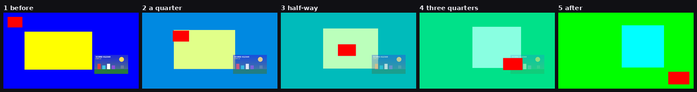</p>

### Morph between items

The same change inside one scene: when one item is hidden and another is shown at the same moment,
the one moves, resizes and turns into the other, instead of each fading where it is.

It happens whenever both items have **Morph (StageKit)** as their way of going and coming:

- in a StageKit filter that shows and hides items (Automatic Source Switcher, Show in Scenes, Program
  Trigger, Link Visibility), choose *Morph (StageKit)* under *Transition* or *Show transition*;
- or set it on the items yourself: right-click an item, *Show Transition* and *Hide Transition*.

Who hides and shows them does not matter: one filter, two filters, two Stream Deck keys in one
multi-action, or the eye in OBS's list, as long as it happens within a tenth of a second.

Which two go together follows the Morph transition's rules:

- **Linked sources** first: every link made in any Morph's settings counts, the ones under *Scene
  Transitions* and the ones made in a Show in Scenes filter. Links carry through one another.
- Then **the main image**: the largest item hidden and the largest item shown, when each covers
  at least 15 % of the screen. That is what pairs two captures in Automatic Source Switcher with no link
  at all. Untick *Morph the main image* to have only linked sources change into each other.
- An item **left over** still changes into (or out of) one that is already changing, by the same
  two rules; for the main image, both must cover at least a third of the screen. Hiding a
  full-screen camera to show a capture often brings the camera's corner view back as well: with the
  two cameras linked, the camera goes into its corner view, and the capture comes out of the camera
  too, instead of fading in by itself. Going back, both go into the camera. A panel beside the main
  image (a chat box, say) is never pulled into another item's change unless you link it.

OBS's log says which two items changed into each other and why, one line per change:
`Morph: 'DSLR' changes into 'Window Capture' in 'Live' (main image)`.

An item with nothing to change into goes by **Unpaired: show or hide**, under Morph in the filter's
settings (Show in Scenes, Link Visibility, Scene Transitions and the rest; per source with *Settings
for*) and in the Morph transition's own settings: *Fade* (as it comes), *Fade and zoom*, *Slide off
the nearest edge*, *Make room*, *Cut* (at once), or any other transition you have, such as *Fade and
Zoom (StageKit)*, *Swipe* or *Slide*, with that transition's own settings right under it (a slide or
swipe can go *Off the nearest edge* too). Every way but *Make room* stays inside the item's own frame,
as OBS's show and hide transitions do. *Make room* moves the item right off the screen, away from the
change under way in its scene ([Make Room](#make-room-transition)). Settings made before this read as before: *Fade and zoom* under *With nothing to
change into* (or *Unpaired: scene change*) is *Fade and zoom* here, and anything else a fade. That holds for an
item being shown as much as for one being hidden, over the same time as the change. (Up to beta155 an
item left over and being shown appeared all at once at the end of the change; in beta156 and beta157
the capture in the camera example above faded in where it is, and since beta158 it comes out of the
camera.)

Things to know:

- While a change lasts, a locked item named *Morph (StageKit, in progress)* is in the scene, straight
  above the two items; it draws the change and is taken out again after. You may see it flash by in
  the Sources list. It is put in a frame or two after the keys are pressed (longer if OBS is busy);
  until then the item being hidden stays as it is, and then the change runs over the time that is
  left.
- It works in the scene that is on screen and for items straight in the scene. An item inside a
  group, or in a scene that is not showing, fades instead.
- The two items are hidden and shown from the first moment, as far as OBS and everything else is
  concerned; only the drawing is taken over. A Fit to Space on the item that is shown places it as
  usual, and the change ends wherever that puts it.

<p align="center"></p>

### Fade and Zoom transition

A transition for single items and for scenes: **Fade and Zoom (StageKit)**.

- For an item, choose it under *Transition* or *Show transition* in a StageKit filter, or as the item's
  own *Show Transition* or *Hide Transition*. The item grows to its size as it fades in, and shrinks
  as it fades out.
- For a change of scene, add it with the plus in *Scene Transitions*. The scene you leave stays as it
  is underneath and the new one fades in over it as it grows.
- **Smallest size**: how small the image is when it is all but gone (80 % as it comes; 100 % is a
  plain fade). **Easing**: the same curves as everywhere else.

### Make Room transition

**Make Room (StageKit)** is the Morph transition with everything that has no partner making room for
what morphs in: each slides right off the screen, by the nearest edge away from the morph. It
is also a choice in Morph itself: *Make room* under *Unpaired: scene change* (a change of scene) and under
*Unpaired: show or hide* (an item's own Morph).

Which edge a source leaves by:

1. Take the middle of what morphs in: the places the paired sources go to in the new scene, each
   counted by its size. A pair that neither moves nor resizes is not morphing and does not count,
   nor does a background (what covers 90% of the screen or more).
2. Draw a line from that middle to the source's middle. Of the screen's four edges, only those
   that lie the way the line points are candidates: left of the morph, the left edge; above and to
   the right of it, the top and the right edge; never the edge towards the morph.
3. Of those, the source takes the one it has least far to go to be all off the screen.
4. With nothing morphing in, it simply takes the nearest edge.

A source that is only in the new scene comes in the same way the other way round: from the edge that
lies away from where the morph comes from in the old scene. A background only fades, as always.

As a **scene transition**, add it with the plus in *Scene Transitions*. Its settings are Morph's
pairing (*Morph the main image*, *Use visible pixels*, *Ignore shadows & outlines*, *Linked
sources*), the easing, and:

- **Make room by**: *Away from the morph* (as it comes) or *Nearest edge only*, which
  takes the nearest edge whatever morphs.
- **Fade while moving** (unticked as it comes): ticked, a source fades as it slides; unticked, it
  stays whole until it is off the screen.

As an **item's own show or hide transition** (in Show in Scenes, Link Visibility, Scene Transitions,
the switchers, or an item's own *Show Transition* and *Hide Transition*) it never pairs with another
item: the item slides off the screen when hidden and in from it when shown, away from whatever else
is shown or hidden in its scene at that moment (with any transition, within a tenth of a second),
or by its nearest edge when nothing else changes. Like Morph between items, a locked *Morph
(StageKit, in progress)* item draws it while it moves; in a scene that is not showing, or inside a
group, the item slides off its nearest edge inside its own frame instead. OBS's log has one line per
item: `Morph: 'Chat' makes room in 'Live', by the right edge (away from the change under way)`.

<p align="center">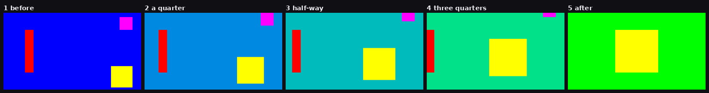</p>

### Scene filters

A scene filter sits on a scene, not on a source, and looks after the scene's sources together: one filter in
place of one per source. Add one from the scene's own Filters window (right-click the scene, *Filters*).
There are seven: **Scene Modes** (which sources show), **Scene Transitions** (how they show and hide), **Scene
Fit** (where they go), **Scene Standby** (the standby image in a capture's place), **Scene Corners**,
**Scene Shadow** and **Scene Blur** (how they look). They work together, and a Standby Image, Corners & Edges or Shadow, Glow &
Outline you put on a source yourself is left as it is. Five of them draw nothing, and Scene Shadow is
built to keep Morph working, so a scene carrying any of them still morphs. In a scene that is not on screen
they do as little as they can, and nothing at all while a scene collection loads.

Scene Transitions, Scene Fit, Scene Standby, Scene Corners and Scene Shadow each have a **Sources covered**
list that starts with **All sources**: every source in the scene, a group counting as one, and sources you add
later too, except the ones under **Ignored sources**. The Morph layer and Standby stand-ins are never counted.
Each filter starts on what it did before there was a choice (see each one below), so a filter you already
have keeps doing what it did.

#### Scene Modes

<!-- ==== scene-filters:modes (Scene Modes) ==== -->
**Scene Filter: Scene Modes (StageKit)** names a scene's modes and the sources of each: *Game*, *Window* and
*Display* in a live scene, say, or *Starting*, *Be right back*, *Intermission* and *Ending* in a holding
scene. One mode is on at a time. Turning a mode on hides the other modes' sources and shows its own.
A source in both the old and the new mode is left as it is (an image shown in Starting and Be right
back stays up), and a source in no mode is never touched.

- **Making modes:** one row adds a mode. Choose one under *From template* (Starting, Game, Display /
  Screen, Window, Camera, Chat, Intermission, Be right back, Ending), or type a name under *New mode
  name*, or both, and press *Add mode*. A template gives the mode its type, and its name when none is
  typed; both can be changed afterwards. No mode name is built in, and two modes may have the same name.
- **Settings for**: the mode whose group is shown. Only one mode's group shows at a time, so the
  settings under the modes are in reach. A mode added is the one shown; removed, the one before it.
- **Each mode** has a group of its own, headed *Mode: <name>*:
  - **Name**: renaming a mode keeps its sources, its hotkey and its Stream Deck keys.
  - **Mode type**: what it shows (Game, Handheld, Window, Camera, Chat, Starting and so on: every type the Stream Deck Scene Mode key offers). A Stream Deck
    *Scene Mode* key left on *Automatic* takes its image from this.
  - **Switch to scene**: a key or hotkey turning this mode on also changes OBS to that scene, unless
    the scene on screen is this filter's own scene or one under *Same modes in scenes*.
  - **Sources**: the sources shown while this mode is on. Sources inside groups, and groups, can be
    chosen.
  - **Hide when on**: other sources hidden in this scene when this mode comes on, with the mode's
    transition. They are not part of the mode: when another mode comes on they are not shown again,
    and nothing else is done to them.
  - **Leave when shown** and **Leave to**: while this mode is on, showing one of these sources (a
    Show in Scenes key, a Link Visibility, the eye) turns the mode under *Leave to* on (shown once a source is listed): *The mode
    before* (as it comes), *No mode* (only with *Allow no mode*) or another mode. The source that
    was shown stays shown, even when the next mode's *Hide when on* lists it (the log says so).
  - **Placed in this mode**, **Save their places now**, **Move duration** and easing: sources put in
    a place of their own when this mode comes on: position, size, crop and bounding box. They need
    not be the mode's sources; a music widget shown in two modes can sit under the chat in one and
    match the width of the handheld windows in the other. Turn the mode on, arrange the sources by
    hand, press *Save their places now* (in this scene and the scenes under *Same modes in scenes*).
    When the mode comes on they glide there (300 ms as it comes; 0 moves them at once; at once in a
    scene not on screen, for a hidden source and when OBS starts). Locked sources move too. A mode
    with nothing saved for a source leaves it where it is. A Fit to Space or Scene Fit on the source
    takes it where it was put, but may still adjust it by its own rules.
  - **Move up** and **Remove mode**. The order is the order of *next*. A mode removed leaves its
    sources as they are.
- **Mode now**: the mode that is on. Choosing another here turns it on, but never changes scene.
- **Allow no mode**: a *Toggle* key pressed on the mode that is on hides every mode's sources. Unticked
  (as it comes), it goes back to the mode before instead.
- **Same modes in scenes**: other scenes that follow this filter's mode, so one key works in two
  layouts alike. A key pressed while one of them is on screen stays in that scene.
- **Lock hidden sources**: each mode's source is locked while hidden, so a click in OBS's preview
  cannot pick a source stacked under the one you see.
- **Show/Hide transition**: how the sources come and go. With *Morph (StageKit)*, the capture of the
  mode going changes into the capture of the mode coming.

A source of a mode that is not on, shown some other way (the eye, an old *Source* key), is hidden
again at once. A source of the mode on that you hide stays hidden: a camera switched off stays off.
A camera switch (Show in Scenes) and a Standby filter's *Show when source is hidden* go by the modes:
the camera shows only in its own mode, and its standby image never covers another mode. The other
way round, a camera switch that is off does not stop a mode from showing the camera: a switch is a
command, not a lock. When a scene
has two Scene Modes filters, a source in both shows only while both have it on. In a scene that is
not on screen a change is a cut, so a hidden capture card is never opened for a moment when the scene
comes on.

**Two columns without marker sources.** A layout scene with a *Chat* mode (chat box, a small
camera) and a *GBA* mode (two handheld windows, a camera beside them), and a full-screen camera
(*DSLR*) that must never cover the GBA column: in the GBA mode set *Hide when on*: DSLR, *Leave when
shown*: DSLR and *Leave to*: Chat. GBA coming on hides DSLR; DSLR shown while GBA is on brings Chat
back, and DSLR stays shown. If you had kept the two apart with a Link Visibility (*Show only one*
between DSLR and a transparent *Column: GBA* marker), remove that Link Visibility, take *Column:
Chat* and *Column: GBA* out of the modes and out of the following sources of any other Link
Visibility (*Link Visibility-CaptureChat*, say), then delete the two marker sources.

**Keys:** the scene gets a hotkey for each mode (*StageKit: <filter>: <mode>*), one for the next mode,
and one for no mode while that is allowed. The Stream Deck *Scene Mode* key, and anything else that
speaks obs-websocket, uses these vendor requests:

| requestType | requestData | Response |
| --- | --- | --- |
| `ListSceneModes` | `scene?` | `filters: [{scene, filter, enabled, current, currentName, allowNone, modes: [{id, name, type}], scenes: [{name}]}]` |
| `GetSceneMode` | `scene`, `filter?` | `current`, `currentName`, `previous`, `previousName`, `enabled`, `allowNone`, `modes` |
| `SetSceneMode` | `scene`, `filter?`, `mode` (its id, or its name), `how?`: `on` (as it comes), `toggle`, `next` or `none` | none. It fails, with the reason, when the scene, the filter or the mode is not there, the filter is off, or no mode is not allowed |

A `SceneModeChanged` event (`scene`, `filter`, `mode`, `modeName`, `previous`, `previousName`) follows
every change of mode, and every change to the list of modes. A mode is known by an id that never
changes (`m1`, `m2`, ...), so renaming it breaks no key.
<!-- ==== end scene-filters:modes (Scene Modes) ==== -->

#### Scene Transitions

<!-- ==== scene-filters:transitions (Scene Transitions) ==== -->
**Scene Filter: Scene Transitions (StageKit)** is one place to set how every source in a scene shows and hides, instead of
a transition setting inside each filter. It sets OBS's own show and hide transition on each source (the ones
in a source's right-click menu), so they also hold when a source is shown or hidden with the eye, its
hotkeys, a Stream Deck *Source Visibility* key or obs-websocket.

- **Sources covered**: *All sources* (as it comes), or *Chosen sources*.
- **Sources with own settings** (with *All sources*): add a source here to give it a transition of its
  own, then choose it under *Settings for* in *Show/Hide transition*. Every other source uses the scene's
  transition. With *Chosen sources* the same list is called **Chosen sources**: only these sources get the
  scene's transition (and each can still have its own under *Settings for*).
- **Ignored sources** (shown with *All sources*): sources this filter never sets, such as one another tool animates. A source a
  Show/Hide Animation animates, and one a Standby Image stands in for, are always left to those filters.
- **Sources in groups**: also set the sources inside groups (off as it comes: a group is then one source
  like any other). OBS plays an inner source's transitions whenever its group is shown or hidden too, so a
  fade on both fades twice.
- **Override other filters** (off as it comes): every show and hide of a source this filter covers uses the
  scene's transition (or the source's own, under *Settings for*), whatever Link Visibility, Show in Scenes,
  Scene Modes, Program Trigger or a window switcher is set to. A source a Standby Image stands in for keeps
  the Standby's transition; ignored sources and sources a Show/Hide Animation animates are left alone.
- **Show/Hide transition**: the same control as Show in Scenes': a show and a hide transition, each with its
  own duration and settings (the way a slide goes, *Off the nearest edge*), settings of their own for listed
  sources, and Morph links. Fade, 300 ms, as it comes. With *Morph* chosen, Morph's own choices appear under
  it: *Unpaired: show or hide* (how a source with nothing to change into comes and goes, with that transition's
  own settings), *Morph the main image*, *Use visible pixels*, *Ignore shadows & outlines* and the easing;
  and *Linked sources*, in the same group, says which sources change into each other. They are handed to each
  source's Morph transition.

**If the scene's transitions seem to do nothing**: another filter is set to a transition of its own. A Link
Visibility or Show in Scenes set to Morph, say, uses Morph for every change it makes, and the scene's
transition only comes back afterwards. Either set those filters' *Show transition* to *As the scene sets*,
or tick *Override other filters* here.

**As the scene sets** is a new choice in every StageKit filter that shows and hides sources (Show in
Scenes, Link Visibility, Program Trigger, the two switchers, Standby Image), and the one they start with.
(Auto Capture's hide sets no transition: it uses the one the source carries.) With a Scene Transitions on
the source's scene, the change is the one set there; where the scene has none, it is a fade of the filter's
own duration, which is what those filters did before. A filter set to a transition of its own uses it for
the changes it makes, and afterwards the source carries the scene's transitions again. A Standby Image that
stands in for a source sets that source's transitions itself.

Switching the filter off or removing it leaves each source the transitions it has. It writes only when a
source differs from what it should carry, so nothing is written at each start. For a source set to *Off the
nearest edge* that is shown or hidden by hand (the eye, a Stream Deck key), the direction is the one worked
out where the source last came to rest: OBS starts the transition before StageKit hears of the change.
<!-- ==== end scene-filters:transitions (Scene Transitions) ==== -->

#### Scene Fit

<!-- ==== scene-filters:fit (Scene Fit) ==== -->
**Scene Filter: Scene Fit (StageKit)** does what a Fit to Space filter does, for several sources of the scene at once. Each source in
*Fitted sources* has the whole set of Fit to Space settings of its own (choose it under *Settings for*), and
starts from a gap of 30 px in the free space round its place.

Where it differs is the timing: the sources are worked out together, in the order of the list, before any of
them moves. When the camera is hidden or shown, a game changes shape or a widget starts to draw, every source
that has to make way sets off once, all at the same moment. With a Fit to Space per source each filter only
learns where the others are going a frame later, and they could shift a few times before settling.

- **Sources covered**: *Chosen sources* (as it comes: the sources under *Fitted sources*) or *All sources*.
  With *All sources* every source of the scene is fitted, a group counting as one and sources added later
  too: first the ones under *Fitted sources*, in their order, then the rest from the top of the scene down,
  each starting from the usual entry settings (in the free space round its place, a gap of 30 px, resized to
  fit, *Shares space*). Each one is under *Settings for* like a listed one, with its own *Space
  priority*; untick *Resize to fit* for a source that keeps its size. Left out: sources under **Never fitted** (they stay where they are, and the fitted sources keep clear of
  them), a source a Fit to Space of its own already fits, a source another Scene Fit of the scene lists (or
  every source, when an earlier Scene Fit has *All sources* too), and a source that covers 90% of the
  screen or more when it is first met, such as the background: it could only be made smaller, and the free
  space round a place inside it is never in its way. A source fitted once stays fitted however large it is
  fitted to. A source added on top of a fitted one is fitted once that one has made room for it.
  Switching back to *Chosen sources* leaves the others where they are.
- **Fitted sources**: the order matters. Put the sources that keep their size (a camera, a chat box) above
  the ones that are resized to fit (the game). With *Priority by list order* ticked, the order is also the
  priority: a source higher in the list takes its space first.
- **Settings are**: *Each source's own* (as it comes: every source has its own settings, chosen under
  *Settings for*) or *Shared by all sources*: one group of settings, *Space priority* included, for every
  fitted source, and no *Settings for*. Each source still keeps its own place and its own kept size.
  Switching either way moves nothing: the shared settings start as the first source's, and going back to
  *Each source's own* gives every source the shared settings.
- **Space priority**: each source's own (*Takes space first*, *Shares space*, *Makes room*), as in
  [Fit to Space](#fit-to-space), or the group's with *Shared by all sources*.
- **Priority by list order**: one switch for every source. Ticked, the sources' *Space priority* is greyed
  out; a source higher in *Fitted sources* takes its space first, and the Scene Fit counts at its place in the
  scene's filter list against any Fit to Space there that has the box ticked too. Towards the others it counts
  as *Shares space*.
- **Take over Fit to Space**: every Fit to Space switched on in this scene becomes an entry here, with all its
  settings, the place it keeps its source round and the size it keeps. Each filter is switched off, not
  deleted: switch it on again (and the Scene Fit off) to go back. Nothing moves. Taken into a Scene Fit with
  no sources yet, two or more Fit to Space filters with exactly the same settings make *Settings are* *Shared by
  all sources*; if their settings differ it stays *Each source's own*. Taken into a Scene Fit that is
  already *Shared by all sources*, they go by its settings.
- **Overlap only when it fills**: one switch for every entry; each entry's own rules (*Use fill percentage*,
  *Use edge gaps*) say when. A *Fit to Space Overlap* key on the Stream Deck works on a Scene Fit too.
  The rules are in each source's settings (under *Settings for*): they show with *Fit area* on *Free space
  around source*, and with *The whole screen* or *A box I set* once that source's **Make room if not
  filling** is ticked (see Fit to Space).
- **Ignored for this source** and **Sync to scenes** are the entry's own lists, as in Fit to Space.

- **Ignored for this source** and **Sync position to scenes** are the entry's own lists, as in Fit to Space.

**Groups of sources.** To give several sources one set of settings, and other sources another, add one Scene
Fit per group to the scene, each on *Shared by all sources* with its own *Fitted sources*. For example:

1. A Scene Fit named *Captures* listing the game and window captures, *Settings are* *Shared by all sources*,
   *Space priority* *Takes space first*.
2. A second Scene Fit named *Camera and chat* listing the camera and the chat box, *Shared by all sources*,
   *Resize to fit* unticked if they keep their size, *Space priority* *Makes room*.

The captures then take their space as if the camera and chat box were not there and never shrink for them; the
camera and chat box fit round the captures, and the captures never cover one that keeps its size. Within one group the sources share space with each other. With
*Priority by list order* ticked on both, the Scene Fit higher in the scene's filter list goes first instead.
List each source in one group only.

Do not give a listed source a Fit to Space of its own as well. Off screen, Scene Fit (and Fit to Space) look at
their sources only four times a second and put everything right the moment the scene comes on. A Multiview or
a projector counts as on screen.
<!-- ==== end scene-filters:fit (Scene Fit) ==== -->

#### Scene Standby

<!-- ==== scene-filters:standby-corners (Scene Standby) ==== -->
**Scene Filter: Scene Standby (StageKit)** sets the standby image once for the sources of a scene: any empty capture shows
the image, and any source you list shows it in its place while it is hidden, without setting up a filter on
each capture by hand.

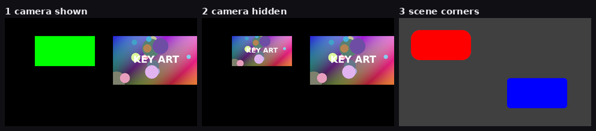

It does not draw anything itself. It adds a **Standby Image** filter to each source it covers and sets it from
the scene filter. That filter says *Set by Scene Standby in <scene>* and leaves out the image controls,
which are set in the Scene Standby.

- **Sources covered**: *All sources*, *Every capture* (as it comes: each game, window and camera capture in
  the scene, groups included) or *Chosen sources*. With *Every capture*, screen captures (which always have
  an image) are left out unless you tick *Include screen captures*. *All sources* covers every source with
  an image of its own, the ones inside groups too, sources added later and screen captures included; an
  empty one (a capture with nothing attached, a stopped video, a text with no words) shows the image. Groups,
  nested scenes and the source used as the image are not covered. *Ignored sources* are left out of both.
- **When a source has no image** (a group with its own tick box, ticked as it comes; it was *Show when no
  image*): an empty capture (no game or window attached, no camera signal) shows the image. The group holds
  the *No-signal transition*, the two durations, the easing and *Animate the size change*.
  The image goes with the source into every scene it is in, as a Standby Image filter of its own would.
- **When a source is hidden**, the second group, holds **Show when hidden**: the sources whose place the image takes **in this scene only** while they are
  hidden, with the *Show/Hide transition* in the same group as the one change between the source and the image (with
  Morph, the one changes into the other). Leave out captures that are hidden on purpose, such as the
  stacked captures of a layout scene.
- **Image** and **Keep image's aspect ratio**, above both groups, and the controls in the first group are
  the Standby Image filter's own controls.

A source that already has a Standby Image filter you made keeps it, and Scene Standby leaves it alone. To go
without the image on one source, switch its filter off with the eye: Scene Standby does not switch it on
again. When a source stops being covered, its filter is taken off a few seconds later. If no Scene Standby
uses a filter any more (the scene filter was deleted), the filter shows nothing and says so; you can remove it.
When two scenes' Scene Standby filters cover the same source, its filter follows the one it names, and the
other takes it over if that one is removed.
<!-- ==== end scene-filters:standby-corners (Scene Standby) ==== -->

#### Scene Corners

<!-- ==== scene-filters:standby-corners (Scene Corners) ==== -->
**Scene Filter: Scene Corners (StageKit)** puts the same corners and edges on the sources of a scene, set once. It adds a
**Corners & Edges** filter to each source it covers and sets it from the scene filter; that filter says *Set by
Scene Corners in <scene>*. Corners & Edges never changes a source's size, so nothing in the scene moves and
Morph still morphs the scene.

<p align="center"></p>

- **Applied to**: *Each source by itself* (as it comes, and what every Scene Corners saved before does) or
  *The screen's edges*. With *The screen's edges* the scene's own image gets the look at the edges of the screen, as one
  shape: rounded or cut corners, softened edges, a line round it. The sources inside are left exactly as they
  are and get no filter; any filters Scene Corners had added are taken off a few seconds later (and come back
  if you go back to *Each source by itself*). Sizes are screen pixels. Scene Corners then draws, so it keeps itself after
  a Scene Shadow and a Scene Blur in the filter list (it moves itself there within half a second), and Morph
  still morphs the scene: the shape goes with the change, part-way between the two scenes' shapes (to a scene
  without it, the corners shrink away).
- **Sources covered**: *All sources*, *All but the background* (as it comes) or *Chosen sources*. *All
  sources* is every source in the scene, a group counting as one, the background too. *All but the
  background* is the same with **Full-screen = background**: sources at the bottom of the scene that cover
  90 % of the screen or more are left out. *Ignored sources* are left out of both.
- The look (**Style**, **Size**, the four corners, **Inset**, **Softness**, the line, **Sizes in screen
  pixels**) is the Corners & Edges filter's own.
- Switching Scene Corners off switches its filters off, and on again (with *The screen's edges*, the shape goes
  at once).

A source with a Corners & Edges you made keeps it and is left alone. A filter whose source is no longer covered
is taken off a few seconds later. If its Scene Corners is deleted, the filter keeps working as one of your own,
and says so.
<!-- ==== end scene-filters:standby-corners (Scene Corners) ==== -->

#### Scene Shadow

<!-- ==== scene-filters:shadow (Scene Shadow) ==== -->
**Scene Filter: Scene Shadow (StageKit)** gives every source of a scene one shadow, glow or outline, set once, instead of a
Shadow, Glow & Outline on each source.

<p align="center"></p>

- The scene is drawn as OBS draws it, and the shadow is laid over it. **Nothing is resized or moved**: the
  sources keep their size, so Fit to Space, the arrange tools and Morph work as they do without it.
- **Applied to**: *Each source by itself* or *The scene as drawn* (as it comes, and what every Scene Shadow
  saved before does).
  - *The scene as drawn*: sources that overlap make one shape with one shadow and one outline round it, and the
    shadow falls on the background, never on a source.
  - *Each source by itself*: every source gets its own shadow, glow and outline, as a Shadow, Glow & Outline
    on each source would give it. A source's shadow falls on whatever lies under it, other sources included
    (a camera's shadow on the game under it), and the sources above it cover it. Sources side by side cost no
    more than with *The scene as drawn*; each pile of overlapping sources is drawn in a few more passes.
    Morph carries it too; a change between a scene shadowed one way and a scene shadowed the other way is a
    cross-fade (the log says so).
- **Shadow or glow** and **Outline** have the same settings as Shadow, Glow & Outline (type, colour or the
  image's own colours, opacity, offsets, softness, strength, colour boost, intensity; outline width, colour,
  opacity and corners). Sizes are in canvas pixels, so the same number gives the same width as a Shadow, Glow
  & Outline in screen pixels. As there, the drop shadow is thrown by the sources with their outline, so it
  has the outline's corners. Morph keeps an outline solid through a change for a source in both scenes,
  and fades it with a source that comes or goes.
- **Background sources**: drawn underneath as they are; they cast nothing and the shadow falls on them.
  **Full-screen = background** (on as it comes) counts the sources at the bottom of the scene that cover nine
  tenths of it as background, so the scene's picture or colour needs no listing.
- When a fitted source leaves just one pixel between its opaque image and the canvas edge, Scene Shadow
  leaves that pixel clear of the outer outline. A gap of two pixels or more keeps its outline.
- **Sources covered**: *All sources* (as it comes: every source that is not background casts, sources added
  later too) or *Chosen sources*: only the sources listed cast. With *The scene as drawn* the shadow is kept
  off every source that is not background.
- **Ignored sources**: sources that cast nothing (with *The scene as drawn* the shadow is still kept off them).
  A source with a Shadow, Glow & Outline filter of its own keeps that one and casts nothing here, so no source
  gets two.
- A source fading in or out with its show or hide transition takes its shadow with it. A Standby stand-in has
  the shadow of the source it stands in for.
- **Switch duration** and **Easing**: switched on or off (the eye, a hotkey, a Stream Deck filter key), the
  shadow fades in or out.
- **Morph keeps morphing.** A scene whose only filter that draws is a Scene Shadow is still morphed source by
  source, and the shadow goes with the change: part-way, it is part-way between the two scenes' shadows (to a
  scene without one, it fades out), and a source that casts in one scene and not in the other gains or loses
  its shadow on the way. One source changing into another inside the scene (Morph as a show or hide
  transition) has its shadow too.

What to know:

- With *The scene as drawn*, sources that overlap make one shape: one does not shadow another. Where a shadow
  must fall on another source (a camera over a game), choose *Each source by itself*.
- At a see-through edge of a source the background under it is darkened very slightly differently from a
  shadow drawn under that source alone. A crop to the item's bounding box is not followed by the shape (as in
  Morph).
- Put Scene Shadow last in the scene's filter list. With a filter that draws (a blur, a colour correction)
  before it, it draws nothing and says so once in the log. It also stands aside while a scene collection loads,
  on a group, and on a canvas in a wide colour space (HDR).
- Its shader has only been run on OpenGL here. If the log has an error about `stagekit-scene-shadow.effect`
  on Windows, the scene is drawn without the shadow; please send the log.
<!-- ==== end scene-filters:shadow (Scene Shadow) ==== -->

#### Scene Blur

<!-- ==== scene-filters:blur (Scene Blur) ==== -->
**Scene Filter: Scene Blur (StageKit)** blurs a scene's sources, in that scene only: switch it on for a "be right back"
over the game, say, and the same game in your other scenes stays sharp.

<p align="center">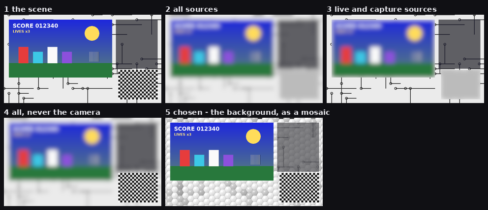</p>

<p align="center">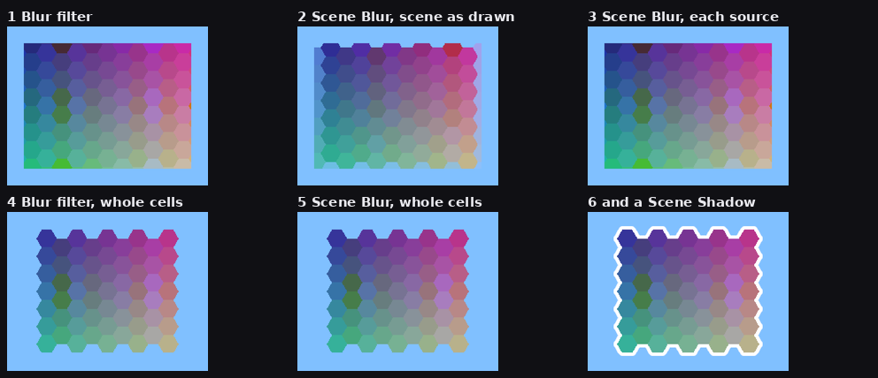</p>

- **Sources covered**: *All sources* (as it comes), *Live and capture sources* (game, window, display and
  camera captures, capture cards and media: what the Blur filter's *And live captures on screen* counts as
  live, also by way of a Cropped View, a group or a nested scene), or *Chosen sources*, with the **Chosen sources** list
  listing them.
- **Never blur these**: sources that stay sharp whatever is chosen above (your camera). A Cropped View of a
  listed source stays sharp too.
- A source above a blurred one that is not blurred stays sharp, and the blur under it does not smear its
  colours: the camera over a blurred game stays a clean camera.
- **Applied to**, the first control: *The scene as drawn* (as it comes) blurs the finished scene and keeps the blur to where the
  chosen sources show, and the blur takes in only what lies where they show: a blurred source's edge takes in
  nothing of an unblurred background round it, so its shadow or outline sits right against it. A mosaic's
  cells are laid out over the whole screen. With *All sources* the background is blurred too, so along a
  source's edge the blur mixes it with the background as the scene shows them. *Each source by itself* blurs every chosen source from its own image only, as a Blur
  filter on that source would: its edges take in nothing around it, a mosaic is laid out over that source,
  and *Mosaic edge* is offered (*Whole cells*: the source's outline is made of whole cells). With the same
  settings it looks the same as the Blur filter on the source, edges included. *Whole cells* leaves the screen's
  edge alone: where a source reaches or runs past the screen's edge (a full-screen background, say) its cells
  there are kept, since the screen cuts them anyway. *Mosaic edge* is only used with *Each source by itself*:
  left on *Whole cells* and switched back to *The scene as drawn*, it changes nothing.
- **Blur** and **Timing**: the Blur filter's own settings: Gaussian, Dual Kawase, Box, Pixelate (seven cell
  shapes, smoothing, glass, and with *Each source by itself* the mosaic's edge), Radial, Motion and Temporal;
  strength up to 1000; *Blur transition* (grow the strength, or fade the blurred image in), *Blur-in
  duration*, *Blur-out duration* and *Easing*.
- Switched on and off like any filter: the eye, a Stream Deck key, and three hotkeys on the scene,
  *StageKit: (filter name): toggle*, *switch on* and *switch off* (Settings, Hotkeys, under the scene). It blurs in and
  out over its durations. A Scene Blur that was on when OBS closed is on again at start, without blurring in.
- **Nothing is moved, resized or added**: the scene is drawn as OBS draws it and the blur is laid over it where
  a chosen source shows. Switched off, it costs nothing; on, it draws the scene's sources once or twice more
  each frame and blurs the picture, and it reads nothing back from the graphics card. With *Each source by
  itself* it blurs each chosen source's own image (smaller than the screen, so often cheaper) and draws the
  scene's sources once more, inside the chosen sources' boxes only where it is laid over the scene.
- **Morph**: a change of scene from or to a scene while its Scene Blur blurs is a cross-fade, so the blur stays
  on screen all the way. With the blur off (or with nothing in the scene to blur), the scene is morphed source
  by source as before.
- **Stream Deck**: the *Scene Blur* key switches the Scene Blurs of one name, on one scene or on every scene
  that has one. See [Stream Deck plugin](#stream-deck-plugin).
- **Remote control**: `ListSceneBlurs` lists them by name, with their scenes; `SceneBlur` with `filter`,
  `scene` (empty: every scene with that name) and `how` (`on`, `off`, `toggle`; none: only asks) switches them
  and answers `active` and each one's state; a `SceneBlurChanged` event (`scene`, `filter`, `active`) follows
  every change. See [Remote control](#remote-control).

What to know:

- The blur stays inside the shape of what shows of a blurred source; a Blur filter on the source itself
  spreads past a see-through edge. A group or nested scene is blurred, or kept sharp, as one source.
- With a Scene Shadow on the same scene, in whichever order you add them, Scene Blur puts itself after the
  shadow by itself. Blurring *the scene as drawn*, the shadows are blurred with what they fall on. Blurring
  *each source by itself*, the shadows stay sharp, and a blurred source's shadow, glow and outline take the
  blurred image's shape: with *Whole cells*, the shadow's edge is made of the same cells. With another filter that draws before
  it (a colour correction), it draws nothing and says so once in the log: put Scene Blur after such filters.
  It also stands aside while a scene collection loads, on a group, and on a canvas in a wide colour space
  (HDR).
- Its shaders have only been run on OpenGL here. If the log has an error about `stagekit-looks.effect` on
  Windows, Scene Blur draws nothing; please send the log.
<!-- ==== end scene-filters:blur (Scene Blur) ==== -->

### Remote control

With obs-websocket, send `CallVendorRequest` with `vendorName: "StageKit"`:

| requestType | requestData | Response |
| --- | --- | --- |
| `GetVersion` | none | `version`, `features` |
| `ListBlurFilters` | none | `filters: [{sourceName, filterName, active, level, blurType}]` |
| `BlurOn` / `BlurOff` / `BlurToggle` | `sourceName`, `filterName?`, `durationMs?` | the filter's new state |
| `SetBlur` | `sourceName`, `filterName?`, `active`, `durationMs?` | the filter's new state |
| `BlurAll` | `mode?`: `on`, `off` or `toggle` | `active` |
| `HookFront` | `sourceName`: a Game Capture or a Window Capture; `transition?`: an OBS transition's kind or `none`; `transitionMs?` | `executable`: the program in front, which the capture now takes. An Auto Capture on the source is switched off |
| `SetPictureShape` | `sourceName`: a source with an Auto Frame; `shape`: `4:3`, `8:7`, a number, or `auto`; `untilGone?` (true unless given): drop it when that game's capture ends | none |
| `GetOptions` | none | The dock's switches: `snap`, `guides`, `limit`, `slide`, `everyScene`, `keepShape` |
| `SetOption` | `option`: one of those names; `mode?`: `toggle` (unless given), `on` or `off` | `on`: which way it is now. An `OptionsChanged` event with all six follows every change |
| `Slide` | `direction`: `left`, `right`, `up`, `down`, `up-left`, `up-right`, `down-left`, `down-right` or `centre` | none. Slides the item the dock is on, as its arrows do |
| `ListSceneBlurs` | `scene?` | `filters: [{filter, type, style, active, scenes: [{scene, active}]}]`, each name once (`style`: the Stream Deck Blur style entry, such as `gaussian`, `trail`, `mosaic_circle`, `glass`); `blurs: [{scene, filter, type, style, active, enabled}]` |
| `SceneBlur` | `filter`; `scene?` (empty or none: every scene with a Scene Blur of that name); `how?`: `on`, `off` or `toggle` (all off when any is on, else all on); none only asks | `active`, `blurs: [{scene, filter, type, active, enabled}]`. A `SceneBlurChanged` event (`scene`, `filter`, `active`) follows each change, however it was made |
| `StandbyCover` | `sourceName`; `filterName?` (none: the source's first enabled Standby Image); `how?`: `on`, `off` or `toggle` (none only asks) | `filterName`, `covered`, `enabled`. The Standby Image shown over the source on purpose, or taken away, with that filter's own transition; any source (a camera, a capture card). Refused for a filter that is switched off. A `StandbyCoverChanged` event (`sourceName`, `filterName`, `covered`) follows each change, however it was made (the hotkey, the button, a switcher's or Show in Scenes' hide, a key) |
| `GetStandbyCover` | `sourceName`, `filterName?` | `filterName`, `covered`, `enabled` |
| `ShowInScenesPress` | `sourceName`, `filterName`: a Show in Scenes; `how`: `toggle`, `on` or `off`; `hideAs?`: `filter` (none: as its *Hide shows Standby Image* says), `hide` or `cover` | `enabled`: the switch afterwards. Switches the filter as any key does, and that one press hides its sources the way `hideAs` says; the press that shows them undoes it (uncovers what was covered, shows what was hidden) |

Every response has `success` and, on failure, `error`. A `BlurChanged` event is sent when a blur turns
on or off. The other tools are filters, so the standard `SetSourceFilterEnabled` request triggers them.

## Stream Deck plugin

StageKit has its own plugin for the Elgato Stream Deck. It is new and **has not been run on a real
Stream Deck yet**; Elgato's OBS Studio plugin and its *Filter* and *Source* keys keep working as
before, side by side with it.

**Install:** download `stagekit-<version>-streamdeck.streamDeckPlugin` from the release page and
double-click it. Stream Deck (7.1 or later) asks whether to install it; the keys then appear under
**StageKit** in the list on the right.

**Connect it to OBS once:** in OBS, *Tools → WebSocket Server Settings*, tick *Enable WebSocket
server*, and press *Show Connect Info* for the port and password. In Stream Deck, drop a StageKit key
on a button, open **OBS connection** at the bottom of its settings and fill in the port and password
(the address stays `127.0.0.1` when OBS runs on the same computer). Every StageKit key uses that one
connection, and it reconnects by itself when OBS is started later.

There is one key for each feature, under **StageKit** in Stream Deck's list. Each has one list to
choose from, holding only what that key is for.

**What does my key work with?** The first row of every key's settings, **Works with**, says it:

- On a key that works a filter, the kind of filter exactly as OBS's Filters window names it, such as
  *Source Filter: Show in Scenes (StageKit)*, and under it the filter the key is set to, such as
  *Square Camera — Show in Scenes-Camera*, or *(choose one below)*. A key that can work several kinds
  (Manual Window / Source, Fit to Space Overlap) names the chosen filter's own kind once OBS is
  connected. In OBS, right-click that source or scene and choose *Filters* to find it.
- On the other keys, what they work: *OBS scenes* (Switch Scene, with the scene chosen), *OBS
  streaming* (Stream), *OBS recording* (Record), *A Game Capture or Window Capture* (Capture Active
  Window, with the capture chosen), *StageKit dock: Arrange tools* (Arrange tool), *StageKit dock:
  Options* (Dock Option) and *StageKit dock: Slide to the next edge* (Slide to Edge). Blur All
  says *Source Filter: Blur (StageKit)*, every one with *Include in Blur All* ticked.
- *(not found in OBS)* after what a key is set to means OBS has no such filter, capture or scene now
  (renamed or removed): choose it again. With OBS closed the row says the kind and what the key was
  set to.

The list that picks the filter is called *Source and filter* (*Scene and filter* on a key for a
filter on a scene), and each entry reads *source — filter*: the source (or scene) and the filter's
name exactly as OBS's Filters window shows it, with its kind in brackets when the name does not say
it, such as *Window Capture — Apps (Automatic Window Switcher)*. Its tooltip names the kind of filter
to look for. The Scene Mode key's list names the scene and its Scene Modes filter (*Standby — Holding
modes*); the mode is chosen under it. Keys made before keep working: only the wording changed.

#### Covering a camera with its Standby Image

To show an image in a camera's place without the camera's spot going empty (a capture card or a
display capture works the same way):

1. In OBS, add **Source Filter: Standby Image (StageKit)** to the camera (right-click it, *Filters*), and choose its
   image and its *No-signal transition*, which is the change used to cover and uncover.
2. Either: in the camera's **Show in Scenes** filter, tick *Hide shows Standby Image*, and use its
   Show in Scenes key as before: hiding covers the camera with the image, showing takes it away. With
   one Show in Scenes shared by several keys, each key's *When hiding* chooses for its own presses:
   *As the filter says* (as it comes), *Hide the sources* or *Cover with Standby Image*.
   For a camera key whose switch lists several camera views, some of them hidden on purpose in some
   scenes (a full-screen DSLR in the component layout), also tick *Show only what it hid* and *Follow
   what is shown*: a press hides only the views that were showing, and the next press brings back
   exactly those, so a hidden view is never shown and a Link Visibility never reacts to it.
3. Or: drop a **Standby Image** key, choose *Camera — Standby Image* and set *On press* to *Cover:
   toggle* (or *Cover with image* / *Uncover*). The key is lit while the image covers the camera.

The image covers the source the Standby Image filter is on, everywhere it is drawn, Cropped Views of
it included; to cover one view only, put the filter on that view.

Key images carry no words: each key sets its own title from what it does and the options you
choose (*Manual / Auto*, *Blur Off*, *Slide Up Left*), and a title you type in Stream Deck takes its
place. Left on *Automatic*, a key's image is the one for its filter and its options; every
option has one.

**Type lists, in place of the Image list.** Each key has a list, or two, of what it is for, and its
image follows what you choose there. The types are general (no list is about one particular
stream), each has its own image, and no list shows the same image twice. Every list starts with
*Automatic*, the key's image as it comes. The images are the icon pack's own where the pack has one
that fits the type and what the key does (a Show in Scenes key's camera with the eye over it, a
Shadow key's game with its shadow, a Blur key's window blurred in the blur's style, a Switch Scene
key's gameplay-with-chat layout), and drawings in the same style for the rest.

**Any image on any key.** The types that fit the key come first; after them every other source
type (*More: ...*) and every scene image, the pack's scene layouts included (*Scenes: ...*), so a
Show in Scenes key for a start screen can show the *Starting soon* scene image. On Switch Scene and
the other scene keys the scene types come first and every source type after them (*Sources:
...*). An image already offered higher up is not repeated.

| Key | List | What it offers |
| --- | --- | --- |
| **Show in Scenes** | Source type | What a source can be, in seven groups: *Captures & games* (Game, Retro game, Emulator, Console, Handheld, Linked handheld screen, Second linked handheld screen, Capture card internal and external, HDMI source, Window, Browser, Display, Second display, Tablet, Phone screen), *Apps* (Art app, 3D app, Sculpting app, CAD app, Code editor, Office / documents, Video player, Reference board), *Cameras* (Camera / webcam, DSLR / mirrorless, Camcorder, Action camera, PTZ camera, Facecam, Full-screen, Side, Phone, Desk / overhead and Virtual camera), *Devices & audio* (Gaming PC, Laptop, Retro console, Controller, Stream controller, Pen display, VR headset, Headset, Microphone, Speakers, Audio mixer, Key light, Green screen), *Overlays* (Chat, Voice chat, Music, Alerts, Events / goals, Countdown, Title / text, Image, Video, Logo, Standby image), *Status & holding screens* (Live / on air, Recording, Paused, Muted, Offline, Camera off, Raid / host, Starting soon, Be right back, Intermission, Technical difficulties, Ending) and *Layout markers* (Chat column, Handheld column) |
| **Shadow, Glow & Outline** | Shadow style, Source type | *Shadow style*: Soft, Hard and Long shadow; Glow, Neon, Outline, Panel (*Automatic*: the filter's own look). *Source type*: the types the pack has a shadow image of |
| **Blur** | Blur style, Source type | *Blur style*: *Blurs* (Gaussian, Box, Dual Kawase, Zoom blur, Motion blur, Trail) and *Mosaics* (Square, Hexagon, Circle, Triangle, Voronoi, Rhomboid, Triakis, Glass). *Source type*: the types the pack has a blurred image of, drawn in that style (or the nearest style the pack has) |
| **Blur All** | Blur style, Scene type | *Blur style* as on the Blur key. *Scene type*: what is blurred, as on Switch Scene; with one chosen, the blur style is drawn in its corner |
| **Scene Blur** | Blur style, Scene type | As on Blur All. On *Automatic*, the blur style is the one the filter is set to |
| **Corners & Edges** | Corner style | *Corners*: Rounded, Cut, Notched, Scooped. *Edges*: Soft, Outlined, Trimmed |
| **Show/Hide Animation**, **Link Visibility**, **Automatic Source Switcher**, **Automatic Window Switcher** | Transition | Fade, Cut, Slide, Swipe, Wipe, Zoom, Morph, beside the key's Scene type or Source type (which comes first when both are set) |
| **Zoom**, **Standby Image**, **Auto Capture**, **Auto Frame**, **Automatic Window Switcher**, **Program Trigger** | Source type | The types that make sense for that feature (captures, devices and cameras for Zoom and Standby Image, games for Auto Capture and Auto Frame, programs for the switcher and the trigger) |
| **Scene Mode** | Image (each mode's, under *Mode settings*) | Status and holding screens, layouts (Game, Console, Linked handheld screen, Capture card, Window, Display, Tablet, Camera: the icon pack's scene image of that layout), apps, the layout markers and activities (Speedrun, Music production, Cooking, IRL / outdoors, Tutorial, Unboxing, Fitness, Reading, Watch party, Charity, Just chatting, Podcast, Interview / guest). *Automatic* takes the mode's *Mode type* in OBS (for a key set up earlier with a key-wide Mode type, that type for the key's own mode) |
| **Switch Scene**, and the keys for a filter on a scene (Fit to Space, Scene Fit, Link Visibility and the rest), **Fit to Space Overlap**, **Apply Layout**, **Stream**, **Record** | Scene type | *Holding & status* (Starting soon, Countdown, Be right back, Intermission, Technical difficulties, Ending, Holding screen, Paused, Offline, Camera off, Raid / host), *Games* (Gameplay, Gameplay + chat, PC game, Retro gaming, Classic gaming, Speedrun, Emulator, Console, Console + handheld link, Capture card, Capture card + chat), *Apps & screens* (Window / app, App + chat, Desktop, Second screen, Browsing), *Creative* (Tablet / drawing, Art / design, 3D modelling, Coding, Music production), *Camera & talk* (Just chatting, Camera only, Interview / guest, Podcast, Live music, Tutorial), *IRL & lifestyle* (IRL / outdoors, Cooking, Fitness, Reading, Unboxing, Watch party, Charity), *All in one* (On air, On air + chat). On a Switch Scene key *Automatic* goes by the scene's name; on the others it shows the filter's own image |
| **Move Source**, **Move Scene Item** | Position, Source type | *Position*: every place the filter can send a source: the nine places on the screen, *Saved spot* (the source's own saved place) and *Spot on the screen* (the same spot in every scene, as the dock's slides use; *Automatic*: where the filter sends the source). *Source type*: what is moved (cameras, overlays such as Chat, Alerts, Music, Logo, Title, games, windows, apps) |
| **Capture Active Window** | Capture type, Source type | *Capture type*: Game, Window (*Automatic*: by the kind of capture chosen); the key's title follows it. *Source type*: what it takes (Game, Retro game, Emulator, Window, Browser, the apps, Chat, Voice chat, Music) |
| **Manual Window / Source** | Source type, beside *On press* | What the capture or the scene switches between: Window, Browser, Game, Retro game, Emulator, Console, Capture card, Display, Linked handheld screen, the apps, Chat, Voice chat, Music and the cameras |
| **Arrange tool**, **Slide to Edge**, **Dock Option** | Source type, beside *Tool*, *Slide* or *Option* | What is lined up, slid or placed: the cameras, the overlays, games, windows, browsers, displays and the apps |
| **Set Aspect Ratio** | Source type, beside *Ratio* | What is framed: Game, Retro game, Emulator, Console, Retro console, Handheld, Linked handheld screens, Capture card internal and external, HDMI source, Window, Display, Gaming PC, VR headset |

Hold the pointer over a list's name for a line on what it does.

**A type and what the key does, both on the image.** On a key that has both (a step, a tool, a
slide direction, an aspect ratio, a dock option, a kind of capture, a blur style or a destination
besides its type), choosing a type shows that type's image with what the key does drawn small in
the top right corner, in the same style: a switch for *Toggle*, a play-to-bar for *Next*, a
turning-back arrow for *Return to automatic*, the eye crossed out for *Hide*, an arrow to the edge
for a slide, a frame of the ratio's shape for an aspect ratio, a little screen with the source at
that spot for a move, the tool's or option's own drawing, the capture's corners with a game or a
window, the blur style. A Move Source or Move Scene Item key also shows, in the top left corner,
what else its filter does: a source brought along (with arrows both ways when it is flipped round
the moved one), or the move made in the scene on screen or a chosen scene only. On a key that shows
whether it is on, the green dot or red sign stays in the top left corner. Left on *Automatic*, the
type list changes nothing: the key shows exactly the image it showed before.

**Layout: the image alone, live, or live with chat.** Every key with a *Source type* or *Scene
type* list has a *Layout* list just above it, so the layout is chosen first and the type second
(on the Scene Mode key, each mode's *Layout* sits above its *Image*, under *Mode settings*):

| Layout | The key's image |
| --- | --- |
| *Automatic* (as it comes) | Exactly what the key showed before: nothing changes on a key you already have |
| *Standalone* | The type's image by itself. A scene type that is a layout already (Gameplay, Gameplay + chat, Capture card, Capture card + chat, Window / app, App + chat) shows its drawing alone: the gamepad, the capture card, the window |
| *Live (no chat)* | The icon pack's live layout: the hexagon frame, the type's drawing in the big panel and a small camera in the top right corner |
| *Live + chat* | The icon pack's layout with chat: the type's drawing in the panel on the left, a camera over a chat column on the right |

Every layout image is the same template, with the camera in the same place, whatever the type:
only the drawing in the panel changes. Every source type and scene type with a drawing has its own
pair, in all six palettes. Drawings sit in the middle of their frame or panel, and no type shows a
program's logo or letter (the 3D, sculpting and CAD app types are a wireframe cube, a bust with a
sculpting tool, and a set square with a ruler). A key showing the type with its function (a Show in Scenes key's eye, a Shadow key's
shadow, a Blur key's blur) shows the type's drawing in the layout. An image with no drawing of its
own (the standby image, a key left on *Automatic* type, an image kept from the old *Image* list) is
shown smaller inside the layout's panel. The corner badge and the green dot or red sign stay on
top, as on any key.

**Keys made before (Stream Deck plugin 0.18 and earlier)** keep their look. An image chosen in the
old *Image* list is set as the type that shows that same image where there is one, and is otherwise
kept as it is, until you choose something in one of the key's lists (*Automatic* included). An old
*Source type* choice on *Capture Active Window* or *Manual Window / Source* (Stream Deck plugin
0.18) is the type in their new *Source type* list, so those keys now carry their capture kind or
step as a corner badge too.

**Editable SVGs:** `streamdeck/svg/` holds every image drawn in this repository as SVG, with the
drawing as shapes in a layer of its own (see its README). The original icon pack's own images
exist here as PNGs only.

**Every key that switches something shows which way it is**, whatever switched it (the key, OBS,
a hotkey, another key): a **green dot** in the corner while it is on, a **red "no" sign** in the
same corner, the image a little greyed, while it is off. That is every feature key, *Blur All*,
*Dock Option*, *Fit to Space Overlap*, *Scene Mode*, *Scene Blur*, *Stream*, *Record*, and *Manual Window / Source* set to *Toggle* (on: a manual window is shown) or *Hide*
(on: the capture is shown). Stream Deck no longer flips such a key's image by itself when it is
pressed, so it never flashes the wrong one.

| Key | What it does |
| --- | --- |
| **Blur**, **Shadow, Glow & Outline**, **Corners & Edges**, **Zoom**, **Auto Capture**, **Auto Frame**, **Standby Image**, **Show in Scenes**, **Fit to Space**, **Automatic Source Switcher**, **Automatic Window Switcher**, **Program Trigger**, **Link Visibility**, **Show/Hide Animation**, **Scene Fit**, **Scene Shadow**, **Scene Corners**, **Scene Standby** | Switches that feature on a source (or scene) on and off, and the key shows which way it is, also when it is switched some other way. *On press* can be *Toggle*, *Switch on* or *Switch off*. The **Standby Image** key's *On press* also has *Cover: toggle*, *Cover with image* and *Uncover*: its image over the source now, whatever the source shows, lit while it covers. The **Show in Scenes** key's *When hiding*: *As the filter says*, *Hide the sources* or *Cover with Standby Image* |
| **Scene Mode** | Works one scene's *Scene Modes* filter. *Scene and filter* lists the filters by scene and the filter's name (*Standby — Holding modes*, *Chat Live — Captures*), the name to look for under the scene's Filters in OBS. *On press*: *Switch on* (as it comes) or *Toggle* the mode chosen under *Switch to mode* (Toggle pressed while its mode is on goes to no mode where the filter allows that, else back to the mode before), *Switch off* (no mode; the filter must allow no mode), or *Next mode*: the next mode in the filter's order, round again after the last, passing over the modes left out under *Use in Next*. With more than two modes, *Toggle* only goes between its own mode and the one before it; to go through all of them, use *Next mode*. *Long press* (*Nothing* as it comes) gives holding the key one of the same choices, with its own *Long press mode* and a *Hold time* (800 ms); set, a press acts when the key is let go. The image and title are the mode that is on, with that mode's picture; with no mode on, a stack of modes and *No mode*. A *Switch on* key shows its own mode instead, lit (green dot) while it is on. Lit: *Toggle* while its own mode is on, *Switch off* and *Next mode* while any mode is. **The page, top to bottom:** *Works with*, what the key works and the Scene Modes chosen; *Scene and filter*; *Mode settings*, a mode of that filter (the key's *Switch to mode* as it comes, else the first mode), and right under it that mode's own *Use in Next* (*Used*, or *Left out of Next mode*), *Layout* and *Image* (the full Layout and Mode type lists, any combination); then, under *Key*, *On press*, *Switch to mode*, *Long press*, *Long press mode*, *Hold time* and *Palette*. Choose another mode under *Mode settings* to set its own; each mode keeps its own. A mode's *Image* on *Automatic*: the mode's own *Mode type* in OBS, else the type its name speaks of (*Be Right Back*; *GBA* is a handheld), else a stack of modes. A key set up earlier with one *Layout* or *Mode type* for the whole key looks as it did: that Layout stays behind every mode without its own, and that Mode type behind the key's own mode, where *Image* shows it; change that *Image* to replace it. The key keeps modes by their id, not their name, so renaming one in OBS breaks nothing. A key made before 0.1.0-beta178 keeps its mode and its press |
| **Move Source**, **Move Scene Item**, **Apply Layout** | Runs that move. A tick shows on the key when OBS has taken it |
| **Set Aspect Ratio** | Sets a game's aspect ratio by hand, for when Auto Frame's own reading is not what you want: 4:3, 8:7, 3:2, 10:9, 16:9 and more, or *Automatic* to hand it back. *Keep ratio*: *This game only* (the shape lasts while that game is captured and goes back to automatic when it ends; set before the game starts, it waits for it) or *Until changed*. The key shows its ratio |
| **Capture Active Window** | Makes a Game Capture or a Window Capture take whatever window or game is in front when you press it. *Transition* and *Duration* choose how the capture changes over: a fade (as it comes), a cut, or any other transition OBS has. An Auto Capture on that capture is switched off so it stays where you put it; the **Auto Capture** key, set to *Switches it on*, hands it back |
| **Fit to Space Overlap** | Switches a Fit to Space filter's, or a Scene Fit's, *Overlap only when it fills* on and off, and shows which way it is. On: the fitted window goes under the camera only while it fills its space, and beside it otherwise |
| **Switch Scene** | Switches OBS to the scene chosen: on the program (live), or on the preview in Studio Mode. *Transition* and *Duration* can be chosen (*As set in OBS* as it comes); a transition chosen here becomes OBS's current one. Lit (green dot) while that scene is the one on the program or preview, however it got there; titled with the scene's name. Its image is the *Scene type* chosen; left on *Automatic*, the icon pack's own image of that scene's layout when the pack has one by the scene's name, and a generic scene otherwise. A scene called *Live*, *Chat Live* or *Standby* has an image of its own: a screen with a record button, a record button beside chat bubbles, and a screen with the standby sign |
| **Manual Window / Source** | Also for a Window Capture with a Automatic Window Switcher filter: the next of its *Manual windows*, back to following the apps, or the capture hidden and shown. For a scene with a Automatic Source Switcher filter: shows the next of its *Manual sources*, or goes back to following the apps. Set to *Toggle* it shows whether a manual window is on; set to *Hide*, whether the capture is shown. Also lists Auto Capture filters, for *Hide* |
| **Arrange tool** | One of the dock's arrange tools on a key: line up an edge or centre, space out evenly, snap, make the same width, height or size, or copy a transform to all or to the chosen scenes. It works on the items selected in OBS's preview |
| **Dock Option** | One of the dock's switches on a key: *Snap on release*, *Guides*, *Stop resizing at edges*, *Slide to the next edge*, *In every scene* or *Keep shape*. It shows which way the switch is, also when you change it in the dock |
| **Slide to Edge** | Slides the item selected in OBS left, right, up, down or cornerwise to the next edge, or centres it in the free space, with the dock's edge distance and timing. The next press passes that edge |
| **Blur All** | Switches every Blur on, and the next press switches them all off. It shows on while any is on |
| **Scene Blur** | Switches a scene's *Scene Blur*. *Blur filter* lists the Scene Blurs by name (with the scene, or how many scenes have one of that name); *Scene* is *All scenes with this filter* (as it comes) or one of the scenes that has it. *On press*: *Toggle* (with all scenes: all off when any is on, else all on), *Switch on* or *Switch off*. Lit (green dot) while it is on (with all scenes, while any is); titled *Scene Blur*. Its image, as on *Blur All*: the *Scene type* chosen with the blur style in its corner, else the *Blur style* chosen (the Blur key's fourteen), else the style the filter is set to |
| **Stream** | Starts and stops OBS's stream. *On press*: *Toggle (start or stop)* (as it comes), *Start streaming* or *Stop streaming*. **A stream cannot be paused**: OBS can pause a recording but not a stream, and OBS's WebSocket server has no request for it, so this key has no Pause (its tooltip says so). Lit (green dot) while live, reconnecting or stopping. Titled with what a press does and, while live, how long the stream has run (*Show time*: *On* as it comes, or *Off*) |
| **Record** | Starts, stops, pauses and resumes OBS's recording. *On press*: *Toggle (start or stop)* (as it comes), *Start recording*, *Stop recording*, *Pause / resume* (pauses, or resumes while paused), *Pause* or *Resume*. Lit while recording or paused. Titled as the Stream key, with the recording's time |

A key that cannot reach OBS, or whose target is gone, shows Stream Deck's yellow warning triangle when
pressed. *Set Aspect Ratio* and *Capture Active Window* need StageKit 0.1.0-beta84 or later in OBS; *Dock Option* and *Slide to Edge* need 0.1.0-beta85; *Scene Mode* and the four scene filter keys need 0.1.0-beta155; *Scene Blur* needs 0.1.0-beta161. Keys made with
the first versions' *Filter switch* and *Move* keep working; those two are no longer in the list.

**Stream and Record keys.** Both talk to OBS's own WebSocket requests and events, so they work
with any version of StageKit in OBS. Their images move, in the key's palette, while something is
happening, and stand still otherwise:

| Key | Stopped | Starting | Running | Also |
| --- | --- | --- | --- | --- |
| **Stream** | an antenna | its waves appear one by one | waves pulse out from the tip | reconnecting: the waves flicker; stopping: they go one by one |
| **Record** | a hollow red dot beside a strip of film | the dot fills, a ring of light turns round it | the red dot pulses, the film runs | paused: pause bars pulse slowly in the dot; stopping: the dot empties |

The record dot is red in every palette; the waves, the ring and the pause bars take the palette's
colour. *Animate*: *On* (as it comes) or *Off* for a still image. An image moves only while the key
is on the screen, and a deck full of these keys is never sent more than a dozen images in an
eighth of a second. With a *Scene type* chosen, the key shows that type with whether it is live or
recording as a still badge in its corner. While OBS cannot be reached, the key shows what OBS last
said, still.

*Long press* (both keys): *Nothing* (as it comes: the key acts the moment you press it, as every
other key does), or any of that key's *On press* choices. Set, a short press does *On press* when
you let go, and holding the key for *Hold time (ms)* (800 as it comes, 300 to 5000) does the long
press the moment that time is reached; letting go after it does nothing. A bar in the palette's
colour fills under the image while you hold. For example *On press* *Start streaming* and *Long
press* *Stop streaming*, so a stray tap never ends the stream. The title then has a third line,
*Hold: Stop*.

**Images.** The keys use the StageKit icon pack. Left on *Automatic*, a key takes the image that
fits its filter and how it is set: a Blur key shows its blur type, a Move Source key the corner it
sends the camera to, Shadow, Glow & Outline its look, Corners & Edges its corner style, and switch
keys have an "on" and an "off" look. Where the pack has an image drawn for one source (its *show
hide*, shadow, standby and blur images) and that image's name is in the source's name, a Show
in Scenes, Shadow, Standby Image or Blur key on that source takes it. Failing that, a Show in
Scenes key shows what its source is, as under *Source type* above (a Cropped View counts as what
it shows). The holding scene's titles and the column markers have show-key
images of their own, by the source's name: *starting* (a play sign), *BRB* (a cup), *intermission*
(an hourglass), *ending* (a stop sign), *column chat* and *column GBA*. When several images fit a
name, the one whose label has the most words wins, so *Chat Live* gets its own image, not *Live*'s.
A filter the pack has no image for gets a plain key in the same
style. **Palette** is each key's own colour: mono (as it comes), violet, ocean, forest, ember or
neon. You can still set your own image or title on a key in Stream Deck: Stream Deck keeps a title
you type over the plugin's, and an image you set there (from a file or the icon library) should
likewise be kept over the plugin's, though that has not been tried on a Stream Deck here.

The plugin's code is in [`streamdeck/`](streamdeck); `npm install`, then `npm run build`, `npm test`,
`npm run validate` and `npm run pack` there.

## Updates and settings

StageKit updates itself from inside OBS, on Windows.

- **It looks for a newer release** about ten seconds after OBS starts, by reading the list of
  releases of this project on GitHub. Nothing about you or your setup is sent; it is an ordinary
  web request to `api.github.com`.
- **When there is one**, a line appears at the top of the StageKit dock: *StageKit … is
  available*, with **What's new** and **Update**. With no update, the dock shows nothing of the
  updater.
- **What's new** and **Update** both list what changed since the version you have, at a glance:
  every release in between, newest first (you may have skipped a few), each with its one-line
  summary and the headlines of what it added, changed and fixed. Fifteen releases at most; the
  list then says how many earlier ones there were. *Release page* opens the full notes.
- **Update** asks first, under that list. Then the installer (and the Stream Deck plugin's file, if that plugin is
  installed) is downloaded and checked against the checksums in the release notes. If that fails it
  says so and nothing is changed. Otherwise OBS closes, Windows asks for permission to install, the
  installer runs without its pages, and OBS opens again. It will not start while you are streaming
  or recording.
- OBS's **Tools** menu has a **StageKit** entry: the version you have, *Check for updates now*,
  *Check for updates when OBS starts* and *Include test versions* (pre-releases; on, because that is all there
  is so far), and *Update to … now* while a newer version is waiting.
- The same entry keeps **OBS's window layout**: *Save window layout* stores where every dock is,
  docked or floating; *Restore window layout* brings it back; *Restore layout when a collection loads* (ticked
  as it comes) does so shortly after OBS has loaded, and again after every change of scene
  collection (OBS puts the docks that belong to a collection up again then), once every plugin's
  docks are there; *Save it
  when OBS closes* (unticked as it comes) keeps it up to date by itself. Nothing happens until a
  layout has been saved once.
- On macOS and Linux it tells you about a newer release and opens its page; installing is by hand.

To update by hand instead, close OBS and run a newer installer, or replace the plugin folder with a
newer build.

All settings are stored by OBS in your scene collection, alongside the filters and sources they belong
to (the two update choices are kept with the plugin instead). Replacing the plugin does not change them. Hotkey bindings are stored there too.

## Troubleshooting

- **A StageKit filter or source shows a blank or unchanged image on Windows.** The shaders have only
  been tested with OpenGL. Open *Help → Log Files → View Current Log*, search for `stagekit`, and
  report any line that mentions an effect failing to load.
- **A filter you switched on turned itself off.** Move Source, Move Scene Item and Layout do that on purpose
  after each move.
- **Auto Capture picked up a program that is not a game.** Add part of its file name to *Never
  capture*.
- **Auto Capture does not pick up a game.** Add part of its file name to *Always capture*. The OBS log
  has a line starting `Auto Capture:` each time it changes what it follows.
- **Auto Capture is aimed at a game but the capture stays empty, or comes only after clicking out
  of the game and back in.** With an NVIDIA card, open *NVIDIA Control Panel → Manage 3D settings*
  and set **Vulkan/OpenGL present method** to **Prefer native**, then restart the game. Set to
  *Prefer layered on DXGI Swapchain*, the driver shows a Vulkan or OpenGL game through a Direct3D
  swapchain; OBS's Game Capture then starts two captures of the one game and they keep ending each
  other. OBS's log shows it as `attempting to hook process` followed by `capture stopped` over and
  over, or `vulkan capture freed` many times a second. Emulators such as Ryujinx and Dolphin are
  typical. It can be set for single programs under *Program Settings* instead.
- **A game takes a few seconds to show after it starts, or after it goes full-screen.** That is
  OBS's Game Capture hooking it, which can take a few seconds (Vulkan games and emulators more
  than most), and nothing can be hooked while an emulator is in its menu or a game is still
  loading. Auto Capture stays aimed at the game meanwhile (once the game has shown an image, the
  log says `kept on ...` when the image goes). How often
  OBS tries is the Game Capture's own **Hook Rate**, in its properties: *Slow* (every 4 seconds),
  *Normal (recommended)* (every 2 seconds), *Fast* (every second) or *Fastest* (five times a
  second), each twice as long after a try that failed. A faster rate finds the game sooner for a
  little more of the processor's time.
- **Items inside a group are missing from a scene filter's item list.** Add the filter to the group
  itself instead.
- **OBS froze (stopped responding, with no crash report) while sources were shown and hidden with
  Morph or Make Room, often from Stream Deck keys.** Up to beta198 StageKit added and removed its
  *Morph (StageKit, in progress)* layer in the middle of OBS's drawing, where it could end up waiting
  for OBS's window while the window waited for it. Update StageKit: the layer is now added and
  removed on OBS's own thread, as OBS does it itself. If OBS still freezes, leave it frozen, open
  Task Manager, go to *Details*, right-click `obs64.exe`, choose *Create memory dump file*, and send
  that file with the OBS log: the dump shows what each part of OBS was waiting for.
<!-- ==== scene-filters:perf (Frame time) ==== -->
- **OBS's *Average time to render frame* went up.** Every 30 seconds StageKit writes to the OBS log
  what its own work cost, when it was noticeable: a line per filter that was slow (`timing, last 30
  s: stagekit_...: tick ... calls, 0.012 ms each ...`), and one line for all of StageKit together,
  `timing, last 30 s: StageKit ticks 0.123 ms a frame (fit_item 0.081, shadow_backdrop 0.012, ...)`,
  naming the filters that cost most. Send the log (*Help → Log Files → Upload Current Log File*) with
  the problem; the end of it also has OBS's own figures (`obs_graphics_thread`, `tick_sources`). Most
  StageKit filters do less while their scene is not on screen, and the ones that watch your scenes
  (Show in Scenes' *Follow what is shown*, Link Visibility's *Follow sources*, a shadow's
  size in screen pixels, Ambient Background's live capture) look again when something in a scene
  changes rather than many times a second. A Multiview or a projector shows every scene, so with
  one open they all count as on screen.
<!-- ==== end scene-filters:perf (Frame time) ==== -->

## Development

Start with [AGENTS.md](AGENTS.md), then [DEVELOPMENT_HANDOFF.md](DEVELOPMENT_HANDOFF.md).

Build and run every test on Linux:

```bash
tests/run-tests.sh
```

`scripts/merge-capture-scenes.py` turns a collection with a scene per capture into one with two
layout scenes, *Live* and *Chat Live*, added beside the old ones,
`scripts/merge-holding-scenes.py` adds one holding scene, *Standby*, beside Stream Start, Be Right Back, Intermission and Stream Ending (and brings a holding
scene it made before up to date), and `scripts/merge-columns.py` gives the Chat Live scene
a second column (the GBA windows of Dolphin-GBA-Scene) beside the chat column, each for a
side-by-side trial (see the scripts' headers). Each switch they make has *Switch to scene* set:
the captures' to Live, the titles' to Standby, the column markers' to Chat Live. Each reads one
file and writes another, with a report. A collection merged before 0.1.0-beta154 (scenes called
Full-Capture-Scene, Component-Capture-Scene, Holding-Scene) is refused: merge again from the file
before it.

<!-- ==== scene-filters:perf (Measuring) ==== -->
`tests/run-perf.sh <build dir>` measures what StageKit's filters cost a frame, headless
(`tests/collection-perf`, built with the tests): it writes a synthetic collection of the shape of a
large StageKit setup (`tests/make-perf-collection.py`, nobody's own sources), shows each of its
layout scenes and then none, and prints each StageKit kind's instances, microseconds a frame and its
per-call mean, p50, p95 and longest, beside OBS's own `tick_sources` (`tests/perf-compare.py` puts
two runs side by side). `PLUGIN=<other stagekit.so>` measures another build the same way. It is not
part of `run-tests.sh`, and its times are llvmpipe's: compare runs with each other, not with a real
OBS.
<!-- ==== end scene-filters:perf (Measuring) ==== -->

Windows and macOS builds come from GitHub Actions, based on the official
[obs-plugintemplate](https://github.com/obsproject/obs-plugintemplate).

## License

[GPL-2.0](LICENSE), the same license as OBS Studio.
