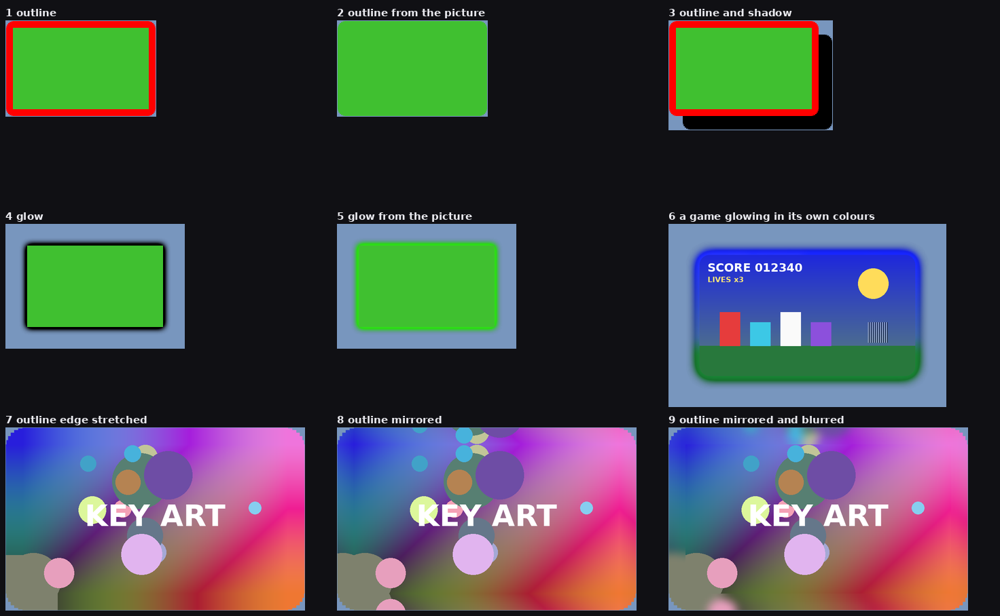
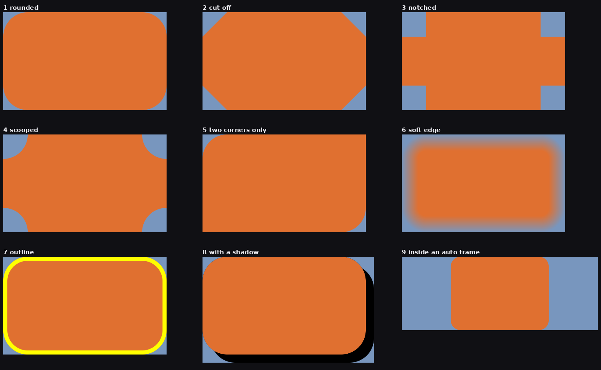
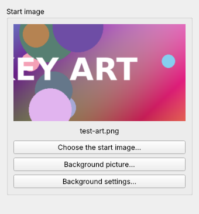

<h1 align="center">StageKit</h1>

<p align="center">Quality-of-life tools for OBS Studio: ramping blur, backgrounds, shadows and easy positioning, without chains of filters and nested scenes.</p>

<p align="center">
  <a href="#download">Download</a> |
  <a href="#getting-started">Get started</a> |
  <a href="#features">Features</a> |
  <a href="#screenshots">Screenshots</a> |
  <a href="#updates-and-settings">Updates</a> |
  <a href="#development">Development</a>
</p>

## Features

StageKit is for streamers who build their scenes by hand. Each tool replaces a setup that normally
takes several filters, source clones or wrapper scenes. Everything can be triggered from OBS itself,
from hotkeys, or from the Stream Deck OBS Studio plugin's *Filter* and *Source* keys.

- **Blur** (filter): blurs a source in and out smoothly. Seven types: Gaussian, Dual Kawase, Box,
  Pixelate, Hexagons, Zoom and Motion.
- **Ambient Background** (source): a soft, drifting backdrop built from an image or another source,
  optionally tinted by whatever capture is live.
- **Start image**: one picture, chosen once, shown on the start scene and used by the background.
- **Shadow, Glow & Outline** (filter): drop shadow or glow, in a colour or in the picture's own moving
  colours, an outline, a panel behind the source, and rounded corners, with no
  wrapper scene.
- **Corners & Edges** (filter): rounds, cuts, notches or scoops a source's corners, trims and softens
  its edges and outlines it. A shadow added after it takes the same shape.
- **Auto Frame** (filter): gives a game or emulator capture a fixed frame and fits any resolution inside
  it, so one scene serves every picture shape.
- **Fit to Space** (scene filter): one capture for every shape. A picture with the screen's shape fills it;
  an emulator's squarer picture floats centred inside a margin.
- **Auto Capture** (filter): one Game Capture finds whatever game is running, windowed or full-screen,
  with no list of games to keep. Windows only.
- **Follow Active App** (scene filter): a scene has a capture for each of several apps, and the one you are
  using is shown, with a fade. The last one stays while something else is in front, and an earlier
  one comes back when an app closes. Windows only.
- **Program Trigger** (filter): while a program is open, shows chosen items and switches chosen filters
  on; puts them back when it closes. Windows only.
- **Cropped View** (source): part of another source, such as your camera cropped square, as a source of
  its own. Filters on the view follow the crop, so no wrapper scene is needed.
- **Zoom** (filter): zooms smoothly into a point of a source and back out.
- **Move Source** (filter): put it on your camera, once per spot. Each one is a Stream Deck key that moves
  the camera to a corner or to a spot you saved, in every scene the camera is in.
- **Move Scene Item** (scene filter): the same move, set up on a scene instead of on the source.
- **Show/Hide Animation** (scene filter): slides or pops an item in and out when it is shown or hidden.
- **Link Visibility** (scene filter): ties eye icons together. Show only one of a set of items, or show
  and hide a set together.
- **Match Item** (scene filter): keeps an item lined up with an item in another scene, so titles sit in
  the same place in every scene.
- **Apply Layout** (scene filter): saves an arrangement of a scene's items and glides back to it.
- **StageKit dock**: click an item into place, and make Stream Deck keys for its positions in one click.
- **Line up, resize and snap**: from a right-click in the preview, hotkeys or the dock, measured by
  what is actually drawn in each item.

## Screenshots

These are real frames rendered by the plugin in its automated tests, using made-up sample images.

**Blur: every blur type at three strengths**

<p align="center"></p>

**Ambient Background: from image to finished backdrop**

<p align="center"></p>

**Shadow, Glow & Outline**

<p align="center"></p>

## Download

StageKit is in pre-release. Builds for Windows, macOS and Linux are on the releases page:

- [All releases, including pre-releases](https://github.com/TechSavage1989/StageKit/releases)

On Windows, pick the file ending in `windows-x64-Installer.exe` (from the second pre-release onward), or
the `windows-x64` zip to copy the files yourself. The installer shows the folder it will install to
(`C:\ProgramData\obs-studio\plugins\stagekit`) and lets you change it; OBS only loads plugins from its
own plugins folder, so change it only if your OBS uses a different one, such as a portable copy. There is no stable release yet, so the "latest release" shortcut
does not point anywhere. Release notes are kept in [docs/releases](docs/releases).

## Requirements

- OBS Studio 31 or newer. Builds are compiled against OBS 31.1.1.
- Windows x64, macOS (Apple silicon and Intel) or Ubuntu 24.04 x86_64.
- Automated tests run on Linux with OpenGL only. Nothing has been verified in OBS on Windows or macOS
  yet, including whether the shaders compile under Direct3D.
- Optional: obs-websocket (bundled with OBS) for remote control.

## Getting started

On Windows, with the installer:

1. Download the file ending in `windows-x64-Installer.exe` from the releases page.
2. Close OBS, then run the installer. Windows may warn that the publisher is unknown, because the
   installer is not signed: choose *More info*, then *Run anyway*, if you trust this download.
3. Start OBS. *Blur (StageKit)* and the other tools appear in the filter list of any source,
   *Ambient Background (StageKit)* in the list of sources, and the dock under *Docks → StageKit*.

The installer puts the plugin in `C:\ProgramData\obs-studio\plugins\stagekit` and adds an entry under
*Apps & features* for removing it. It needs administrator rights for that folder.

Without the installer: unzip the `windows-x64` zip and copy its `stagekit` folder into
`C:\ProgramData\obs-studio\plugins\` yourself.

Neither route has been checked on a real Windows machine yet; please report anything that looks wrong.

## How to use

**Lists.** Wherever a StageKit filter keeps a list (sources to blur, scenes to leave a shadow off in,
programs to capture, items to link), it works the same way: choose from the box to add, and press the
✕ on a row to remove that entry.

### Blur

Add **Blur (StageKit)** as a filter on a source or scene. The filter's own on/off switch is the
blur: turning it on ramps the blur in, turning it off ramps it out and then really switches the filter
off, so it costs nothing while off.

| Setting | What it does |
| --- | --- |
| Blur type | Gaussian (smoothest), Dual Kawase (fastest, best for strong blur), Box, Pixelate (square blocks), Hexagons (a honeycomb mosaic), Zoom, Motion |
| Strength | 0–250. Gaussian, Kawase and Box look alike at the same number |
| Ramp style | Grow the blur strength, or cross-fade a fully blurred image in |
| Ramp in / out time | 0–5000 ms each. 0 is instant |
| Easing | Eleven curves, eased in, out or both |
| Include in 'Blur All' | Whether the global Blur All hotkeys affect this filter |
| Blur these too | Other sources that are blurred and cleared together with this one |
| And live captures on screen | Also blurs every game, window, screen and camera capture showing in the scene on screen when this filter is switched on |

Ways to trigger it:

- The eye icon next to the filter.
- A Stream Deck OBS Studio plugin *Filter* key pointing at the filter.
- Hotkeys under the source in *Settings → Hotkeys*: `StageKit: Blur Toggle / On / Off`.
- `StageKit: Blur All Toggle / On / Off` in the top section of *Settings → Hotkeys*, which drives every
  Blur at once.

**One key for several sources.** Under *Blur these too*, choose a source in the *Add a source* box,
once for each source; each becomes a row. From then on, switching this one filter on or off, from a single Stream
Deck *Filter* key, blurs and clears every source in the list. A listed source with no Blur of its
own is given one with the same settings (*Blur (follows another)*); one that already has a Ramp
Blur keeps its own settings. Remove a source with the ✕ on its row.

To replace a Composite Blur + Move chain: add one Blur, pick the type and strength (Composite
Blur's Pixelate at radius 5 is *Pixelate* at strength 4), point your existing keys at it, then delete
the old filters.

### Ambient Background

Add **Ambient Background (StageKit)** as a source. It fills the canvas.

| Group | Settings |
| --- | --- |
| Picture | The start image, an image file, or any existing source or scene. Optionally blend in a live capture: a chosen source, or *Automatic*, which uses the largest visible capture in the current scene. The capture can fill the screen, fit inside it, match its width or height, or stretch, with its own zoom. *Live capture replaces the picture* makes the capture the whole background while there is one; the moment there is none, the usual picture is back. A capture with an Auto Frame is used as the trimmed game picture, without the empty frame around it. A capture showing nothing, or black all over for two seconds, counts as no capture. *Keep the capture ready* keeps it running in scenes that do not show it, so it is there at once in the next scene that does |
| Motion | Drift speed in each direction, zoom, and mirroring at the edges so the drift never shows a seam |
| Look | Blur, hexagon or square mosaic, saturation, glow, brightness, vignette |
| Texture overlay | An image multiplied or screened over the result, optionally in black and white |

Put it in one shared scene and nest that scene wherever you need the background.

### Start image

Choose the start image once, in the StageKit dock under *Start image*. The dock shows a small picture
of it. It is saved with the scene collection.

- Add **Start Image (StageKit)** as a source wherever the picture itself should be shown.
- Every Ambient Background uses it as its picture automatically. A background you had pointed at an
  image of its own switches over when you choose a start image; to keep one on its own picture, set its
  *Background from* back to *An image* afterwards.

Changing the start image updates both at once.

### Shadow, Glow & Outline

Add **Shadow, Glow & Outline (StageKit)** as a filter on a source, group or scene. (It was called
Shadow & Backdrop; filters you already have keep working.) It has three parts, each with a tick box in
its heading:

<p align="center"></p>

- **Shadow or glow**
  - *Type*: *Drop shadow (to one side)* or *Glow (all round)*.
  - *Made from*: *A colour*, or ***The picture itself***. With the picture itself, a game, camera or
    video casts a soft, moving copy of its own colours instead of a flat colour. *Colour boost* makes
    that richer.
  - *Opacity*, *Softness* (0 gives a hard edge), *Strength*, and for a drop shadow how far right/left
    and down/up it falls.
  - *Hide the picture* leaves only the shadow or glow.
- **Outline**: a line round the picture, any width. *Made from* a colour or the picture itself. Made
  from the picture, *Past the edge* chooses between stretching the picture's edge outwards and
  mirroring the picture, and *Outline blur* softens it. The
  line follows the picture's real shape, including text and rounded or cut corners. A shadow is cast
  by the picture and its outline together.
- **Panel behind the source**: a coloured panel with a margin.

*Rounded corners* rounds the picture and the panel.

**Leave it off in these scenes**: choose scenes from your collection; each becomes a row with its own
✕ to remove it. While a listed scene is on screen the filter draws nothing; the source shows plain
there and keeps its place. It goes by the scene on screen (Program in Studio Mode).

Sizes are as they look on screen: with *Sizes as they look on screen* ticked (the default), 20 px of
shadow is 20 px in the finished picture however much the item is scaled, so a small camera and a large
panel get the same shadow. Untick it to give sizes in the source's own pixels.

The shadow needs room around the source, so the source itself gets bigger. With *Keep the picture
where it is* ticked (the default), the source's items in every scene are adjusted by exactly that room:
the picture keeps its size and place whatever the softness, offset, outline or panel margin, including
inside a bounding box. Switching the filter off or removing it puts the items back.

### Corners & Edges

Add **Corners & Edges (StageKit)** as a filter on a source: a camera, a capture, an image, a browser
widget.

<p align="center"></p>

- **Corner style**: *Rounded*, *Cut off (chamfer)*, *Notched (square cut)* or *Scooped (curved in)*.
- **Corner size**, and **Which corners** it applies to, each one on or off.
- **Trim edges** cuts the same amount off all four sides. **Soften edge** fades the picture out
  towards its edge.
- **Outline**: a line of any width, colour and opacity that follows the shape.
- **Sizes as seen on screen** (on by default): a 40 px corner looks the same on a big item and a small
  one, the same rule Shadow, Glow & Outline uses.

It works with the other tools:

- The source **keeps its size**, so nothing moves or resizes in any scene, and Move Source keys, layouts
  and the line-up tools carry on as before. The line-up tools measure the new shape when *Use visible
  pixels* is on.
- **Shadow, Glow & Outline** after it in the filter list casts a shadow of the new shape. If you add
  Corners & Edges to a source that already has a shadow, it places itself above the shadow for you.
- After an **Auto Frame**, it shapes the game picture inside the frame, and follows it when the picture
  changes shape.
- Blur and Zoom can go before it (the blur or zoom stays inside the shape) or after it.

### Auto Frame

Add **Auto Frame (StageKit)** as the first filter on a game, window or capture-card source. Set the
frame's width and height once. From then on the source always has that size, and whatever the game or
emulator outputs is fitted inside it, gliding to its new fit when the resolution changes.

The top line of the controls says which program is being captured and which picture shape applies.
The settings are in five numbered groups:

| Group | What is in it |
| --- | --- |
| 1. Frame size | Width and height, or pick a scene and an item and press *Use that item's size* |
| 2. Picture | Fit (whole picture, whole-number scale, fill, stretch), picture shape, where it sits, sharp pixels |
| 3. Black bars | Trim automatically, trim a set amount, or leave them. Automatic trims only when the picture is seen to end in a straight line, the same distance in from both sides, leaving a standard game shape. Artwork, a logo or a dark scene on black is not mistaken for bars. *Hold a shape for* sets how long a different shape must be clearly on screen before the picture changes to it |
| 4. Picture shape for each program | *Start from each program's usual shape*, *Forget shapes seen before*, and shapes you save yourself, used at once when that program is captured (see below) |
| 5. Movement | How long the picture takes to settle after a resolution change |

**The first clear sight of a picture is used at once.** When a game appears, or its window changes
size, the capture is looked at ten times a second until its shape is settled, and the bars are trimmed
within a fraction of a second of the picture being seen clearly: a windowed game whose picture sits
inside its window with bars above and below does not wait for the hold time. It does not need a bright
scene. Bars are flat black and even a night scene is not, and a picture fitted in its window gives
itself away with a few lit pixels at each side: it reaches both ends one way and stops the same
distance in from both ends the other way, leaving a real picture shape. A black loading screen teaches
nothing, and nothing is trimmed on a guess.

**A program's shape is remembered.** Once a program's picture has held one shape for a quarter of a
minute, that shape is kept for the program, and the next time it is captured the picture starts out in
it from the first frame, at any window size, even while the screen is still black. What is seen still
corrects it. A program that turns out to show more than one shape (an emulator for several consoles,
or a game that simply fills whatever window it is given) starts from nothing instead. The tooltip of
*Forget shapes seen before* lists what is remembered; the button clears it.

**A shape, once found, is held.** When a window goes full-screen, or the resolution changes, the
picture keeps the shape it had: there is no moment of showing the bars and trimming them again. The
last good picture stays up for a fifth of a second while the capture settles, and for up to a second if
the capture drops out, so the switch does not blink. A menu, a pop-up or a mouse pointer over the bars
does not resize it. It changes when another real picture shape has been clearly on screen for the hold
time, when the picture itself keeps showing inside the trimmed part, or when a different program is
captured. A shape carried over to a new size is only a starting point until the picture is seen to fit
it: if the picture plainly shows inside it, it is let go within about a second.

**If a game's shape is slow to come right**, OBS's log says what Auto Frame saw and when
(*Help → Log Files → Show Log Files*, the lines with `Auto Frame:` in them).

**Unusual shapes.** Automatic trimming knows the shapes consoles and handhelds use, including two
screens stacked or side by side (DS, 3DS), upright and ultra-wide. For a picture in some other shape,
press *Measure the bars now* on a bright scene (or set the amounts by hand), then *Keep this trim for
this program*. That saves the shape for the program being captured and goes back to automatic, so the
program is right from then on, at any window size, and everything else is still worked out by itself.

**Picture shape for each program.** A program seen before starts from the shape it showed then.
Otherwise common emulators start from their usual shape (Snes9x 8:7, mGBA
3:2, Project64 4:3 and so on), so the picture is right from the first frame. Either is only a starting
point: if the picture clearly shows another shape, that shape is used and held. To fix a program's
shape yourself, choose the program from the list of
open programs (or find its file with *…or find it on this computer*), choose its shape and press
*Remember this shape for this program*. A shape you save is always obeyed as it is. Emulators that play
several consoles, such as RetroArch and Dolphin, are not built in because their shape depends on the game.

To set the shape from a Stream Deck, add **Aspect Ratio Preset (StageKit)** next to Auto Frame, once per
shape, and point a *Filter* key at it. Switching it on sets the shape and it switches itself off; a key
set to *Automatic* hands control back.

Because the source's size no longer changes, one scene can replace a scene per picture shape and the
automation that switched between them. Put Shadow, Glow & Outline after it and the shadow follows the picture.

### Fit to Space

Add **Fit to Space (StageKit)** as a filter on a *scene*. It places one item of that scene for you.

- **Item**: the item to place, usually your game capture.
- **Fit it in**: *The whole screen*, *A box I set* (left, top, width, height in canvas pixels), or
  *The free space around it*.
- **Margin for other shapes**: a picture with the box's shape fills the box. Any other shape is kept
  this far from the box's edges and centred. With a Shadow, Glow & Outline set to *Keep it on
  screen*, a picture that fills the box makes room for its shadow.

**The free space around it** makes the item as large as it can be where it is, always keeping the
gap you set (*Gap to edges and items*) from the screen's edges and from every other item, at its
nearest.

- Move, show or hide another item and the fitted item glides to its new space (*Glide to a new space
  over*, with a curve to choose; 0 changes at once). An item that starts drawing something after
  showing nothing, such as a music widget, is noticed within a few seconds.
- Drag the fitted item to another part of the scene, or send it there with a key, and it takes the
  free space around that place instead.
- A background or a frame is not in the way: anything the item's place lies inside is ignored.
- It only works while its scene is being shown, so scenes you are not on cost nothing.
- **Items never in the way**: items the free space ignores, such as a camera meant to overlap the
  game.
- **Use visible pixels** and **Ignore shadows & outlines** (both on as they come) are this filter's
  own settings; the dock's Arrange options do not change them. With the first, the items around it
  are measured by what they draw, and an item that is drawing nothing is not in the way. With the
  second unticked, shadows, glows and outlines keep the gap too, the fitted item's own included.

Use it with Auto Frame's *Frame → Just the picture*, so the source is only the trimmed picture. One
game capture can then sit in a full-screen scene (a widescreen game fills it, an emulator floats in the
middle) and in a scene with a camera and chat beside it (fitted to that scene's game box), with nothing
to change when you switch games. A shadow on the source is allowed for.

It works on any source. For a **Window Capture**, add Fit to Space to the scene and choose the window
capture: the window fills the space when it has the space's shape and floats centred otherwise, and it
stays fitted while you drag the window to a new size, because the fitting itself is done by OBS on
every frame. Use one Fit to Space filter for each item to be fitted.

Fit to Space takes over the item's position and bounding box and removes its rotation. Switch the
filter off to move the item by hand.

### Auto Capture

Add **Auto Capture (StageKit)** as a filter on one *Game Capture* source. Windows only.

Four times a second it looks at the window in front. If that window is a game, the capture is aimed at
it, windowed or full-screen. It stays on that game when you switch to another program, and moves on
when the game closes or another game comes to the front. There is nothing to set up per game.

The filter's controls show what it is capturing now.

- **Not a game? Never capture this program**: one press when it picks up the wrong thing.
- **Pick from the programs that are open**: choose a program and press *Always capture it* (for a game
  it misses) or *Never capture it*. There are no file names to type.
- **Your lists**: the two lists those buttons fill in, as plain text you can edit (`blender, vlc`). OBS,
  browsers, Discord, Steam's own windows and similar are already left alone.
- **Find games**: *Automatically*, or *Only from 'Always capture'*.
- **Keep capturing in other scenes** (on as it comes): the capture carries on while you are on a scene
  that does not show it, so it is there at once when you come back. Unticked, OBS stops it a moment
  after you leave and starts it again when you return.
- With no game open, the Game Capture goes back to *Capture any fullscreen application*.

A game is recognised by what the program has loaded: a graphics engine together with something only
games have (controller support, a game store's library, a game engine's player, game audio or video),
a game engine's own kind of window, or a window that fills its screen. A program seen to be a game
once is remembered and picked up at once from then on. The filter changes the Game Capture's own
*Mode* and *Window* settings for you.

### Standby Picture

A picture in a capture's place while the capture has nothing to show, so its spot in the scene is not
an empty hole while you wait for a game or window. Add **Standby Picture (StageKit)** as a filter on a
Game Capture, Window Capture or other live source.

- **Nothing to show** means no game or window is attached to the capture. A capture that is attached
  and showing a black picture, such as a loading screen, is left alone.
- While it waits, the picture is shown whole, in its own shape, as tall as the capture last was.
- When the capture starts, the size glides from the picture's shape to the capture's while the
  picture fades into it. When the capture ends, its last frame fades back into the picture, which
  glides back to its own shape. Neither is ever squashed on the way.
- It belongs after an Auto Frame in the filter list and puts itself there.
- Corners, shadows and other filters after it are put on the picture as they are on the capture.
- To go without it, switch the filter off with its eye or a Stream Deck filter key.

| Setting | What it does |
| --- | --- |
| Picture | *The start image* (the default: the one set in the StageKit Background dock), *An image or video file*, or *Another source* |
| File / Source | The file or source to show, for those two choices. A video loops, without sound |
| Picture keeps its shape | On (the default): the picture is shown whole in its own shape. Off: it fills the size the capture last had, with what does not fit cut off |
| Change with | How the picture gives way to the capture: a fade (the default), a cut, sliding away or wiping in any of four directions, or a zoom and fade. It comes back the same way in reverse |
| To the capture / Back to the picture | How long each change takes |
| Easing curve / Easing direction | The motion the change follows |
| Size glides too | On (the default): the size glides between the two shapes over the same time. Off: the size changes at once |

When first added it puts itself straight after an Auto Frame if there is one, and otherwise first in
the list; after that the order is yours.

### Follow Active App

For a scene that shows whichever app you are working in. Give the scene a Window Capture for each app
(Blender, ZBrush, a browser, and so on), then add **Follow Active App (StageKit)** as a filter on the *scene*
and add those captures to its list. Windows only.

Which app a capture belongs to is read from the capture itself, so there is nothing to type. From then
on one of the listed captures is shown at a time:

- **An app that opens is shown.** So is a capture you aim at another window in its own settings.
- **Clicking into one of the apps shows it** (*Follow the app in use*, on to begin with). With two of
  them open, the capture follows you from one to the other.
- **Clicking into anything else changes nothing.** The last app stays captured while OBS, a chat
  window or anything not on the list is in front.
- **When the app that is showing closes, the one you used before it comes back.** When none of them is
  open, the first capture in the list is shown, so put the one you want as the standby first.

| Setting | What it does |
| --- | --- |
| Captures to switch between | The scene's captures, one per app. Choose to add; each row has its own remove button. The first is the standby |
| Captures you switch to | Other captures in the scene that you show yourself, such as a Window Capture of your browser. Show one and it takes over and stays, whatever app you use; hide it and the captures above follow your apps again. Showing one hides any other on this list |
| Follow the app in use | On: the app you click into is shown. Off: an app is shown when it opens and stays until it closes |
| Change with | How one capture gives way to the next: a fade (the default), any other transition OBS has, a cut, or whatever is already set on each item. It sets OBS's own show and hide transition on each listed item |
| Lasting | How long the change takes |
| Keep the others ready | While the scene is showing, the captures of the other open apps keep running, so the one you switch to has its picture at once |

**Switching to a window by hand.** Add a Window Capture for the window you want (a browser, say), add
it to *Captures you switch to*, and hide it. Then:

- **A Stream Deck key** set to show and hide that source in the scene (Elgato's OBS *Source* key)
  switches to it and back. OBS's own *Show* and *Hide* hotkeys for the item do the same.
- While it is showing, nothing takes over from it: you can work in Blender or ZBrush and the browser
  stays on screen. Hide it and the capture of the app you are in comes back.
- With several on the list, showing one hides the others, so each can have its own key.
- The filter adds two hotkeys to the scene in *Settings → Hotkeys*, named after the filter: one steps
  through these captures in turn and then back to the apps, one goes straight back to the apps.

It acts only when one of those things happens, so a capture you show by hand stays until then. A
minimised window counts as closed. The top line says what is showing. Switch the filter off to pause it.
Each capture can have its own [Fit to Space](#fit-item), shadow and blur; they follow the capture.

### Program Trigger

Add **Program Trigger (StageKit)** as a filter on a *scene* to show and hide that scene's items, or on
any *source* to switch that source's other filters. Windows only.

1. **While this program**: choose the program from the open ones, or find its file. Optionally give
   text its window title must contain (for example `GBA1`); with the program left empty, the title alone
   decides. Choose whether it counts when it has a window open or only when that window is in front.
2. **Show and switch on**: pick items and filters and add them to the lists. *Do the opposite* hides and
   switches off while the program is here instead.
3. **Change with** and **Lasting**: how the items appear and disappear. A fade to begin with; any other
   transition OBS has, a cut, or whatever is set on each item.

While the program is here the items are shown and the filters are on; when it goes they are hidden and
off. It acts when the program appears or goes, so a change you make by hand in between is kept until
then. A minimised window does not count as open. The top line says whether it sees the program now.

### Cropped View

Add **Cropped View (StageKit)** as a source. Choose the source to show, then crop it to a square, to
4:3, 16:9, 3:4 or 9:16 from the middle, by set amounts off each side, or to *Whatever is drawn*.

*Whatever is drawn* needs no numbers: it trims off the empty, see-through room around the content and
follows the content when it changes size. It suits web widgets, whose page is much bigger than the card
they draw. It looks about once a second, grows at once and shrinks only when the smaller picture has
settled.

Use it when one camera is wanted in more than one shape. OBS applies an item's crop after the source's
filters, so a shadow on the camera is cut off by the crop; a Cropped View is the cropped picture as a
source, and a Shadow, Glow & Outline or Zoom added to the view follows it. Make one view per shape. The
camera is still captured only once.

### Zoom

Add **Zoom (StageKit)** as a filter on a source. Turning it on zooms into the point you choose;
turning it off zooms back out. It has a `StageKit: Zoom Toggle` hotkey under the source.

### Move Source

Add **Move Source (StageKit)** as a filter on the source you want to move, such as your camera. Add one per
spot and name each after its spot ("Camera top right").

1. Choose where to send it: one of nine screen positions with a margin from the edge, or a saved spot.
   The margin is kept to the picture you can see. *Use visible pixels* and *Ignore shadows &
   outlines* are the filter's own settings (the dock's Arrange options do not change them); untick
   the first to keep the margin to the item's box.
   For a saved spot, drag the camera where you want it in the preview and press *Save the item's
   current spot*. Its size is saved too if you tick *Also restore the item's size*. *A spot on the
   screen* puts the item's left and top edges at the numbers you give, in every scene alike; the
   dock's slides use it.
2. Choose where it moves (*Move it in*). **Every scene it is in** is the default: the source ends up
   in the same place in each of its scenes, on screen or not. **Only the scene on screen** leaves the
   other scenes as they are. **Only one scene I choose** always moves it in that scene. It is found
   inside nested scenes and groups.
3. Optionally choose an item to bring along.

On a Stream Deck, add the OBS Studio plugin's *Filter* key, pick the camera as the source and one of
these filters. Pressing the key moves the camera; the filter switches itself off again, ready for the
next press. Each filter also has a `StageKit: Move` hotkey under the source.

### Move Scene Item

Move Scene Item does the same job from the scene's side. Add **Move Scene Item (StageKit)** as a filter on a
*scene*, once per destination.

1. Choose the item to move.
2. Choose where to send it: one of nine screen positions with a margin from the edge, or a saved spot.
   The margin is kept to the picture you can see. *Use visible pixels* and *Ignore shadows &
   outlines* are the filter's own settings (the dock's Arrange options do not change them); untick
   the first to keep the margin to the item's box.
   For a saved spot, drag the item where you want it and press *Save the item's current spot*.
3. Optionally choose an item to bring along. It keeps its place relative to the moved item and flips to
   the other side if it would leave the screen.

Switching the filter on moves the item; the filter then switches itself off, ready for the next time.
Trigger it from the eye icon, a Stream Deck *Filter* key, *Move it now*, or its `StageKit: Move`
hotkey under the scene.

### The StageKit docks

There are two, under *Docks*: **StageKit** for the item you are working on, and **StageKit Background**
for the start image and the moving background. Both work on the current scene (the preview scene in
Studio Mode).

<p align="center"></p>

<p align="center"></p>

**StageKit**

The *Scene* and *Item* it works on stay at the top; below them are four tabs. **Place** sends the
item to a spot and makes Stream Deck keys for it. **Arrange** lines up, spaces, snaps, resizes and
reorders what is selected, and holds the measuring options. **Copy** copies a transform to other
scenes or sources. **Effects** adds a StageKit filter to the item. What the last press did is said
at the bottom, whichever tab is open.

- **Select an item in OBS's own preview** and the dock works on it. The *Item* list follows your
  selection; you can also choose from the list. A group you select is worked on as one item.
- Click one of the nine positions and the item glides there. With *In every scene* ticked (the
  default) its source is moved in every scene it is in, keys you make do the same, and one Undo takes
  the whole move back. Untick it to change only the scene you are working on.
  The *Edge distance* is kept to what the Arrange options below count as the item: with *Use visible
  pixels* the picture you can see, and with *Ignore shadows & outlines* a shadow reaches past it.
- Tick **Slide to the next edge** and the arrows slide the item instead: it moves that way until it
  comes within the *Edge distance* of the next edge it meets, which is the near side of another item in
  its path, or the screen's edge. Press again and it goes through that edge: first to the item's far
  side (inside it, the same distance short of that side), then on to the next item or the screen's
  edge. Nothing takes it past the screen's edge, and something thinner than the edge distance is
  passed in one press. Pressing again while it is still gliding carries on from where it is going. The
  diagonals slide across, then up or down. The centre button centres the item in the free space around
  it. *Use visible pixels* and *Ignore shadows* in the Arrange box decide what counts as an edge, and
  an item brought along is never in the way. With *In every scene*, the item lands on the same spot of
  the screen in each of its scenes. It glides for the *Travel time*, following the *Motion* you choose
  (the curve, and whether it eases at the start, the end or both); a run of presses made while it is
  still moving is one step for Undo.
- *Make 9 position keys* adds a Move Source filter for each one **to the item's own source**,
  named after the position ("Top right"). Point a Stream Deck *Filter* key at the camera and one of
  those filters, or give it a hotkey.
- *Save this spot as a key* does the same for wherever the item is now: drag it where you want
  it in the preview first.
- *Bring to front*, *Forward one*, *Back one* and *Send to back* change which items cover which.
- *Add effect* puts a Blur, Shadow, Glow & Outline, Zoom or Show/Hide Animation on the item
  and opens its filter window. Blur and Zoom are added switched off.
- The *Scene* list reaches a scene that is not on screen.

**StageKit Background**

- A picture of the start image, as wide as the dock. Turn the mouse wheel on it for a closer look, drag to move around,
  double-click to reset; this changes only the thumbnail, never your scene.
- The start image is also the moving background's picture. *Background picture…* gives the
  background a picture of its own; *Background settings…* opens the Ambient Background's settings.

### Lining up, resizing and snapping items

These tools move and resize the items **selected in OBS's preview**. Click one item, or hold Ctrl and
click several. You can use them from three places, and all three share the same options:

- **Right-click in the preview** and open the *StageKit* menu.
- **Hotkeys**: *Settings → Hotkeys*, the entries that start with *StageKit:* (for example
  *StageKit: Align left*).
- The **Arrange** box in the StageKit dock, which also lists every selected item in the order you
  selected it. It always works on the scene you are editing in OBS, whatever scene the dock's own
  *Scene* list shows.

Each use is one step in OBS's *Edit → Undo* and *Redo*.

What they do:

| Tool | What happens |
| --- | --- |
| *Left*, *Centre*, *Right*, *Top*, *Middle*, *Bottom* | Lines the items up with that side of the screen. With *Align to: Each other*, lines two or more up with one another instead. With *First selected* or *Last selected*, that item stays put and the others line up with it. |
| *Space out ↔*, *Space out ↕* | With three or more: the outer two stay put and the rest spread so the gaps are equal. |
| *Same width*, *Same height*, *Same size* | With two or more: resizes the others to match the first or last selected when *Align to* is set to that, otherwise the top-most one in the Sources list. |
| *Snap now* | Moves each item the last few pixels so an edge or its centre meets the screen's or a neighbour's. |
| *Copy transform to all scenes* | Takes the selected item's position, size, rotation and crop in this scene and gives them to every copy of the same source in all your other scenes: OBS's *Copy Transform* and *Paste Transform* done for every scene at once. Copies inside groups land on the same spot of the screen; locked copies are left alone; one step in *Edit → Undo* |
| *Copy transform to chosen scenes* | The same, but only to the scenes listed under *Scenes to copy to* in the dock. Choose a scene from *Add a scene...* to put it on the list; press the **x** beside one to take it off. The list is saved with your scene collection |
| *Sources to copy to* | Which sources take the transform, for both copy buttons. Empty (it then reads *The same source*): the copies of the selected item's own source in the other scenes. With sources listed, the transform goes to those sources instead, in this scene and the others, or in the listed scenes with *Copy transform to chosen scenes*. Add the item's own source to the list to include it too. With several items selected, the last one selected is the one copied. Saved with your scene collection |

Options:

- **Use visible pixels** (on by default) measures the picture actually drawn in each item and ignores
  the empty, see-through room around it. Switch it off to go by the item's box, as OBS does. An item
  that is drawing nothing at all, such as a widget with nothing to show, is treated as not there: it
  does not stop a slide or a resize, and nothing snaps to it.
- **Ignore shadows & outlines** (on by default) measures only each source's own pixels: shadows,
  glows, outlines, borders and anything else its filters draw are left out, so pictures are lined up,
  sized and slid by themselves and their shadows reach past them. Unticked, each item counts together
  with everything its filters draw, so with *Same width* the picture and its shadow together come out
  as wide as the other item and its shadow. (When a source's filters change its size in another way,
  as an Auto Frame does, the picture is measured as it is before its first shadow.) What a filter
  takes away, such as trimmed edges or a mask, does not count as picture either.
  The faint last row of pixels of a smoothed edge is not counted, so a picture sent to the screen's
  edge leaves no line of background there.
- **Keep shape when resizing** (on by default) grows or shrinks an item evenly. Switch it off and
  *Same width* or *Same height* changes only that direction, which stretches the picture.
- **Snap on release** snaps an item by itself after you drag it in the preview and let go. *Snap
  within* sets how close counts.
- **Stop resizing at edges** (off by default) is for resizing by hand. Resize an item in the preview
  as you always do, by an edge or a corner. When you let go, any side you dragged to within the
  *Resize limit* of the screen's edge or of another item is pulled back, so it stops that far short.
  An item scaled evenly is pulled back evenly and keeps its shape. *Use visible pixels* and *Ignore
  shadows & outlines* decide what counts as the item and as the others. It acts when you let go of
  the mouse, not while you drag; rotated and locked items are left alone; it is one step in Undo.
- **Guides in the preview** (off by default) draws a line across the preview where an item you are
  dragging lines up with the screen or another item, and where a line-up tool has just put things.
  The lines are on your screen only, never in the stream or a recording. They are placed for a preview
  set to *Scale to Window*. When you tick the box, a frame flashes round the picture in the preview
  for a moment to show it is working, and the dock says so; if the dock says it cannot find OBS's
  preview, the lines cannot be shown. Each line is a thin strip placed inside the preview;
  OBS's log says when guides are switched on, when a drag is first seen, and where the first line
  was put.

### Show/Hide Animation

Add **Show/Hide Animation (StageKit)** as a filter on a scene and leave it on. Choose the item and
where it comes in from: the nearest screen edge, a chosen edge, or a pop from its centre. From then on,
showing or hiding the item animates it, including from a Stream Deck *Source* key.

### Show in Scenes

One switch that shows or hides sources across scenes, in place of a Stream Deck multi-action with a
*Source Visibility* step for every scene. Add **Show in Scenes (StageKit)** as a filter on a source,
then make a Stream Deck *Filter* key for that source and filter. Each press switches the filter on or
off, and the sources are shown or hidden to match.

| Setting | What it does |
| --- | --- |
| Sources to show and hide | Choose to add; each row has its own remove button. Left empty, it acts on the source the filter is on |
| In | *Every scene they are in*, or *The scenes listed below* |
| Scenes | The scenes to act in, when you chose to list them |
| When this is on | *They are shown* (off hides them) or *They are hidden* (off shows them) |
| Bring-along items too | Ticked: the items those sources bring along are shown and hidden with them. They are the items chosen under *Bring along* in the sources' Move Source keys, and in Move Scene Item filters that move them |
| Change with / Lasting | How each item appears and disappears: a fade (the default), any other transition OBS has, a cut, or whatever is already set on the item; and for how long |
| Do it now | Shows or hides them to match how the filter is switched now |

It acts when it is switched, not all the time, so something you show or hide by hand stays until the
next press. Items inside groups are included. OBS's own show and hide transitions on each item apply.

### Link Visibility

Add **Link Visibility (StageKit)** as a filter on a *scene*, once per set of items.

1. Choose *Show only one at a time* or *Show and hide together*.
2. Pick each item from the list and press *Add it to the list*.

With *Show only one at a time*, showing one item hides the others in the set. With *Show and hide
together*, showing or hiding one does the same to the rest. It follows whatever shows or hides an item:
the eye icon, a Stream Deck *Source* key, a hotkey. Switch the filter off to pause it. *Change with*
and *Lasting* choose how the items it shows and hides appear and disappear: a fade to begin with, any
other transition OBS has, a cut, or whatever is set on each item.

### Match Item

Add **Match Item (StageKit)** as a filter on a scene and leave it on. Choose an item in this scene, and
the scene and item it should line up with. *Fit inside the same box* scales the item to the other
item's box, which suits titles of different lengths; *Copy its position and size settings* matches it
exactly. Moving the original moves every matched item.

### Apply Layout

Add **Apply Layout (StageKit)** as a filter on a scene. Arrange the scene and press *Save where everything is
now*. Switching the filter on glides every saved item back to that arrangement. To cover only some
items, add their names under *Only these items* before saving; several Apply Layout filters can then each
move a different set.

### Remote control

With obs-websocket, send `CallVendorRequest` with `vendorName: "StageKit"`:

| requestType | requestData | Response |
| --- | --- | --- |
| `GetVersion` | none | `version`, `features` |
| `ListBlurFilters` | none | `filters: [{sourceName, filterName, active, level, blurType}]` |
| `BlurOn` / `BlurOff` / `BlurToggle` | `sourceName`, `filterName?`, `durationMs?` | the filter's new state |
| `SetBlur` | `sourceName`, `filterName?`, `active`, `durationMs?` | the filter's new state |
| `BlurAll` | `mode?`: `on`, `off` or `toggle` | `active` |
| `HookFront` | `sourceName`: a Game Capture or a Window Capture; `transition?`: an OBS transition's kind or `none`; `transitionMs?` | `executable`: the program in front, which the capture now takes. An Auto Capture on the source is switched off |
| `SetPictureShape` | `sourceName`: a source with an Auto Frame; `shape`: `4:3`, `8:7`, a number, or `auto`; `untilGone?` (true unless given): drop it when that game's capture ends | none |
| `GetOptions` | none | The dock's switches: `snap`, `guides`, `limit`, `slide`, `everyScene`, `keepShape` |
| `SetOption` | `option`: one of those names; `mode?`: `toggle` (unless given), `on` or `off` | `on`: which way it is now. An `OptionsChanged` event with all six follows every change |
| `Slide` | `direction`: `left`, `right`, `up`, `down`, `up-left`, `up-right`, `down-left`, `down-right` or `centre` | none. Slides the item the dock is on, as its arrows do |

Every response has `success` and, on failure, `error`. A `BlurChanged` event is sent when a blur turns
on or off. The other tools are filters, so the standard `SetSourceFilterEnabled` request triggers them.

## Stream Deck plugin

StageKit has its own plugin for the Elgato Stream Deck. It is new and **has not been run on a real
Stream Deck yet**; Elgato's OBS Studio plugin and its *Filter* and *Source* keys keep working as
before, side by side with it.

**Install:** download `stagekit-<version>-streamdeck.streamDeckPlugin` from the release page and
double-click it. Stream Deck (7.1 or later) asks whether to install it; the keys then appear under
**StageKit** in the list on the right.

**Connect it to OBS once:** in OBS, *Tools → WebSocket Server Settings*, tick *Enable WebSocket
server*, and press *Show Connect Info* for the port and password. In Stream Deck, drop a StageKit key
on a button, open **OBS connection** at the bottom of its settings and fill in the port and password
(the address stays `127.0.0.1` when OBS runs on the same computer). Every StageKit key uses that one
connection, and it reconnects by itself when OBS is started later.

There is one key for each feature, under **StageKit** in Stream Deck's list. Each has one list to
choose from, holding only what that key is for.

| Key | What it does |
| --- | --- |
| **Blur**, **Shadow, Glow & Outline**, **Corners & Edges**, **Zoom**, **Auto Capture**, **Auto Frame**, **Standby Picture**, **Show in Scenes**, **Fit to Space**, **Follow Active App**, **Program Trigger**, **Link Visibility**, **Show/Hide Animation** | Switches that feature on a source (or scene) on and off, and the key shows which way it is, also when it is switched some other way. *On press* can be *Toggle*, *Switch on* or *Switch off* |
| **Move Source**, **Move Scene Item**, **Apply Layout** | Runs that move. A tick shows on the key when OBS has taken it |
| **Set Aspect Ratio** | Sets a game's aspect ratio by hand, for when Auto Frame's own reading is not what you want: 4:3, 8:7, 3:2, 10:9, 16:9 and more, or *Automatic* to hand it back. *Keep ratio*: *This game only* (the shape lasts while that game is captured and goes back to automatic when it ends; set before the game starts, it waits for it) or *Until changed*. The key shows its ratio |
| **Capture Front Window** | Makes a Game Capture or a Window Capture take whatever window or game is in front when you press it. *Change with* and *Lasting* choose how the capture changes over: a fade (as it comes), a cut, or any other transition OBS has. An Auto Capture on that capture is switched off so it stays where you put it; the **Auto Capture** key, set to *Switches it on*, hands it back |
| **Next Manual Capture** | For a scene with a Follow Active App filter: shows the next of its *Captures you switch to*, or goes back to following the apps |
| **Arrange tool** | One of the dock's arrange tools on a key: line up an edge or centre, space out evenly, snap, make the same width, height or size, or copy a transform to all or to the chosen scenes. It works on the items selected in OBS's preview |
| **Dock Option** | One of the dock's switches on a key: *Snap on release*, *Guides*, *Stop resizing at edges*, *Slide to the next edge*, *In every scene* or *Keep shape*. It shows which way the switch is, also when you change it in the dock |
| **Slide to Edge** | Slides the item selected in OBS left, right, up, down or cornerwise to the next edge, or centres it in the free space, with the dock's edge distance and timing. The next press passes that edge |
| **Blur All** | Switches every Blur on, and the next press switches them all off. It shows on while any is on |

A key that cannot reach OBS, or whose target is gone, shows Stream Deck's yellow warning triangle when
pressed. *Set Aspect Ratio* and *Capture Front Window* need StageKit 0.1.0-beta84 or later in OBS; *Dock Option* and *Slide to Edge* need 0.1.0-beta85. Keys made with
the first versions' *Filter switch* and *Move* keep working; those two are no longer in the list.

**Pictures.** The keys use the StageKit icon pack. Left on *Automatic*, a key takes the picture that
fits its filter and how it is set: a Blur key shows its blur type, a Move Source key the corner it
sends the camera to, Shadow, Glow & Outline its look, Corners & Edges its corner style, and switch
keys have an "on" and an "off" look. A filter the pack has no picture for gets a plain key in the same
style. **Picture** lets you give a key any other picture of the pack (the ones drawn for a particular
source, for instance). **Palette** is each key's own colour: mono (as it comes), violet, ocean,
forest, ember or neon. You can still set your own picture on a key in Stream Deck.

The plugin's code is in [`streamdeck/`](streamdeck); `npm install`, then `npm run build`, `npm test`,
`npm run validate` and `npm run pack` there.

## Updates and settings

StageKit updates itself from inside OBS, on Windows.

- **It looks for a newer release** about ten seconds after OBS starts, by reading the list of
  releases of this project on GitHub. Nothing about you or your setup is sent; it is an ordinary
  web request to `api.github.com`.
- **When there is one**, a line appears at the bottom of the StageKit dock: *StageKit … is
  available*, with **What's new** (the release page) and **Update**.
- **Update** asks first. Then the installer (and the Stream Deck plugin's file, if that plugin is
  installed) is downloaded and checked against the checksums in the release notes. If that fails it
  says so and nothing is changed. Otherwise OBS closes, Windows asks for permission to install, the
  installer runs without its pages, and OBS opens again. It will not start while you are streaming
  or recording.
- The **⋯** button at the bottom right of the dock shows the version you have and holds *Check for
  updates now*, *Check when OBS starts* and *Include test versions* (pre-releases; on, because that
  is all there is so far).
- On macOS and Linux it tells you about a newer release and opens its page; installing is by hand.

To update by hand instead, close OBS and run a newer installer, or replace the plugin folder with a
newer build.

All settings are stored by OBS in your scene collection, alongside the filters and sources they belong
to (the two update choices are kept with the plugin instead). Replacing the plugin does not change them. Hotkey bindings are stored there too.

## Troubleshooting

- **A StageKit filter or source shows a blank or unchanged picture on Windows.** The shaders have only
  been tested with OpenGL. Open *Help → Log Files → View Current Log*, search for `stagekit`, and
  report any line that mentions an effect failing to load.
- **A filter you switched on turned itself off.** Move Source, Move Scene Item and Layout do that on purpose
  after each move.
- **Auto Capture picked up a program that is not a game.** Add part of its file name to *Never
  capture*.
- **Auto Capture does not pick up a game.** Add part of its file name to *Always capture*. The OBS log
  has a line starting `Auto Capture:` each time it changes what it follows.
- **Items inside a group are missing from a scene filter's item list.** Add the filter to the group
  itself instead.

## Development

Start with [AGENTS.md](AGENTS.md), then [DEVELOPMENT_HANDOFF.md](DEVELOPMENT_HANDOFF.md).

Build and run every test on Linux:

```bash
tests/run-tests.sh
```

Windows and macOS builds come from GitHub Actions, based on the official
[obs-plugintemplate](https://github.com/obsproject/obs-plugintemplate).

## License

[GPL-2.0](LICENSE), the same license as OBS Studio.
