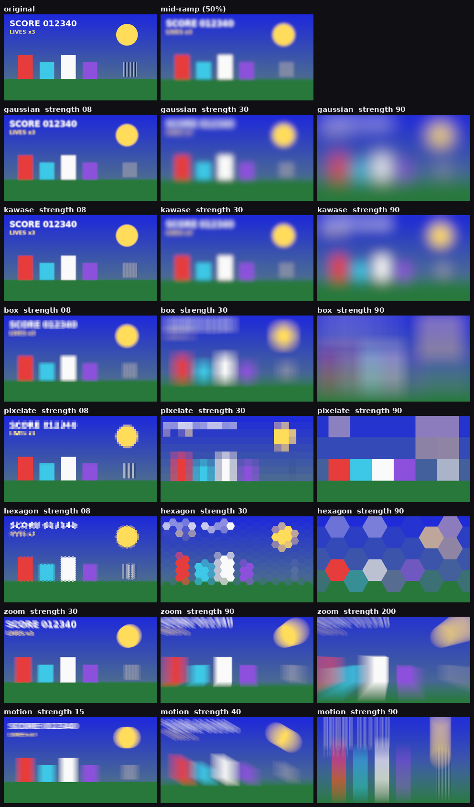
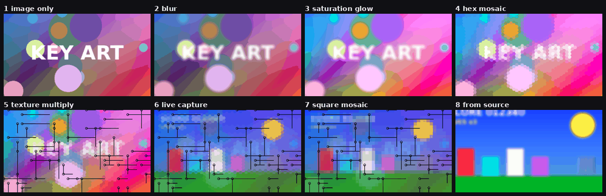
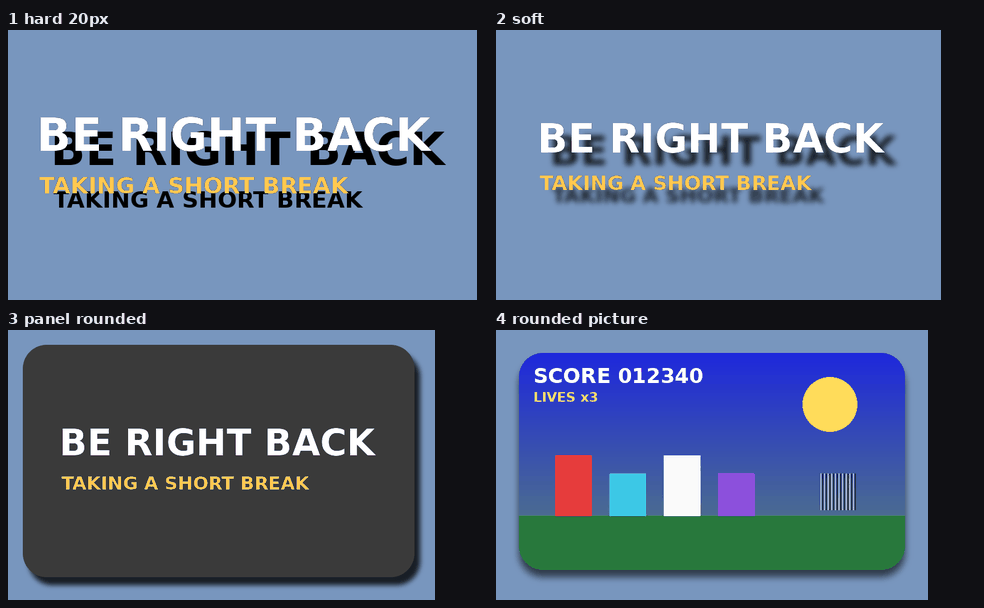
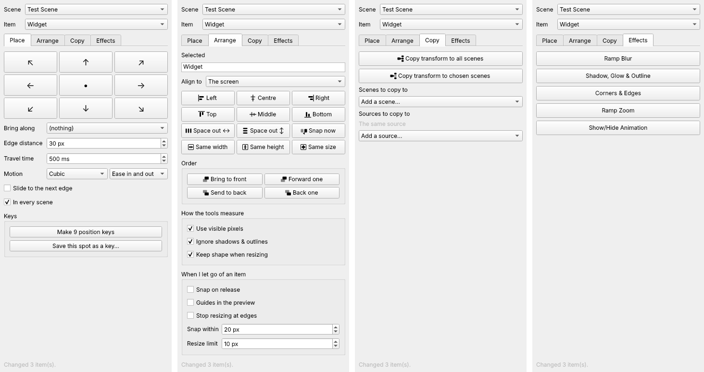

<h1 align="center">StageKit</h1>

<p align="center">Quality-of-life tools for OBS Studio: ramping blur, backgrounds, shadows and easy positioning, without chains of filters and nested scenes.</p>

<p align="center">
  <a href="#download">Download</a> |
  <a href="#getting-started">Get started</a> |
  <a href="#features">Features</a> |
  <a href="#screenshots">Screenshots</a> |
  <a href="#updates-and-settings">Updates</a> |
  <a href="#development">Development</a>
</p>

## Features

StageKit is for streamers who build their scenes by hand. Each tool replaces a setup that normally
takes several filters, source clones or wrapper scenes. Everything can be triggered from OBS itself,
from hotkeys, or from the Stream Deck OBS Studio plugin's *Filter* and *Source* keys.

- **Ramp Blur** (filter): blurs a source in and out smoothly. Six types: Gaussian, Dual Kawase, Box,
  Pixelate, Zoom and Motion.
- **Ambient Background** (source): a soft, drifting backdrop built from an image or another source,
  optionally tinted by whatever capture is live.
- **Start image**: one picture, chosen once, shown on the start scene and used by the background.
- **Shadow & Backdrop** (filter): drop shadow, a panel behind the source, and rounded corners, with no
  wrapper scene.
- **Auto Frame** (filter): gives a game or emulator capture a fixed frame and fits any resolution inside
  it, so one scene serves every picture shape.
- **Auto Capture** (filter): one Game Capture finds whatever game is running, windowed or full-screen,
  with no list of games to keep. Windows only.
- **Ramp Zoom** (filter): zooms smoothly into a point of a source and back out.
- **Send To** (filter): put it on your camera, once per spot. Each one is a Stream Deck key that moves
  the camera to a corner or to a spot you saved.
- **Place Item** (scene filter): the same move, set up on a scene instead of on the source.
- **Show/Hide Animation** (scene filter): slides or pops an item in and out when it is shown or hidden.
- **Match Item** (scene filter): keeps an item lined up with an item in another scene, so titles sit in
  the same place in every scene.
- **Layout** (scene filter): saves an arrangement of a scene's items and glides back to it.
- **StageKit dock**: click an item into place, and make Stream Deck keys for its positions in one click.

## Screenshots

These are real frames rendered by the plugin in its automated tests, using made-up sample images.

**Ramp Blur: every blur type at three strengths**

<p align="center"></p>

**Ambient Background: from image to finished backdrop**

<p align="center"></p>

**Shadow & Backdrop**

<p align="center"></p>

## Download

StageKit is in pre-release. Builds for Windows, macOS and Linux are on the releases page:

- [All releases, including pre-releases](https://github.com/TechSavage1989/StageKit/releases)

On Windows, pick the file ending in `windows-x64-Installer.exe` (from the second pre-release onward), or
the `windows-x64` zip to copy the files yourself. There is no stable release yet, so the "latest release" shortcut
does not point anywhere. Release notes are kept in [docs/releases](docs/releases).

## Requirements

- OBS Studio 31 or newer. Builds are compiled against OBS 31.1.1.
- Windows x64, macOS (Apple silicon and Intel) or Ubuntu 24.04 x86_64.
- Automated tests run on Linux with OpenGL only. Nothing has been verified in OBS on Windows or macOS
  yet, including whether the shaders compile under Direct3D.
- Optional: obs-websocket (bundled with OBS) for remote control.

## Getting started

On Windows, with the installer:

1. Download the file ending in `windows-x64-Installer.exe` from the releases page.
2. Close OBS, then run the installer. Windows may warn that the publisher is unknown, because the
   installer is not signed: choose *More info*, then *Run anyway*, if you trust this download.
3. Start OBS. *Ramp Blur (StageKit)* and the other tools appear in the filter list of any source,
   *Ambient Background (StageKit)* in the list of sources, and the dock under *Docks → StageKit*.

The installer puts the plugin in `C:\ProgramData\obs-studio\plugins\stagekit` and adds an entry under
*Apps & features* for removing it. It needs administrator rights for that folder.

Without the installer: unzip the `windows-x64` zip and copy its `stagekit` folder into
`C:\ProgramData\obs-studio\plugins\` yourself.

Neither route has been checked on a real Windows machine yet; please report anything that looks wrong.

## How to use

### Ramp Blur

Add **Ramp Blur (StageKit)** as a filter on a source or scene. The filter's own on/off switch is the
blur: turning it on ramps the blur in, turning it off ramps it out and then really switches the filter
off, so it costs nothing while off.

| Setting | What it does |
| --- | --- |
| Blur type | Gaussian (smoothest), Dual Kawase (fastest, best for strong blur), Box, Pixelate, Zoom, Motion |
| Strength | 0–250. Gaussian, Kawase and Box look alike at the same number |
| Ramp style | Grow the blur strength, or cross-fade a fully blurred image in |
| Ramp in / out time | 0–5000 ms each. 0 is instant |
| Easing | Eleven curves, eased in, out or both |
| Include in 'Blur All' | Whether the global Blur All hotkeys affect this filter |

Ways to trigger it:

- The eye icon next to the filter.
- A Stream Deck OBS Studio plugin *Filter* key pointing at the filter.
- Hotkeys under the source in *Settings → Hotkeys*: `StageKit: Blur Toggle / On / Off`.
- `StageKit: Blur All Toggle / On / Off` in the top section of *Settings → Hotkeys*, which drives every
  Ramp Blur at once.

To replace a Composite Blur + Move chain: add one Ramp Blur, pick the type and strength (Composite
Blur's Pixelate at radius 5 is *Pixelate* at strength 4), point your existing keys at it, then delete
the old filters.

### Ambient Background

Add **Ambient Background (StageKit)** as a source. It fills the canvas.

| Group | Settings |
| --- | --- |
| Picture | The start image, an image file, or any existing source or scene. Optionally blend in a live capture: a chosen source, or *Automatic*, which uses the largest visible capture in the current scene |
| Motion | Drift speed in each direction, zoom, and mirroring at the edges so the drift never shows a seam |
| Look | Blur, hexagon or square mosaic, saturation, glow, brightness, vignette |
| Texture overlay | An image multiplied or screened over the result, optionally in black and white |

Put it in one shared scene and nest that scene wherever you need the background.

### Start image

Choose the start image once, in the StageKit dock under *Start image*. The dock shows a small picture
of it. It is saved with the scene collection.

- Add **Start Image (StageKit)** as a source wherever the picture itself should be shown.
- Every Ambient Background uses it as its picture automatically. A background you had pointed at an
  image of its own switches over when you choose a start image; to keep one on its own picture, set its
  *Background from* back to *An image* afterwards.

Changing the start image updates both at once.

### Shadow & Backdrop

Add **Shadow & Backdrop (StageKit)** as a filter on a source, group or scene. Set the shadow's colour,
opacity, offset, softness (0 gives a hard edge) and spread. Optionally add a panel behind the source and
round the corners.

The shadow needs room around the source, so the source itself gets bigger. With *Keep the picture
where it is* ticked (the default), the source's items in every scene are adjusted by exactly that room:
the picture keeps its size and place whatever the softness, offset or panel margin, including inside a
bounding box. Switching the filter off or removing it puts the items back.

### Auto Frame

Add **Auto Frame (StageKit)** as the first filter on a game, window or capture-card source. Set the
frame's width and height once. From then on the source always has that size, and whatever the game or
emulator outputs is fitted inside it, gliding to its new fit when the resolution changes.

The top line of the controls says which program is being captured and which picture shape applies.
The settings are in five numbered groups:

| Group | What is in it |
| --- | --- |
| 1. Frame size | Width and height, or pick a scene and an item and press *Use that item's size* |
| 2. Picture | Fit (whole picture, whole-number scale, fill, stretch), picture shape, where it sits, sharp pixels |
| 3. Black bars | Trim automatically, trim a set amount, or leave them. Automatic trims only when the picture left is a standard game shape, so a game with a black background is not mistaken for bars. *Hold a shape for* sets how long a different shape must be clearly on screen before the picture changes to it |
| 4. Picture shape for each program | Shapes used at once when that program is captured (see below) |
| 5. Movement | How long the picture takes to settle after a resolution change |

**A shape, once found, is held.** When a window goes full-screen, or the resolution changes, the
picture keeps the shape it had: there is no moment of showing the bars and trimming them again. The
last good picture stays up for a fifth of a second while the capture settles, and for up to a second if
the capture drops out, so the switch does not blink. A menu
or pop-up drawn over the bars does not resize it. It changes only when another real picture shape has
been clearly on screen for the hold time, or when a different program is captured.

**Picture shape for each program.** Common emulators start from their usual shape (Snes9x 8:7, mGBA
3:2, Project64 4:3 and so on), so the picture is right from the first frame. That is only a starting
point: if the picture clearly shows another shape, that shape is used and held. To fix a program's
shape yourself, choose the program from the list of
open programs (or find its file with *…or find it on this computer*), choose its shape and press
*Remember this shape for this program*. A shape you save is always obeyed as it is. Emulators that play
several consoles, such as RetroArch and Dolphin, are not built in because their shape depends on the game.

To set the shape from a Stream Deck, add **Picture Shape key (StageKit)** next to Auto Frame, once per
shape, and point a *Filter* key at it. Switching it on sets the shape and it switches itself off; a key
set to *Automatic* hands control back.

Because the source's size no longer changes, one scene can replace a scene per picture shape and the
automation that switched between them. Put Shadow & Backdrop after it and the shadow follows the picture.

### Auto Capture

Add **Auto Capture (StageKit)** as a filter on one *Game Capture* source. Windows only.

About once a second it looks at the window in front. If that window is a game, the capture is aimed at
it, windowed or full-screen. It stays on that game when you switch to another program, and moves on
when the game closes or another game comes to the front. There is nothing to set up per game.

The filter's controls show what it is capturing now.

- **Not a game? Never capture this program**: one press when it picks up the wrong thing.
- **Pick from the programs that are open**: choose a program and press *Always capture it* (for a game
  it misses) or *Never capture it*. There are no file names to type.
- **Your lists**: the two lists those buttons fill in, as plain text you can edit (`blender, vlc`). OBS,
  browsers, Discord, Steam's own windows and similar are already left alone.
- **Find games**: *Automatically*, or *Only from 'Always capture'*.
- With no game open, the Game Capture goes back to *Capture any fullscreen application*.

A game is recognised by what the program has loaded: a graphics engine together with controller
support, or a graphics engine in a window that fills its screen. The filter changes the Game Capture's
own *Mode* and *Window* settings for you.

### Ramp Zoom

Add **Ramp Zoom (StageKit)** as a filter on a source. Turning it on zooms into the point you choose;
turning it off zooms back out. It has a `StageKit: Zoom Toggle` hotkey under the source.

### Send To

Add **Send To (StageKit)** as a filter on the source you want to move, such as your camera. Add one per
spot and name each after its spot ("Camera top right").

1. Choose where to send it: one of nine screen positions with a margin from the edge, or a saved spot.
   For a saved spot, drag the camera where you want it in the preview and press *Save the item's
   current spot*. Its size is saved too if you tick *Also restore the item's size*.
2. Choose whether it moves in the scene on screen or in every scene it is in. It is found inside nested
   scenes and groups.
3. Optionally choose an item to bring along.

On a Stream Deck, add the OBS Studio plugin's *Filter* key, pick the camera as the source and one of
these filters. Pressing the key moves the camera; the filter switches itself off again, ready for the
next press. Each filter also has a `StageKit: Move` hotkey under the source.

### Place Item

Place Item does the same job from the scene's side. Add **Place Item (StageKit)** as a filter on a
*scene*, once per destination.

1. Choose the item to move.
2. Choose where to send it: one of nine screen positions with a margin from the edge, or a saved spot.
   For a saved spot, drag the item where you want it and press *Save the item's current spot*.
3. Optionally choose an item to bring along. It keeps its place relative to the moved item and flips to
   the other side if it would leave the screen.

Switching the filter on moves the item; the filter then switches itself off, ready for the next time.
Trigger it from the eye icon, a Stream Deck *Filter* key, *Move it now*, or its `StageKit: Move`
hotkey under the scene.

### The StageKit dock

Open it from *Docks → StageKit*. It works on the current scene (the preview scene in Studio Mode).

<p align="center"></p>

- Pick a scene: the one on screen, or any other by name, which is how you reach an item that lives in a
  nested scene. Items inside groups are listed too.
- **The picture of the scene** is for working by hand. Click an item to select it and drag it to move
  it. Turn the mouse wheel over the picture to make the selected item bigger or smaller. If the item
  has a Ramp Zoom, a yellow cross marks where it zooms in: drag the cross to move that point, and hold
  Ctrl while turning the wheel to set how far it zooms. Untick *Show the live picture* to see outlines
  only, which costs nothing to draw.
- Pick an item and click one of the nine positions. It glides there.
- *Make keys for all nine positions* adds a Place Item filter for each one to the scene, named like
  "Camera → Top right". Point a Stream Deck *Filter* key at one, or give it a hotkey.
- *Save its current spot as a key* does the same for wherever the item is now.
- *Bring to front*, *Forward one*, *Back one* and *Send to back* change which items cover which.
- *Add to this item* puts a Ramp Blur, Shadow & Backdrop, Ramp Zoom or Show/Hide Animation on the item
  and opens its filter window. Ramp Blur and Ramp Zoom are added switched off.

### Show/Hide Animation

Add **Show/Hide Animation (StageKit)** as a filter on a scene and leave it on. Choose the item and
where it comes in from: the nearest screen edge, a chosen edge, or a pop from its centre. From then on,
showing or hiding the item animates it, including from a Stream Deck *Source* key.

### Match Item

Add **Match Item (StageKit)** as a filter on a scene and leave it on. Choose an item in this scene, and
the scene and item it should line up with. *Fit inside the same box* scales the item to the other
item's box, which suits titles of different lengths; *Copy its position and size settings* matches it
exactly. Moving the original moves every matched item.

### Layout

Add **Layout (StageKit)** as a filter on a scene. Arrange the scene and press *Save where everything is
now*. Switching the filter on glides every saved item back to that arrangement. To cover only some
items, add their names under *Only these items* before saving; several Layout filters can then each
move a different set.

### Remote control

With obs-websocket, send `CallVendorRequest` with `vendorName: "StageKit"`:

| requestType | requestData | Response |
| --- | --- | --- |
| `GetVersion` | none | `version`, `features` |
| `ListBlurFilters` | none | `filters: [{sourceName, filterName, active, level, blurType}]` |
| `BlurOn` / `BlurOff` / `BlurToggle` | `sourceName`, `filterName?`, `durationMs?` | the filter's new state |
| `SetBlur` | `sourceName`, `filterName?`, `active`, `durationMs?` | the filter's new state |
| `BlurAll` | `mode?`: `on`, `off` or `toggle` | `active` |

Every response has `success` and, on failure, `error`. A `BlurChanged` event is sent when a blur turns
on or off. The other tools are filters, so the standard `SetSourceFilterEnabled` request triggers them.

## Updates and settings

StageKit does not check for updates and never downloads anything. To update, close OBS and run a newer
installer, or replace the plugin folder with a newer build.

All settings are stored by OBS in your scene collection, alongside the filters and sources they belong
to. Replacing the plugin does not change them. Hotkey bindings are stored there too.

## Troubleshooting

- **A StageKit filter or source shows a blank or unchanged picture on Windows.** The shaders have only
  been tested with OpenGL. Open *Help → Log Files → View Current Log*, search for `stagekit`, and
  report any line that mentions an effect failing to load.
- **A filter you switched on turned itself off.** Send To, Place Item and Layout do that on purpose
  after each move.
- **Auto Capture picked up a program that is not a game.** Add part of its file name to *Never
  capture*.
- **Auto Capture does not pick up a game.** Add part of its file name to *Always capture*. The OBS log
  has a line starting `Auto Capture:` each time it changes what it follows.
- **Items inside a group are missing from a scene filter's item list.** Add the filter to the group
  itself instead.

## Development

Start with [AGENTS.md](AGENTS.md), then [DEVELOPMENT_HANDOFF.md](DEVELOPMENT_HANDOFF.md).

Build and run every test on Linux:

```bash
tests/run-tests.sh
```

Windows and macOS builds come from GitHub Actions, based on the official
[obs-plugintemplate](https://github.com/obsproject/obs-plugintemplate).

## License

[GPL-2.0](LICENSE), the same license as OBS Studio.
