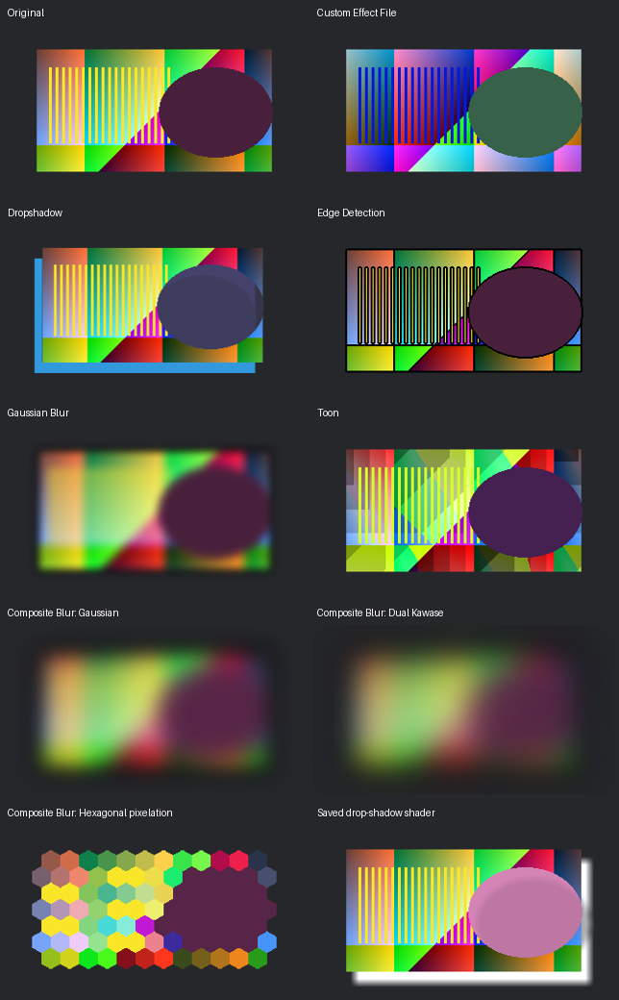

# Replacing OBS filters and tools with StageKit

In OBS, open **Tools > StageKit > OBS filter replacements**. Search for the name currently shown in OBS, including names such as **DWM.Name** or **Move Source Swap**. The second column shows the corresponding StageKit control or the built-in OBS feature. The Availability column identifies platform and runtime requirements on this computer.

To add a filter, right-click the source, group or scene in OBS, open **Filters** and click **+** under **Effect Filters**. Choose **Source Filter** for a filter that acts on its host source. Choose **Scene Filter** for a filter that addresses items inside a scene or group. OBS can also apply a Source Filter to the finished image of a scene.

## Filter equivalents

| Original entry | Where it belongs | StageKit filter and purpose |
| --- | --- | --- |
| 3D Effect | Source | **3D Effect** rotates and moves the source in three dimensions. |
| Advanced Mask | Source | **Advanced Mask** uses a shape, image, source or gradient to mask the input. |
| Composite Blur | Source | **Composite Blur** starts with Gaussian area blur and supports the original algorithms, masks and saved settings, including Dual Kawase and hexagonal pixelation. |
| Custom Filter | Source | **Custom Effect File** loads an OBS effect file with a Draw technique. The reload button rereads an edited file. |
| User-defined shader | Source | **User-defined Shader** accepts ShaderFilter code and its saved uniforms. Its bundled examples include drop shadow, bloom, scan lines, VCR and VHS. |
| DWM.Name | Source | **Directory Watch Media** watches a folder and updates an image or media source from files in that folder. |
| Dedicated NDI® output | Source | **Dedicated NDI Output** sends this source to an NDI receiver. **Dedicated NDI Audio Output** provides the audio filter. Both require the NDI runtime. |
| DistroAV - Fix alpha blending | Source | **Fix Alpha Blending** applies OBS's premultiplied-alpha effect. This filter works independently of the NDI runtime. |
| Dropshadow | Source | **Dropshadow** preserves the Lua filter's colour and horizontal and vertical offsets. Its output expands to include the shadow. |
| Dynamic Delay | Source | **Dynamic Delay** changes video delay and playback rate over time. |
| Edge Detection | Source | **Edge Detection** draws a chosen colour where the contrast exceeds the threshold. |
| Freeze | Source | **Freeze** holds a frame, with the original duration and hotkey controls. |
| Gaussian Blur | Source | **Gaussian Blur** supports kernel size, pixel spacing, standard deviation, and an optional image alpha mask and its inverse. |
| Move Action | Source | **Move Action** performs configured actions at the start or end of a move. The audio version appears on audio sources. |
| Move Source | Scene | **Move Source** animates the position, size and other supported properties of a selected item. This is the Move-compatible scene filter. The earlier StageKit **Source Filter: Move Source** remains available for its original workflow. |
| Move Source Swap | Scene | **Move Source Swap** exchanges two items' transforms in the scene. |
| Move Value | Source | **Move Value** changes settings on a source or its filter over time. The audio version appears on audio sources. |
| Move Video Capture Device | Source | **Move Video Capture Device** changes supported camera controls on Windows DirectShow devices. The settings depend on the camera and its driver. |
| Move transition override | Source | **Move Transition Override** supplies per-source settings for the Move transition. |
| Noise Displacement | Source | **Noise Displacement** distorts the input with noise. The separate **Noise** input is under **Sources > +**. |
| Pixel Art | Source | **Pixel Art** reduces resolution and applies the selected pixel-art settings. |
| RecursionEffect | Source | **Recursion Effect** draws repeated copies of the source. |
| Retro Effects | Source | **Retro Effects** applies the selected retro video effect and its original controls. |
| Source Defaults | Source | **Source Defaults** copies the marked source's settings to newly created sources of the same type. |
| TimeWarpScan | Source | **Time Warp Scan** builds an image from a scan over successive frames. |
| Toon | Source | **Toon** reduces hue and brightness levels for a cel-shaded look. |

**Source Clone** is under **Sources > +**. **Move** and **Shader** transitions appear in **Scene Transitions**. Ported filters have their own IDs. An original plugin and its StageKit equivalent can coexist while you compare their output.

OBS supplies **Apply LUT, Chroma Key, Color Correction, Color Key, Compose SDR on HDR (Override), Crop/Pad, HDR Tone Mapping (Override), Image Mask/Blend, Luma Key, Render Delay, Scaling/Aspect Ratio, Scroll** and **Sharpen**. Existing instances continue using OBS's own implementation. [OBS Filters Guide](https://obsproject.com/kb/Filters-Guide)

**Original input and seven filters rendered by OBS, including three Composite Blur settings**

## Tools and Stream Deck

| Original Tools entry | Corresponding control |
| --- | --- |
| Dock Layout Manager | **Dock Layout Manager (StageKit)** saves and recalls OBS dock arrangements. |
| Quick Access Utility | **Quick Access Utility (StageKit)** provides source search and custom quick-access docks. |
| SceneCollectionManager | **Scene Collection Manager (StageKit)** manages collections and their backups. |
| Source Copy | **Source Copy (StageKit)** copies and pastes sources, filters and transforms. |
| SourceDock | **Source Dock (StageKit)** puts a source in a custom dock. |
| TransitionTable | **Transition Table (StageKit)** selects transitions for particular scene pairs. |
| DistroAV NDI® Settings | **NDI Settings (StageKit)** configures the port's NDI output when the separately installed NDI runtime is available. |
| Elgato Stream Deck | Install the **StageKit** companion in the Elgato app and connect it to OBS's built-in WebSocket server. StageKit keys have their own action IDs. Existing Elgato OBS keys continue to use Elgato's integration until reassigned. |
| Auto-Configuration Wizard, Plugin Manager, Captions (Experimental), Automatic Scene Switcher, Output Timer, Scripts, WebSocket Server Settings | Available directly in OBS. |

In the Stream Deck app, the StageKit category includes **Switch Scene, Stream, Record, Source Visibility, OBS Filter, Audio Mixer Mute, Studio Mode** and **Virtual Camera**. **Move Source in Scene** and **Swap Sources in Scene** press the original Move-compatible Start hotkey on the selected scene. The mute key controls the mixer mute button. A source visibility key remembers the collection, parent scene or group, item ID and source name, so it cannot switch another item that reused the ID.

Each utility stores its own configuration. Recreate settings stored outside scene collections, such as a utility's backup locations or an NDI output configuration, when moving to StageKit. The NDI runtime and the Elgato desktop app are separate installations. [DistroAV](https://github.com/DistroAV/DistroAV) · [Elgato OBS integration](https://help.elgato.com/hc/en-us/articles/7262866127757-Elgato-Stream-Deck-How-to-fix-Waiting-for-OBS-error-message)

## Try an existing collection

1. In OBS, use **Scene Collection > Export** to save the collection you want to try.
2. Open **Tools > StageKit > OBS filter replacements > Save a converted collection copy**. Select the export and give the output a new filename.
3. Review the conversion summary, then use **Scene Collection > Import** and select the new file. Compare the two collections before removing any original plugins.

If the installed StageKit build cannot load the saved version of a filter, the copy keeps the original entry and lists it for review. This also applies to filters that require a missing runtime or a different platform.

The copy keeps source names, UUIDs, filter order, enabled state, settings and Move filter references. Matching ShaderFilter example files are relinked to StageKit's own copies. An edited example stays at its existing path and is listed for review. Keep custom shader files and any referenced images available when removing their original plugin.

**Automatic Scene Switcher** is the built-in OBS tool. **Advanced Scene Switcher** is a separate third-party macro engine. The copy preserves its macro data and reports the number of macros, excluding group headings. Older StreamFX blur and SDF effects also retain their original IDs. Keep those plugins available for collections that depend on them. [Advanced Scene Switcher](https://github.com/WarmUpTill/SceneSwitcher)

## Implementation sources

The compiled StageKit ports use the upstream versions listed below. StageKit supplies separate OBS IDs, labels, resource locations and packaging. The source tree includes the upstream license and attribution for each component. The five Lua effects are StageKit's native implementations of the controls documented in DarkLink's pack. [DarkLink's Script Pack](https://obsproject.com/forum/resources/darklinks-script-pack.655/)

| Component | Version | Upstream source |
| --- | --- | --- |
| obs-3d-effect | 0.1.4 | [exeldro/obs-3d-effect](https://github.com/exeldro/obs-3d-effect/tree/e0afa47fcebbfd4099fd8515145c483f550c85d1) |
| obs-advanced-masks | 1.5.4 | [FiniteSingularity/obs-advanced-masks](https://github.com/FiniteSingularity/obs-advanced-masks/tree/63f2eae2f9f174d781f4a127b66e878760430532) |
| obs-composite-blur | 1.5.2 | [FiniteSingularity/obs-composite-blur](https://github.com/FiniteSingularity/obs-composite-blur/tree/160f7ad4d464e85e24894187244cf71a3913aea9) |
| obs-retro-effects | 1.0.2 | [FiniteSingularity/obs-retro-effects](https://github.com/FiniteSingularity/obs-retro-effects/tree/35e9616a6f08692777578e3559d464ff8705929e) |
| obs-noise | 1.0.0 | [FiniteSingularity/obs-noise](https://github.com/FiniteSingularity/obs-noise/tree/0815be272ce2b49981dd37d9e28e0bc88f206edc) |
| pixel-art | 0.0.4 | [dspstanky/pixel-art](https://github.com/dspstanky/pixel-art/tree/c54ff2429510c46aade22a48b0835f2e5b568a9d) |
| obs-freeze-filter | 0.3.5 | [exeldro/obs-freeze-filter](https://github.com/exeldro/obs-freeze-filter/tree/5de212bd067672f9349a85e0494a65c8b0156bd4) |
| obs-dynamic-delay | 0.1.4 | [exeldro/obs-dynamic-delay](https://github.com/exeldro/obs-dynamic-delay/tree/c6d4fbb7b7f30fb37c1e19738b37d4615df3f77a) |
| obs-recursion-effect | 0.1.0 | [exeldro/obs-recursion-effect](https://github.com/exeldro/obs-recursion-effect/tree/61a835ecda4209e8678197b1e9582ede582aa876) |
| obs-time-warp-scan | 0.1.7 | [exeldro/obs-time-warp-scan](https://github.com/exeldro/obs-time-warp-scan/tree/12e224f3bda34c277487e434546a99ba5406e0fb) |
| obs-dir-watch-media | 0.7.0 | [exeldro/obs-dir-watch-media](https://github.com/exeldro/obs-dir-watch-media/tree/cc320fba63ac250eaefac6d0b8cc20f4bc88aa4f) |
| source-defaults | 1.2.0 | [CodeYan01/source-defaults](https://github.com/CodeYan01/source-defaults/tree/3ce48509258379a7cb49351ad57d81abdf8963e9) |
| obs-move-transition | 3.2.0 | [exeldro/obs-move-transition](https://github.com/exeldro/obs-move-transition/tree/d343b4e014fec5701fd31b13d63e31b68ba9c14a) |
| obs-shaderfilter | 2.5.1 | [exeldro/obs-shaderfilter](https://github.com/exeldro/obs-shaderfilter/tree/11a9d65b436b902eb2d6f6a0421894ee18a36196) |
| obs-source-copy | 0.3.0 | [exeldro/obs-source-copy](https://github.com/exeldro/obs-source-copy/tree/b7d5bac3572800011a3ec7f33955a35c06f748ca) |
| obs-source-dock | 0.5.0 | [exeldro/obs-source-dock](https://github.com/exeldro/obs-source-dock/tree/1ef24b0a805c4bc4cc9afe6a9ad13562a0d31586) |
| obs-transition-table | 0.2.7 | [exeldro/obs-transition-table](https://github.com/exeldro/obs-transition-table/tree/1a85ab9de529ff521b7acad206ab55f4da72ac73) |
| obs-scene-collection-manager | 0.1.2 | [exeldro/obs-scene-collection-manager](https://github.com/exeldro/obs-scene-collection-manager/tree/30cde133fe7368672386c147fafd3e430cd15b46) |
| obs-quick-access-utility | 1.0.4 | [FiniteSingularity/obs-quick-access-utility](https://github.com/FiniteSingularity/obs-quick-access-utility/tree/5f7b613bf5d1494a408255650152be08ec5b0283) |
| OBS-Dock-Layout-Manager | 1.1.5 | [RealProHenis/OBS-Dock-Layout-Manager](https://github.com/RealProHenis/OBS-Dock-Layout-Manager/tree/099d3941ebcf6563be6d1a1d917e8beef82e2a08) |
| DistroAV | 6.1.1 | [DistroAV/DistroAV](https://github.com/DistroAV/DistroAV/tree/2bf2bd0ad4c074777d7ca4824182ea5ff2445cba) |
| obs-source-clone | 0.2.0 | [exeldro/obs-source-clone](https://github.com/exeldro/obs-source-clone/tree/6a0a4531fbb871f3837ffedd6b67d1a05fc3bebf) |
